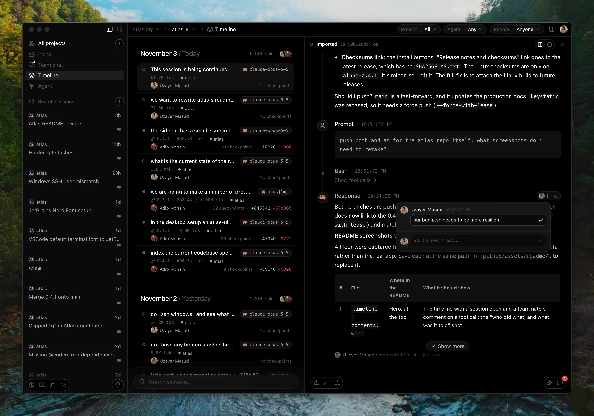
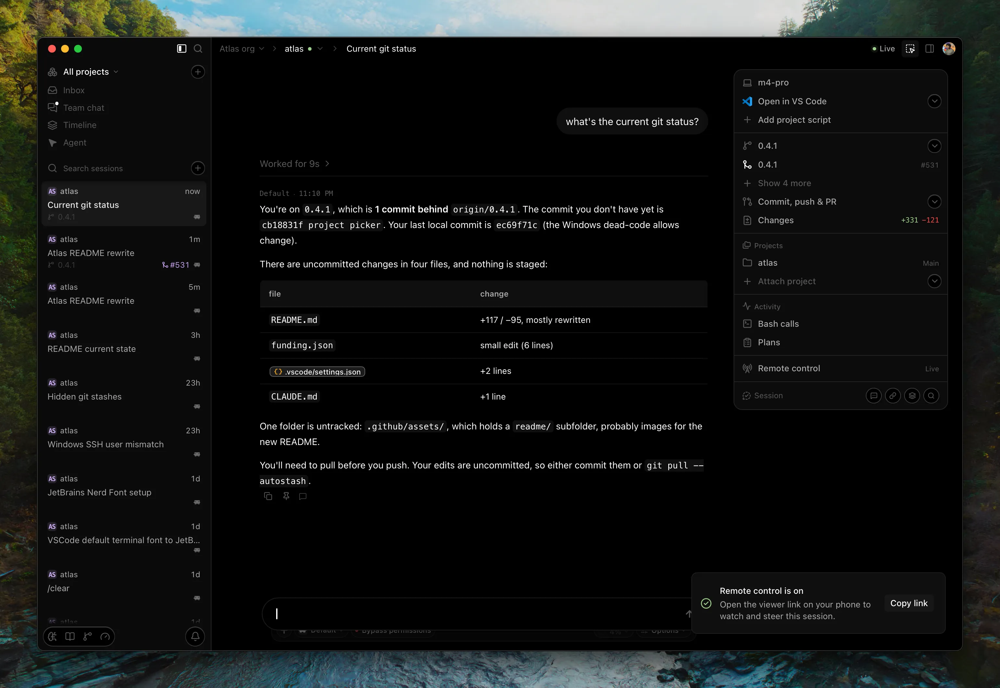
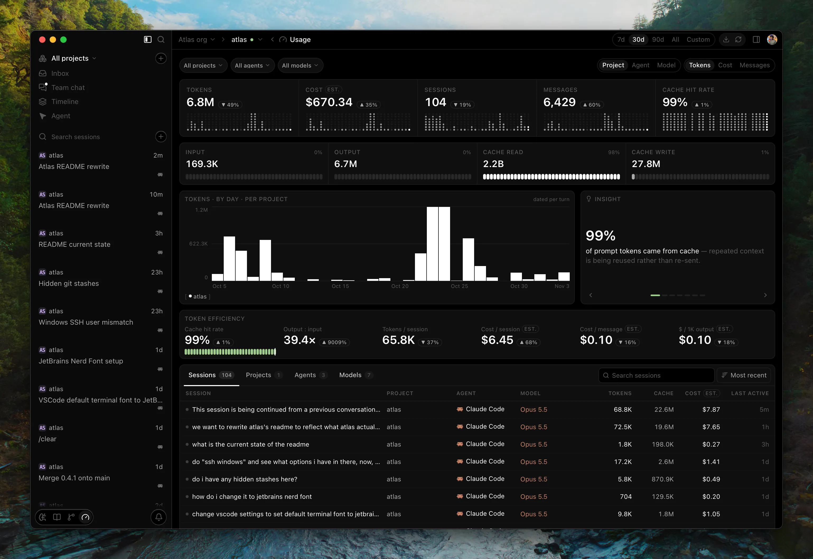
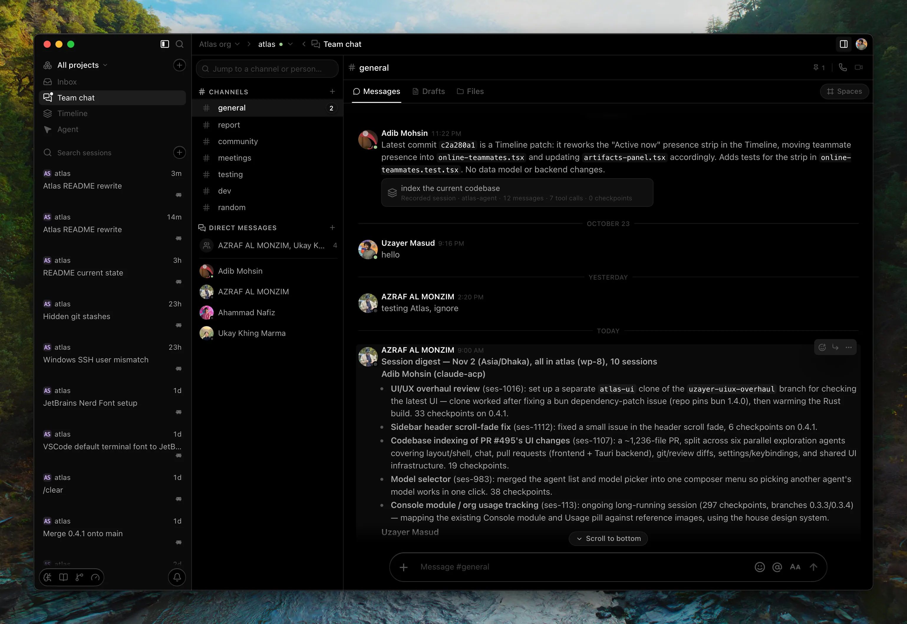
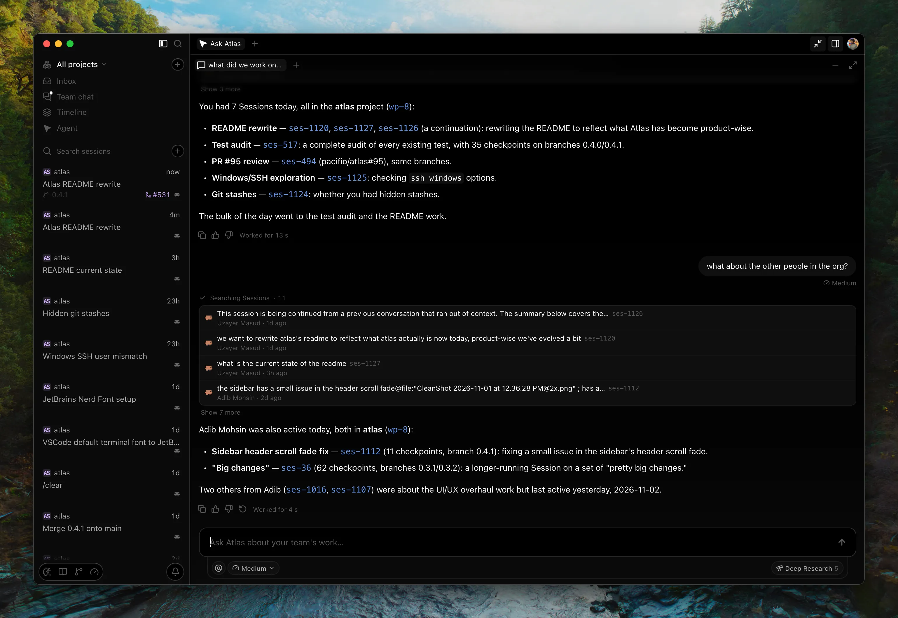

<div align="center">


### Atlas

**Know which prompt shipped which line.**

The agentic visibility & control layer your SDLC was missing.

<br />

<a href="https://trendshift.io/repositories/56020?utm_source=repository-badge&amp;utm_medium=badge&amp;utm_campaign=badge-repository-56020" target="_blank" rel="noopener noreferrer"></a>
<a href="https://trendshift.io/repositories/56020?utm_source=trendshift-badge&amp;utm_medium=badge&amp;utm_campaign=badge-trendshift-56020" target="_blank" rel="noopener noreferrer"></a>
<a href="https://trendshift.io/repositories/56020?utm_source=trendshift-badge&amp;utm_medium=badge&amp;utm_campaign=badge-trendshift-56020" target="_blank" rel="noopener noreferrer"></a>

<br />

<a href="https://github.com/tryatlas/atlas/stargazers"></a>
<a href="https://github.com/tryatlas/atlas/forks"></a>
<a href="https://github.com/tryatlas/atlas/graphs/contributors"></a>

[](https://github.com/tryatlas/atlas/actions/workflows/ci.yml)
[](https://github.com/tryatlas/atlas/releases)
[](LICENSE)
[](#download)
[](https://discord.gg/GmnFggaPfP)
[](https://github.com/tryatlas/cli)
[](https://youtube.com/playlist?list=PLWa1N2LyiGv0)

<sub>[Download](#download) · [Docs](https://docs.tryatlas.cc/) · [Learn](https://youtube.com/playlist?list=PLWa1N2LyiGv0) · [Website](https://www.tryatlas.cc/) · [Contributing](CONTRIBUTING.md) · [Issues](https://github.com/tryatlas/atlas/issues)</sub>

<br />



</div>

Your entire engineering team uses coding agents. You get stacked PRs, you see the diffs without the context. When something breaks in production, **do you know whose agent changed it, and what it was told?**

That's why we built Atlas: every coding agent your team runs, recorded and linked to the commits it produced, on a shared timeline the whole team can collaborate and comment on.

## Desktop app or terminal

Both feed the same team timeline, so mix them: one teammate in the desktop app, another in a terminal over SSH.

**Atlas desktop.** The control-surface IDE below.

[](https://docs.tryatlas.cc/docs/getting-started/install#macos)
[](https://docs.tryatlas.cc/docs/getting-started/install#windows)
[](https://docs.tryatlas.cc/docs/getting-started/install#linux)

**Atlas CLI.** Happy in your terminal? [`atlas-cli`](https://github.com/tryatlas/cli) hooks into the agents you already run (Claude Code, Codex, Cursor, Copilot, OpenCode, Droid, Antigravity and Pi), records every session, links its commits and gives every agent one shared memory. macOS and Linux.

```bash
curl -fsSL https://github.com/tryatlas/cli/releases/latest/download/install.sh | sh
```

## For engineers

Atlas is a "control-surface IDE" built around managing your agents' context.

- **Bring every agent, run them in parallel.** Claude Code, Codex and more, side by side.
- **Teach once, every agent remembers.** Shared memory carries a correction you give one agent over to the rest.
- **Context follows you between agents.** `@` a file, repo, branch or past session. Your `CLAUDE.md`, `AGENTS.md` and knowledge notes reach every agent, and a new session is briefed on where the last one stopped.
- **Conversations are context too.** Team chat, shared prompts and Spaces, right next to your agents.
- **Steer a live session from anywhere.** Start remote control on a desktop session and drive it from a browser, on another computer or your phone. Invite teammates to watch, and hand one of them the controls.
- **The rest of the IDE is there too.** Editor, terminal, source control and pull requests, in the same window.



## For engineering managers

- **Trace every incident to its prompt.** See whose agent changed what, and which session caused the break.
- **Measure how your team ships with agents.** The ROI dashboard sets AI spend against the commits it shipped: cost per commit and per active hour, by project, person and model.
- **Step in while the agent works.** A live timeline of every agent session, your comments land directly in the developer's running session.
- **One organization, every project.** Members see each other's sessions on the timeline and comment on each other's work, from the desktop app or the [web app](https://app.tryatlas.cc).



## Multiplayer

An **organization** has **members** and **projects** (think git repo). Put a project's sessions in the cloud and every teammate who opens the same repository adds their sessions to it.

- **One timeline for the whole team.** Every member's sessions, both live and finished, with agent, model, tokens, and the checkpoints that tie each one to its commits. Filter by project, agent or person.
- **Comment on each other's sessions.** Anchor a thread to a whole session or to one prompt, response, tool call or checkpoint. `@`-mention, reply, resolve. On a live session, the comment lands in the developer's session while the agent is still working.
- **Talk next to the work.** Channels and DMs where a message carries a session or checkpoint card, plus calls, prompt drafts you write together, and Spaces.
- **Ask Atlas about the team.** "What did we work on today?" Atlas, your organization's own agent, answers from everyone's sessions, and can run Deep research or post to a channel when you ask.

Only the record of agent work syncs, never your source tree, and secrets are redacted on your machine first. [What syncs, exactly →](https://docs.tryatlas.cc/docs/team/timeline#what-syncs-and-what-doesnt)

<table>
<tr>
<td width="50%" valign="top"></td>
<td width="50%" valign="top"></td>
</tr>
</table>

## Checkpoints

A checkpoint is like a commit++ with more info: which session produced it, what the agent was asked, the tool calls it made, and the reasoning behind the change, kept together instead of lost the moment the terminal scrolls.

With session capture on (it's off until you turn it on per project), Atlas records every agent session locally in `.atlas/sessions.db`, with secrets scrubbed before anything touches disk. When you commit (from any tool, even with Atlas closed), the commit is linked back to the session that produced it as a checkpoint, and links survive rebases and amends.

You don't have to read the raw transcript to get the context back: select a checkpoint and chat with it directly, and it answers from what actually happened in that session. Local mode works fully offline with no account.

## How it works

Atlas runs your agents as they are, and enriches what they see.

Claude Code and Codex run as external subprocesses over [ACP](https://github.com/zed-industries/agent-client-protocol) and get the most support due to their popularity. Atlas Agent (the native one) runs in-process on its own engine.

Atlas can also spawn any agent in the ACP registry (Cursor, OpenCode, Kilo Code, and more), pulling in each one's official binary automatically. All of them go through the same send path, so everything below applies to whichever one you pick.

> [!NOTE]
> QA on the long tail of registry agents is ongoing.

Atlas never rewrites your prompt. Here is what reaches the agent, and how:

| Context                 | Where it comes from                                                                                                                            | How the agent gets it                                                |
| ----------------------- | ---------------------------------------------------------------------------------------------------------------------------------------------- | -------------------------------------------------------------------- |
| **`@` mentions**        | Resolved locally in Rust before the prompt is sent. Notes, skills, and past sessions are inlined; files and folders resolve to a path          | With your message                                                    |
| **Shared agent memory** | Active plan, decisions, file changes, failures, and architecture notes, written by any agent                                                   | Through Atlas's on-device memory server, which agents call as a tool |
| **Session briefing**    | The tail of the last session in this repository (from any agent), plus the useful parts of `CLAUDE.md`, `AGENTS.md`, and Claude's memory files | Read by the agent when a session starts                              |
| **Semantic search**     | An on-device index of your instruction files, agent memory files, and knowledge notes                                                          | Searched by the agent through the memory server                      |

- **One path, no per-agent special-casing.** Run your existing Claude Code or Codex subscription through Atlas and the session gets more context, with no change to how you work.
- **Claude Code's memory is visible to Codex, and the reverse.** Neither agent can read the other's history on its own.
- **Folders resolve to a pointer, not a paste.** `@`-ing a 5000-line file sends a path the agent reads on demand, so one mention doesn't occupy the context window for the rest of the session.
- **Embedding runs on your machine.** Retrieval never leaves the device.

## Features

<details>
<summary><b>Agents, agent history and the project: every capability</b></summary>

### Agents

| Capability           | Description                                                                                                                                                                          | Link                                                              |
| -------------------- | ------------------------------------------------------------------------------------------------------------------------------------------------------------------------------------ | ----------------------------------------------------------------- |
| Multi-agent sessions | Claude Code, Codex, and Atlas's native agent, selectable per session and running in parallel across tabs. Sessions are independent of tabs, so switching never drops a run in flight | [Chat & Sessions](https://docs.tryatlas.cc/docs/product/chat)     |
| Shared agent memory  | On-device semantic index (local embeddings, HNSW search) that every agent reads from and writes to                                                                                   | [Memory](https://docs.tryatlas.cc/docs/context/memory)            |
| @ mentions           | Local resolution of files, folders, symbols, branches, commits, notes, skills, and past sessions                                                                                     | [Chat & Sessions](https://docs.tryatlas.cc/docs/product/chat)     |
| Skills               | SKILL.md files scoped globally or per project, enabled per agent by symlinking into that agent's own skills directory                                                                | [Skills](https://docs.tryatlas.cc/docs/context/skills)            |
| Packs                | Install a GitHub repo of skills, subagents, commands, hooks, rules, and scripts, discovered through the skills.sh index                                                              | [Skills](https://docs.tryatlas.cc/docs/context/skills)            |
| Model chat           | Talk to a model directly in its own tab, with no agent loop around it                                                                                                                | [Chat & Sessions](https://docs.tryatlas.cc/docs/product/chat)     |
| Organizations        | Sign in, create an organization, and sync across devices and teammates                                                                                                               | [Organizations](https://docs.tryatlas.cc/docs/team/organizations) |

### Agent history

| Capability                    | Description                                                                                                                                                                                       |
| ----------------------------- | ------------------------------------------------------------------------------------------------------------------------------------------------------------------------------------------------- |
| **Session capture**           | Every session recorded to `.atlas/sessions.db`: prompts, messages, tool calls, the files each one touched, and the patches it applied                                                             |
| **Checkpoints**               | Each session linked to the commits it produced. Commits are observed rather than intercepted, so one made from a terminal, from another editor, or while Atlas was closed still finds its session |
| **Survives history rewrites** | Links re-point through amend and rebase by patch-id reconciliation. When a squash makes the link genuinely ambiguous, it orphans instead of guessing                                              |
| **Transcript import**         | Backfills your existing Claude Code history, so the record starts before you installed Atlas                                                                                                      |
| **Secrets scrubbed on write** | Redaction runs before anything is persisted, so the local store is never itself a disclosure risk                                                                                                 |
| **Capture health**            | One signal per project, OK, Degraded, or Stopped, each with a reason and the next step                                                                                                            |
| **Usage**                     | Tokens, messages, sessions, and estimated cost over time, grouped by project, agent, or model                                                                                                     |

Works with no account and no network.

### The project

| Capability         | Description                                                                                                                                                                            | Link                                                                   |
| ------------------ | -------------------------------------------------------------------------------------------------------------------------------------------------------------------------------------- | ---------------------------------------------------------------------- |
| **Editor**         | CodeMirror editing surface, with per-project editor state restored across restarts                                                                                                     | [Editor](https://docs.tryatlas.cc/docs/product/editor)                 |
| **Git**            | Real commit graph with lane assignment, stage/unstage/commit, branch operations, and file-level diffs                                                                                  | [Git & Diff](https://docs.tryatlas.cc/docs/source-control/git)         |
| **Terminal**       | Your own shell in a tab, themed with the app, so `vim`, `htop` and friends work as they do anywhere else                                                                               | [Terminal](https://docs.tryatlas.cc/docs/product/terminal)             |
| **Knowledge base** | Plain markdown notes in `.atlas/knowledge/`, kept on your machine (`.atlas/` is gitignored by default), with backlinks, a link graph, and export to HTML or a standalone server binary | [Knowledge base](https://docs.tryatlas.cc/docs/context/knowledge-base) |
| **Browser**        | Native WebKit webview in a tab, with real logins, cookies, and a reader mode                                                                                                           | [Explorer](https://docs.tryatlas.cc/docs/product/explorer)             |
| **Canvas**         | Spatial board for notes and their connections, persisted as JSON in the project                                                                                                        |                                                                        |
| **Split view**     | Up to three resizable columns, each with its own tabs                                                                                                                                  | [Editor](https://docs.tryatlas.cc/docs/product/editor)                 |
| **Activity log**   | Every significant event in the project, filterable, with rows you can pin across restarts                                                                                              |                                                                        |

</details>

---

## Download

Grab the latest build from [tryatlas.cc](https://www.tryatlas.cc/) or the [releases page](https://github.com/tryatlas/atlas/releases) — a `.dmg` for macOS (Apple Silicon or Intel), an `.msi` for Windows, and `.deb`, `.rpm` or AppImage for Linux.

> [!NOTE]
> Atlas runs on macOS 11+, Windows 10+ (x64), and x86-64 Linux with WebKitGTK 4.1. See the [install guide](https://docs.tryatlas.cc/docs/getting-started/install).

<!-- #todo homebrew tap so this becomes `brew install atlas` -->

## Local by default

- **Your code, notes, and sessions stay on your machine.** External agents talk to their own providers as they normally would; Atlas Agent runs through the Atlas gateway on your account.
- **Secrets are scrubbed before anything is written to disk.** Not before upload, before persistence.
- **Captured sessions stay local.** The [Checkpoints](#checkpoints) record is written to `.atlas/sessions.db` and stays there. No account required, and nothing sent anywhere until you explicitly opt in to sync.
- **Accounts are opt-in.** Sign in to create an organization and sync across devices and teammates.
- **Anonymous usage analytics are on by default.** Coarse metadata, never code or prompts. [What's collected, and how to turn it off](TELEMETRY.md).
- **Nothing is locked in.** Notes are markdown, canvases are JSON, sessions are JSONL. Close Atlas and pick up in vim. The checkpoint record is SQLite in the project's gitignored `.atlas/`, because it is queried, not read.

---

## Build from source

Agents such as Claude Code and Codex install from the ACP registry inside Atlas, so you don't need their CLIs. Atlas Agent needs a signed-in, synced organization.

Requires **[Bun](https://bun.sh/)** and **Rust** (stable, via [rustup](https://rustup.rs/)), plus **Xcode Command Line Tools** on macOS or the **MSVC build tools** (Visual Studio Build Tools with the C++ workload) on Windows.

<details>
<summary>Linux system dependencies</summary>

- **Debian / Ubuntu / Linux Mint** (what the Linux release build installs):
  ```bash
  sudo apt install -y pkg-config libssl-dev libwebkit2gtk-4.1-dev libgtk-3-dev \
    libayatana-appindicator3-dev librsvg2-dev patchelf libglib2.0-dev
  ```
- **Other distributions**: see Tauri's [Linux prerequisites](https://v2.tauri.app/start/prerequisites/#linux).

</details>

```bash
git clone https://github.com/tryatlas/atlas
cd atlas
bun install
bun run dev:app
```

The first Rust compile takes a few minutes; after that it is seconds. Use `bun run dev` for frontend-only iteration, though anything calling `invoke()` needs `dev:app`.

Production builds:

```bash
bun run build:app       # macOS .app bundle
bun run build:app:dmg   # macOS .app + .dmg installer
bun run build:app:win   # Windows .msi installer
```

## Contributing

See [CONTRIBUTING.md](CONTRIBUTING.md). One thing catches people out:

- **Every PR targets `main`** (hotfixes for a shipped version excepted; see CONTRIBUTING.md) and is squash-merged, so write its title as a Conventional Commit (`fix(scope): …`). Releases are tags on `main`.

[docs/architecture.md](docs/architecture.md) covers how Atlas is built. [SECURITY.md](.github/SECURITY.md) covers reporting vulnerabilities.

---

## Contributors

<a href="https://github.com/tryatlas/atlas/graphs/contributors">
  
</a>

## License

Apache License 2.0. See [LICENSE](LICENSE).

---

<div align="center">
<sub>

[Website](https://www.tryatlas.cc/) · [Docs](https://docs.tryatlas.cc/) · [Learn](https://youtube.com/playlist?list=PLWa1N2LyiGv0) · [Discord](https://discord.gg/GmnFggaPfP) · [Telemetry](TELEMETRY.md) · [Apache 2.0](LICENSE)

</sub>
</div>
