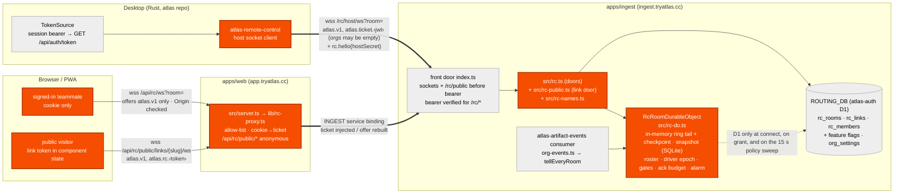

# Universal RC: server API plan

Plan for the cloud half of Universal RC (remote control of a live desktop agent
session), 2026-10-23. Companion to
[`universal-rc-design-review.md`](./universal-rc-design-review.md) (the desktop
design; diagrams D0–D7 are referenced by number below) and
[`universal-rc-seam.md`](./universal-rc-seam.md) (the desktop seams).

Server repo: `/Users/eemong/Codes/server` — every server path below is relative to
it. Desktop paths are relative to `/Users/eemong/Codes/atlas`. Every reused pattern
cites `file:line` in the server repo as read on 2026-10-23; anything not read
directly is marked *inference*.

The document is written to be implementable cold. Section 6 (REST) and section 7
(WebSocket) are in the house style of `docs/api/*.md` so they can be lifted into
`docs/api/atlas-rc-api.md` once built; the rest is the plan around them.

Revision of 2026-10-23 (same day): the security audit (24 gaps) and the capacity
and real-time audit (23 gaps) are folded into the body. Where a fix changed a
number, a frame, a check order or a table, the body is the authority; appendix B
records every non-obvious choice made while folding them in, and appendix A is the
per-door, per-frame checklist.

**Revision of 2026-10-23 (evening) — the account-scoped model.** The decision
audit ([`universal-rc-decision-audit.md`](./universal-rc-decision-audit.md))
found that this plan had copied its authority model from Shared Threads and
Session Artifacts, where every object is a tenant's, and so keyed every door, the
DO name, the socket URLs, the feature gate and the viewer URL on an Organisation
— which made the product owner's first requirement (RC is **personal**: own
laptop, own phone, same account, no org needed — Claude Code's model, cited as
**CC-n** from [`claude-code-remote-control.md`](./claude-code-remote-control.md))
unimplementable by construction, and weakened the single-driver rule in one
sentence ("the owner always may"). This revision rewrites the affected sections
to the audit's §2 "corrected model": a room belongs to an **account**
(`owner_user_id = claims.sub`), reachable with a token whose `orgs` is empty;
the org and Workspace are a nullable, **set-once scope** that exists only to
answer "whom may the owner invite?" and whose org policy applies to links; the
DO is `rc:{roomId}`; no door or URL carries `?org=` except as an optional list
filter; the feature gate is split (platform layer for solo rooms, the scope org's
layer for multiplayer); losing the org revokes the **scope**, not the room; and
steering is **Driver-only, the owner included** — while the owner has handed the
seat to A, only A prompts, from any surface, until the owner takes it back; the
owner's master powers (`stop`, kick, take over, close, answer a control
request) are never seat-gated. The audit's open questions Q1–Q9 are decided and
recorded in appendix B (B-41 onward); the plan's own Q6, Q11 and Q18 are
re-answered there. Sections touched: §1, §3, §4, §5, §6, §7, §9, §10, §11, §12,
§13, §14, §15, §16, §17, §18, §19, §20, appendices A and B; the real-time design
(§2, §8) is unchanged — the fix is to the *scope* of a room, not its mechanics.
Two parallel changes are bringing the server and desktop code to this model; this
document describes the corrected design, not their progress, so a `file:line`
cited below may still show the pre-revision shape.

**Contents.** §1 Summary and scope · §2 Real-time guarantees · §3 Placement and
architecture · §4 Glossary and identifiers · §5 Auth and identity · §6 REST API ·
§7 WebSocket protocol · §8 The tail buffer, join-mid-turn and backpressure · §9
Driver arbitration · §10 The command path · §11 Consent tiers and the gate chain ·
§12 Storage, metrics · §13 Feature flags, limits and plans · §14 Abuse and
security · §15 Web proxy · §16 Notifications and email · §17 Desktop-side
contract · §18 Testing plan · §19 Rollout · §20 Open questions · Appendix A
Security and capacity checklist · Appendix B Decision log.

---

## 1. Summary and scope

**Whose room it is.** A room belongs to one **account** — the one signed in on
the desktop when RC started (`rc_rooms.owner_user_id = claims.sub`). That account
may open, host, list, watch, manage and close it from any surface — the desktop,
or the phone/web signed in as the same account — with no Organisation involved;
a token whose `orgs` is empty is sufficient (CC-1/2). **Multiplayer is optional
and scoped**: a room may carry a nullable, set-once **scope** `(orgId,
workspaceId | null)` — the org and project selected in the app — and only then
may the owner invite people, and only people of that org who can read that
Workspace (org-wide when the project is not cloud-bound). Public links never
require a scope. There is **one Driver**: the owner by default; once the owner
hands the seat to A, only A can prompt — the owner included, on every surface —
until the owner takes it back. The owner stays master (stop, kick, take over,
close) whoever drives. Precedent for an account-scoped feature on this server:
the inbox (`apps/chat/src/notifications.ts:265-275`, subject-scoped with `?org=`
as an optional filter), personal AI grants (`apps/auth/src/entitlements.ts:43-44`,
`org_id = ''`), and the Artifact **Author** ("the Atlas account an Artifact
belongs to. Always derived from the verified token", `CONTEXT.md:267`).

**What the server does.** It hosts one **RC room** per remotely-controlled desktop
session: a Durable Object that (a) accepts exactly one **host socket** from the
owner's desktop and relays its seq-stamped `SessionDelta` stream to N **client
sockets**, **relaying before it stores anything** (§2.2); (b) holds a byte-bounded,
seq-stamped **tail** in memory (checkpointed to its SQLite when the stream goes
quiet, never per frame) plus the host's latest **snapshot** so a joiner mid-turn is
served snapshot-then-tail (D5), under a per-room in-flight byte budget that cuts a
viewer who cannot keep up rather than letting it fill the object (§8.5); (c) arbitrates
one **Driver** among the connected people with an epoch counter, a 60 s
request/grant flow and the owner's take-over — and refuses steering from anyone
who is not the Driver, the owner included (D3, D6, §9.3); (d) relays steering
commands to the host and the host's results back, with the relay-side gates
(tier, driver, epoch, rate) and the desktop's gates both enforced (D6); (e) mints
and revokes **RC links** (public, optionally password-protected) and records
teammate invites; (f) keeps the room open through an owner-offline grace period
without queuing anything (D7); and (g) audits every arbitration and command step.

**What the server never does.**

- It never runs an agent, never interprets a delta, and never answers a permission
  prompt. The payload of `rc.delta` and `rc.snapshot` is opaque bytes to it (the
  Shared Thread `RunStream` precedent, `packages/contracts/src/threads.ts:414-421`).
- It never stores the stream durably beyond the tail buffer. The durable record of
  a session stays the Session Artifacts drain (`CONTEXT.md:355`: a Session Delta is
  "not sent to the cloud raw" — RC is the first exception, and it is relayed, not
  recorded). One reason it *might* have to store more is considered and rejected in
  §8.6.
- It never queues a command while the owner is offline (D7). A command is a
  request with a result, and a result that arrives after the desktop wakes would
  execute a decision taken against stale context.
- It never decides the driver's rights from a JWT claim. The object re-reads room
  membership, link liveness and tier from D1 **at connect**, stamps the verdict on
  the socket, and decides every later command from that stamp, its in-memory
  tombstones and the driver state — never from the token, and never from a D1
  read on the command path (§5.3). Revocation reaches the object by push and cuts
  the socket (ADR-0010 §4; ADR-0014 "re-checked inside the object"; the Space
  object's "the check is per connection … removal closes the socket",
  `apps/chat/src/space-do.ts:2640-2645`).
- It never reads a frame's payload, never polls anything, and never touches D1,
  KV or a Queue for a delta or a command (§2.2).

**Non-goals.** Recording or replaying a room after it ends; an ACP-over-WS
endpoint for third-party clients (design review option (d)); per-tool consent
(design review §4.4 chose per-session tiers); a native mobile client (mobile is
the PWA, `apps/web/public/manifest.webmanifest`); cross-org rooms (a room's
members all come from its one scope org; a *solo* room is no-org, not
cross-org); admin spectating of rooms they were not invited to (ADR-0010 §1
precedent: private rooms are not admin-readable; an admin of the room's **scope
org** may *close* a room, as they may close a thread,
`apps/ingest/src/thread-do.ts:855-857` — a solo room has no admin at all);
auto-created "personal" Organisations to paper over the solo case (no account
has one today — signup creates nothing, `apps/auth/src/auth.ts:345-389`, and the
web's "Create your organization" form is user-driven,
`apps/web/src/components/shell/no-workspace.tsx:34-61`); starting a *new*
session on the laptop from the phone (Claude Code's server-mode "device card",
CC-6 — Atlas's unit is a running session, `rc_start(sessionId)`, and spawning is
a separate feature with its own consent prompt; audit Q7); device trust as an
access layer (CC-3; the host secret and `owner_client_id` are the hook, nothing
assumes "account == device"; audit Q9).

---

## 2. Real-time guarantees

What "real-time" means for this API, as numbers a test can fail, and the design
rules that keep the hot path inside them. Nothing below is a timeout or a TTL (those
are in §7–§9); these are the latencies a person sees. Platform figures are from the
Cloudflare pages cited in appendix B; "same region" means the viewer and the desktop
share a Cloudflare region, "far" means one transcontinental leg between them.

### 2.1 Latency SLOs

| hop | target p50 | target p95 | how it is met | how it is measured |
| --- | --- | --- | --- | --- |
| **Delta glass-to-glass, same region** (desktop emits → viewer paints) | ≤ 150 ms | ≤ 400 ms | desktop coalesces for ≤ 33 ms (§7.2, §17 item 4); ½ RTT up; object does a header decode and N `send()`s with no storage write and no output-gate wait in between (§8.2); ½ RTT down; `JSON.parse` + paint ≤ 16 ms | `rc_join`/`rc_room_stats.relay_ms_p95` in the object (§12.5); end-to-end by the load test's `sent_at` stamp inside each envelope (§18.2) |
| **Delta glass-to-glass, far** | ≤ 300 ms | ≤ 600 ms | same path plus one extra leg the object cannot remove: it lives in the desktop's colo (§3.1) | same |
| **Command round trip** (`rc.command` sent → `rc.command_result` received, relay and desktop gates, excluding the agent's reaction) | ≤ 400 ms | ≤ 1 s (hard cap `RC_COMMAND_TIMEOUT_MS = 30 s`, §7.9) | browser → web proxy (service binding, same colo) → object (memory-only gates, §10) → host → gate → back; the `rc_commands` row is written **after** the frame is sent to the host | `rc_command { rtt_ms }` event (§12.5); load test scenario A |
| **Roster update** (socket event → every client holds the new roster) | ≤ 150 ms | ≤ 200 ms | 100 ms coalescing tick (§7.6) + one downlink; chat's tick is 50 ms (`packages/contracts/src/space.ts:380`), 100 ms is enough for a roster that changes rarely | `rc_room_stats.roster_ms_p95`; `rc-arbitration.test.ts` asserts order, not time |
| **Driver handoff** (`rc.control_answer { approve }` → the new Driver's first command accepted by the desktop) | ≤ 300 ms | ≤ 500 ms | roster is sent to the **host first**, then to clients, then `rc.control_request { status: "approved" }` to the requester (§9.2 step 2), so the requester's first command cannot beat the host's epoch view | load test scenario A (one handoff per minute) |
| **Join time-to-first-paint, desktop/web** (`rc.hello` → first rendered transcript) | ≤ 500 ms | ≤ 2 s | snapshot held in the object's SQLite (≤ 1 MiB) + tail after it (≤ `rc_tail_bytes`), served in waves under the in-flight budget (§8.3, §8.5); no host round trip when the snapshot is fresh | `rc_join { ttfp_ms, served_from }` |
| **Join time-to-first-paint, mobile** | ≤ 1.5 s | ≤ 4 s | the 1 MiB snapshot cap exists for this hop: 1 MiB at 3 Mbit/s ≈ 3 s (§14.3) | same, keyed by `surface: "mobile"` |
| **Join when a snapshot must be fetched from the host** | + 300–500 ms | ≤ 2.5 s; parked ≤ 10 s | one `rc.snapshot_request` in flight, 10 s deadline on the alarm (§8.3); the checkpoint snapshot rule (§8.2 step 6) makes this the rare case | `rc_join { served_from: "host" }` |
| **Reconnect within the tail** (socket drops → `rc.synced`) | ≤ 1.5 s | ≤ 2 s | jittered backoff starting at 0.5–1.5 s (§7.10), hello with `since`, tail replay only | load test scenario C |
| **Laptop wake** (desktop resumes → `rc.owner { online: true }` at viewers; viewers resynced) | ≤ 2 s; + 2 s | ≤ 3 s; + 2 s | the desktop redials at once on a wake/network-change notification instead of waiting out a backoff (§17 item 2); host hello with `as_of_seq > head` → `wants: "snapshot"` → wave-served resync (§8.4) | `rc_host_offline`/`rc_host_online` pair in the log |
| **Dead-host detection** (half-open host socket → viewers see "owner offline", commands stop timing out) | immediate on TCP close | ≤ 60 s | host ping every 15 s, `RC_HOST_SILENT_MS = 45 s`, sweep armed at +15 s while a host is connected, `lastHostFrameAt` OR-ed with the ping timestamp (§7.4) | `rc_host_offline { reason: "silent" }` with the silence measured |
| **Hibernation wake** (first frame after a > 10 s pause) | ≤ 50 ms, once per pause | ≤ 100 ms | the constructor runs `MIGRATIONS[]` and reloads ≤ 8 MiB of checkpointed ring (§8.7); the checkpoint landed ≤ 1 s after the last frame, before the 10 s hibernation threshold | `rc_room_stats.wake_ms` |

**Acceptance.** Glass-to-glass same-region p50 ≤ 150 ms / p95 ≤ 400 ms and join TTFP
p95 ≤ 2 s are the acceptance criteria of slice S1; command RTT p95 ≤ 1 s of S2;
the full table of S6 (§19). The load test in §18.2 is what demonstrates them; the
vitest suites assert order and content, never time.

### 2.2 Design rules that keep the hot path real-time

1. **Push only, never poll.** Every live fact — stream, roster, driver, owner
   presence, control requests — rides the socket. `GET /rc/rooms/{id}` (§6.4) is
   for lists and management; a page that refreshed it would wake hibernated rooms
   for nothing. The one poll in the feature is the invite feed inside the
   notification center (§16), which is not a live path.
2. **No D1, KV or Queue per frame or per command.** D1 is single-region; a room
   in another region would pay 100 ms+ per read. Membership, link liveness and tier
   are read once at connect and stamped on the socket; between connects the
   object's tombstones and the stamp are the authority (§5.3). The only D1 reads
   off a door are the one on **grant** (`mayStillAsk`, §9.2, rare) and the 15 s
   org-policy sweep for *scoped* rooms with link visitors (§14.7, on the alarm,
   never on a frame; a solo room has no org policy and no sweep).
3. **Relay first, then storage.** In every handler that both sends and writes —
   delta relay, command relay, control grant — the `send()`s happen before the
   first `sql.exec()`. A SQLite-backed object holds outgoing messages until prior
   writes are flushed to disk (output gating, [storage API](https://developers.cloudflare.com/durable-objects/api/storage-api/)),
   so a write issued before a send puts every recipient behind a disk flush. The
   write still lands in the same event-loop turn; only its gate no longer delays
   the send. The Run stream precedent relays with no write at all
   (`apps/ingest/src/thread-do.ts:2581-2604`).
4. **No per-frame storage write at all.** The tail is an in-memory ring,
   checkpointed when the stream goes quiet (§8.1–§8.2). Three rows per delta at
   40 deltas/s was 120 rows/s/room — over the included 50 M rows/month in one
   afternoon and ≈ $470/month for ten rooms ([pricing](https://developers.cloudflare.com/durable-objects/platform/pricing/):
   $1.00 per million rows written, deletes and `setAlarm()` count).
5. **A parse-free object hot path for binary stream frames.** The object reads
   the fixed header (`version`, `kind`, `flags`, `seq_first`, `count`) and never
   `JSON.parse`s a payload (§7.2). The per-socket state the relay loop needs
   lives in a `Map<WebSocket, RcSocketState>` built in the constructor from
   `getWebSockets()`, not in `deserializeAttachment()` per socket per frame
   (§8.7).
6. **Coalescing windows, on the desktop and for the roster.** The desktop flushes
   every 33 ms or 8 KiB, whichever first, and immediately on any non-text delta,
   into one **batch frame** (§7.2) — so frames per second are ≤ ~30 regardless of
   token rate, and `send()`s per second are ≤ 30 × sockets. The roster is
   coalesced on a 100 ms tick. The object itself adds no delay on the stream path.
7. **Bounded bytes in flight.** Clients `rc.ack { seq }`; the object keeps
   per-socket un-acked bytes, cuts a viewer that stays > 2 MiB behind for 10 s
   with `1013` (it reconnects with `since` and takes the tail path), and serves
   snapshots in waves under a 16 MiB per-room budget (§8.5). `ws.send()` has no
   backpressure of its own on this platform; without this rule a 1 MiB resync to a
   full room queues more than the isolate's 128 MB.
8. **Placement near the desktop; far viewers pay one leg** (§3.1). The object
   never moves; D1 is never on a live path, so its region does not matter.
9. **Keepalive sized to the SLO, not to the platform default** (§7.4): host
   15/45/15 s; clients 25 s ping, 120 s sweep because Chrome throttles
   background-tab timers to once a minute.
10. **Everything a client observes is testable without a clock** (§18): order,
    frames, close codes; the latency numbers come from the load test and the
    metrics in §12.5.

---

## 3. Placement and architecture

### 3.1 Where it lives

A new Durable Object class **`RcRoomDurableObject`** in `apps/ingest`, one object
per RC room, named **`rc:{roomId}`** (derived, never looked up; the `roomId` is
stored inside and re-checked against `X-Atlas-Rc-Room` on every request — the
`do-names.ts:9-23` / `thread-names.ts:5-14` / `thread-do.ts:684-694` guard with a
one-field pair). The name deliberately contains **no org**: a room's `org_id` is
NULL for a solo room and set-once for a scoped one, and a DO name must never
depend on a mutable or absent field; `roomId` is a ULID minted by ingest and
unique on its own (audit N1). Rooms and links are D1 rows in the shared
`atlas-auth` database (`ROUTING_DB`), beside `artifact_shares`
(`packages/db/src/schema.ts:1594-1631`), because an anonymous request carrying a
slug must resolve to a **room** (and, if it has one, the room's scope) before any
object can be addressed (`apps/ingest/src/shares.ts:14-18` is the slug→row
pattern; here the row is `rc_links` joined to `rc_rooms`).

The web app reaches it through a new `/api/rc/*` prefix on `apps/web/src/server.ts`
using the chat-proxy pattern (cookie → minted ticket → subprotocol rewritten
wholesale, `apps/web/src/lib/chat-proxy.ts:70-96`), with an anonymous
`/api/rc/public/*` sub-prefix (`chat-proxy.ts:58-60`). The desktop dials
`ingest.tryatlas.cc` directly with a JWT ticket, exactly as `atlas-artifacts` and
`atlas-comms` dial today (`crates/atlas-artifacts/src/socket.rs:9-21`).



**Placement.** The object is created by the create door's `/init` (§6.2), which
runs in the Cloudflare colo nearest the desktop that called `POST /rc/rooms`, so the
host hop — the one every delta crosses first — is the short one. Durable Objects
are placed near the colo of the **first** `get()` and never move afterwards
([data location](https://developers.cloudflare.com/durable-objects/reference/data-location/)),
so no door other than `/init` may `get()` a room whose `rc_rooms` row does not yet
exist: the fan-out in `tellEveryRoom` (§14.6) and `GET /rc/rooms/{id}` both read
the row first, and the row is written only after `/init` returned. No
`locationHint` is passed — the desktop's own colo is a better hint than any region
string; passing one derived from `request.cf.region` on `/init` is an optional
belt-and-braces, hint only. Viewers far from the desktop pay one extra
transcontinental leg (≈ +100–150 ms, §2.1) and that is accepted; D1 is single-region
and is therefore kept off every live path (§2.2).

Auth paths, summarised:

| principal | credential at the door | verified by | becomes inside the object |
| --- | --- | --- | --- |
| desktop (owner's machine) | `atlas.ticket.<jwt>` on `/rc/host/ws?room=`, then `rc.hello { hostSecret }` | **`authorizeWsUpgradeSubject`** against the JWKS — a new sibling of `authorizeWsUpgrade` in `packages/do-protocol/src/upgrade.ts` that makes the same two calls (`ticketFromSubprotocol` + `verifyAccessToken`, `upgrade.ts:115-124`) and resolves the principal from `claims.sub` **without** an org (`upgrade.ts:108-111, 126-129` would answer `400 missing org` / `403` to a solo account); the secret inside the object | host, iff `userId == rc_rooms.owner_user_id`, hello's `clientId == rc_rooms.owner_client_id` **and** `sha256(hostSecret)` equals `room_state.host_secret_hash` (§5.1). The JWT alone is a bearer any surface can mint; the secret is what binds the socket to the one desktop the room was created from. A token with `orgs: {}` is a valid proof of the account (`apps/auth/src/auth.ts:593-618`) — that is the solo user. |
| owner on their own phone / web | cookie → proxy mints ticket (`apps/web/src/lib/session-token.ts:75-116`; with no org requested the cached token is reused unconditionally) | same door | owner: role `owner`, tier `steer_approve`, Driver while holding the seat; master powers always. No org consulted. |
| signed-in teammate (web/PWA), **scoped rooms only** | same as the owner | same door | member with the room's `member_tier` (an `rc_members` row), or `404`. A solo room admits nobody but its owner. |
| public visitor | `atlas.rc.<link token>` on `/rc/public/links/{slug}/ws`, `Authorization: RcLink <token>` on REST | row re-read + per-link HMAC (`apps/ingest/src/shares.ts:349-396` pattern) | `guest:{hex}` or `link:{linkId}`, with the link's tier; solo and scoped rooms alike |
| admin of the room's scope org | bearer on REST | the door, `rc_rooms.org_id == the admin's org` | never reaches a room; may `close` and read `audit` (§6.10, §6.11). Meaningless for a solo room. |
| Ops | `PLATFORM_ADMIN_IDS` on `atlas-auth` | — | never reaches a room; flips `rc.enabled` only |

### 3.2 Why here, and the rejected alternatives

| option | verdict | why |
| --- | --- | --- |
| **New DO class in `apps/ingest`** (chosen) | yes | the desktop is compiled against `ingest.tryatlas.cc` (`apps/ingest/src/index.ts:44-56`) and already dials it with the D4 handshake; the worker already holds `authorizeWsUpgrade`, `featureAccessFor` (`src/features.ts:17-26`), `rateExceeded` + the `RATE_LIMIT` binding (`wrangler.jsonc` ratelimits block), `sharingPolicy` (`src/org-policy.ts`), the share row/token/Turnstile door (`src/public-shares.ts`) and the `atlas-artifact-events` consumer that must also cut RC sockets (`src/org-events.ts:139-178`). The web already has an `INGEST` service binding (`apps/web/wrangler.jsonc`). |
| Extend `SharedThreadDurableObject` | no | keyed by `thread:{org}:{ws}:{thread}` — a tenant's object, which is exactly the authority model a personal room must *not* inherit (audit "one-line diagnosis") — gated on Workspace readability only, carries Yjs/merge/version/R2 machinery RC does not want, streams Runs with `seq 0` and no buffer (`thread-do.ts:2581-2604`), one alarm already serving five duties (`thread-do.ts:4225-4260`), 2 KiB attachment already spoken for (`thread-do.ts:156-160`). Its *patterns* are copied; the object is not. |
| Route through `WorkspaceDurableObject` | no | per Workspace, bound-Project only, frames are read-only to the desktop (`crates/atlas-artifacts/src/socket.rs:23-29`); the delta volume of one session does not belong on the socket every teammate's desktop holds open for the board. |
| A new worker (`atlas-rc`) | no | a new custom domain, a new service binding on `web` (reordering nothing, but one more binding), a second JWKS/limiter/Turnstile/queue setup, a **second consumer queue** for membership events (a queue has exactly one consumer, `docs/ci-cd.md:16-21`), and a desktop change to a second host. Nothing RC needs is missing from ingest. |
| Chat DO / Space DO | no | per Organisation / per conversation; RC rooms are not conversations; the chat object is the one thing every member's socket already shares a thread with (ADR-0009 "one object per unit of contention"). |

---

## 4. Glossary and identifiers

### 4.1 Vocabulary (to be added to `CONTEXT.md` with the RC ADR)

Collision check against `CONTEXT.md`: **Remote Run**, **Runner** and **Guest** are
taken (`CONTEXT.md:387-392`, `:341-344`, `:176-178`). **Owner** is taken too — it
means the Organisation's creator, "not a role" (`CONTEXT.md:48-50`). "Driver",
"Visitor", "Room" and "RC" have no occurrences in `CONTEXT.md`, `CLAUDE.md`, the
ADRs or the contracts (reader notes 01 §8). "Link" appears only in compounds
(Invite link, Meeting Link, Share). So:

- **RC room** — one remotely-controlled live desktop Session, hosted by one object
  for as long as the desktop keeps it open (plus a grace period). Not a Shared
  Thread, not a Share: a Share exposes a *record*; a room exposes a *live stream*
  and a steering seat.
- **Room owner** — the **account** whose desktop emits the room: its creator, the
  **master**. Written out as *room owner* everywhere, never bare *Owner*,
  because Owner already means the Organisation's creator. The room owner is a
  person, not a surface: the desktop, the owner's phone and the owner's browser
  are all "the owner" (CC §6). The room owner holds the **master powers** — stop
  the agent, kick the Driver, take the seat back, close the room, answer a control
  request — on every surface, whoever is driving; and answers the desktop's
  *local* permission card whatever the tier (§9.4). The room owner is **not**
  always the Driver: having handed the seat over, the owner does not prompt until
  taking it back.
- **Driver** — the one *person* whose steering commands (`submit`, `set_mode`,
  `set_model`, `set_config_option`, `answer_elicitation`, remote
  `answer_permission`) the room relays — and the desktop accepts — right now. The
  room owner by default; changes by grant, take-over, kick, release or driver
  loss. Each change increments the **driver epoch**. Exclusivity is between
  people, not sockets: all of one Driver's surfaces send interchangeably.
- **Scope** — the nullable, set-once pair `(org_id, workspace_id | null)` on a
  room: the Organisation and (when the project is cloud-bound to it) the
  Workspace selected in the app when the room was created or when the owner
  picked an org later. NULL = a **solo room**: the owner's own devices and
  public links only. Set = a **scoped room**: the owner may also invite members
  of that org who can read that Workspace (everyone in the org when
  `workspace_id` is NULL), and that org's policy governs the room's links. The
  scope never changes once set; losing the org *revokes* the scope and the room
  continues solo (§14.6).
- **Visitor** — any other connected principal: watching, able to request control.
  A Visitor may be a signed-in member or a link holder.
- **RC link** — the shareable credential for a room: an unguessable slug, a **tier**
  (`view` or `steer`), an optional password, an expiry, revocable. The public
  analogue of an invite; a *Share* it is not.
- **Link visitor** — a Visitor who arrived by RC link rather than by membership.
  Named ones are `guest:{hex}` in the ADR-0015 sense (`CONTEXT.md:341`); unnamed ones
  are `link:{linkId}`. The existing term **Guest** is reused on purpose for the
  named case: same derivation, same honesty about what the id asserts.
- **Tier** — what a principal may do in a room: `view` (watch), `steer` (prompt,
  stop, model, non-widening modes), `steer_approve` (also answer permission and
  elicitation prompts, minus standing grants and bypass modes). Server-derived
  from link or membership, never client-named (ADR-0012 §1 precedent: "a
  client-chosen preset is a privilege-escalation API").
- **Host socket** — the desktop's one socket per room; the only socket that may
  send `rc.delta`/`rc.snapshot` and `rc.command_result`.
- **Client socket** — any other socket on the room: member or link visitor, web,
  PWA or another desktop acting as a viewer.
- **Tail** — the bounded, seq-stamped buffer of the most recent deltas the object
  holds for joiners.
- **Control request** — a Visitor's ask for the driver seat; answered by the Driver
  or the room owner, or timed out by the object's alarm.
- **Host secret** — a per-room, 32-byte random value returned once by
  `POST /rc/rooms` and presented in the host's `rc.hello`; the object stores only
  its SHA-256. It is what makes "the host socket" mean "the desktop that created
  this room" rather than "anyone holding the owner's ten-minute JWT".
- **Batch frame** — one binary stream frame carrying `count` consecutive deltas
  (`seq_first … seq_first + count − 1`), built by the desktop's 33 ms / 8 KiB
  coalescing window. The object never looks inside; `count = 1` is the un-batched
  case.

### 4.2 Identifiers

| id | minted by | format | where it appears | must never leave the server to |
| --- | --- | --- | --- | --- |
| `orgId` | auth | Better Auth id | **only** as the room's scope: `rc_rooms.org_id` (nullable), `CreateRcRoomRequest.scope.orgId`, `RcRoom.orgId: string \| null`, `rc.welcome.scope`; and as the optional `?org=` **list filter** on `GET /rc/rooms` / `GET /rc/invites`. Never in a DO name, a socket URL, a viewer URL or an authorisation check. | — |
| `roomId` | ingest (`ulid()`, as threads `apps/ingest/src/threads.ts:370`) | ULID | `rc_rooms.id`, DO name `rc:{roomId}`, `/rc/rooms/{roomId}`, `?room=` on the sockets, the viewer URL `{APP}/rc/rooms/{roomId}`, `rc.welcome.roomId` for members | **link visitors** (they know only the slug; `rc.welcome` to a link socket carries no `roomId`) |
| `slug` | ingest, `randomHex(16)` = 128 bits (`shares.ts:179`; `SHARE_SLUG_BYTES` `packages/contracts/src/shares.ts:28`) | 32 hex | `rc_links.slug`, `/rc/public/links/{slug}` | members other than those who may manage the room (reading the list is a management action, `docs/api/atlas-artifacts-api.md:1241`) |
| `linkId` | ingest | ULID | `rc_links.id`, inside the link token, `/rc/rooms/{roomId}/links/{linkId}` | — |
| `sessionId` | desktop (`atlas-checkpoint`, "globally unique", `packages/contracts/src/cursors.ts:13-18` per reader notes 02 §6) | string | `rc_rooms.session_id`; lets the room be joined to a recorded Session and `ses-N` handle later | link visitors |
| `nativeSessionId` | the agent (ACP session id) | string | `rc_rooms.native_session_id`, nullable; informational, never routing | every client (it is the key to a local store, design review §Q4) |
| `threadId` (desktop-minted, ADR-0001 on the desktop) | desktop | UUID | **not stored** — the desktop keeps the `threadId ↔ roomId` binding itself (seam note Q4); the server has no use for it | every client |
| `workspaceId` | ingest registry | ULID | `rc_rooms.workspace_id`, nullable: the scope's project. Meaningful only when `org_id` is set; NULL inside a scope means "the project is not cloud-bound — invites are org-wide" (audit Q2) | link visitors |
| `ownerUserId` | auth | Better Auth id | `rc_rooms.owner_user_id` = the creating token's `sub`; **the only authority** on who may open, host, list, manage and close a solo room; the host-socket check; the idempotency key with `sessionId` | link visitors (they see the room owner's display name only) |
| `ownerClientId` | desktop, stable per install (`ThreadClientId` regex, `packages/contracts/src/threads.ts:619`) | string ≤ 64 | `rc_rooms.owner_client_id`; the host-socket check; survives redial | every client |
| `hostSecret` | ingest, `randomHex(32)` = 256 bits (`shares.ts:182-184` pattern) | 64 hex | the `201` body of `POST /rc/rooms` **once**; `rc.hello` from the host; `room_state.host_secret_hash` holds `sha256(hostSecret)` and nothing else | every client, D1, any `GET`, the idempotent `200` re-create, every log line |
| `clientId` (client sockets) | each client | string ≤ 64 | `rc.hello.clientId`; the roster's `peerId`; the unit of driver-loss grace | — |
| principal id | derived | `user id` · `guest:{hex}` · `link:{linkId}` | roster, audit, `driver.id`, `command.from` | — |
| `driver_epoch` | the object | integer, starts at 1 | `rc.roster`, `rc.welcome`, every `rc.command`, audit | — |
| `seq` | **the desktop**, per session, dense (design review verdict item 1) | integer ≥ 1 | the batch header's `seq_first` (+ `count`), the ring's `seq_last`, `rc.welcome.head`, `rc.hello.since`, `rc.ack.seq` | — |
| `as_of_seq` | the desktop, on a snapshot | integer ≥ 0 | `rc.snapshot` header, `rc.resync` | — |
| `command_id` | the sending client | ULID (unique per client) | `rc.command`, `rc.command_result`, `rc_commands`, audit | — |
| `request_id` (control) | the object | ULID | `rc.control_request`, `rc_control_requests`, audit | — |
| permission/elicitation `request_id` | the desktop projector (seam note Q2) | string | inside opaque deltas; echoed by `answer_*` commands; the server stores it only in audit `detail` | — |

Two rules carried from the existing doors: the server-minted `roomId` is never the
public credential (the slug is), and a link token names the **link**, not the room
(`shares.ts:320-335`), so a token cannot be replayed against another link.

---

## 5. Auth and identity

### 5.1 Principals

**Desktop (room owner's machine).** A bearer JWT (EdDSA, `aud: "atlas"`, 10 min,
`{sub, orgs}` — `docs/api/atlas-auth-api.md:108-116` per reader notes 01 §2.1)
minted from the session bearer after the device grant. REST calls carry it as
`Authorization: Bearer`; the host socket carries it as `atlas.v1, atlas.ticket.<jwt>`.
The 101 echoes only `atlas.v1` (`upgrade.ts:199-205`). The ticket is verified once
at upgrade; the socket outlives the token; access removal is by eviction (`1008`).

The JWT proves the **user**, not the machine — and not an org: its claims are
`sub` and `orgs` only (`apps/auth/src/auth.ts:593-618`), `orgs` may be empty, and
every RC door accepts such a token (a solo user has no org to name; the stale-pin
failure Claude Code also hit — a Pro user "wrongly checked against a stale
Team/Enterprise org from an earlier login", CC §5 — is what keying on `orgs`
produced here). The web proxy mints tokens of the same shape
from a cookie (`session-token.ts:75-116`), and the desktop's `clientId` is the
`ThreadClientId` that Shared Threads already broadcast to every participant as
`peerId` (`packages/contracts/src/threads.ts:686`). So the host socket is bound by a
second factor the JWT does not carry: the **host secret** (§4.1) minted by
`POST /rc/rooms`, returned once, kept in the room supervisor's memory on the
desktop, and presented in `rc.hello`. The object compares `sha256(hostSecret)`
against `room_state.host_secret_hash` with the hex `timingSafeEqual`
(`shares.ts:446-452`); a mismatch is `rc.refused { code: "not_host" }`, close
`4403`, audit `host_refused`. Only a socket that presented the secret can
supersede the current host (§7.3). The secret never appears in D1, in any `GET`, in
the roster, or in a log line.

**The owner on their own phone or browser, and signed-in teammates (web/PWA).**
The page holds no ticket. The proxy mints one from the cookie (re-minted 60 s
before `exp`; the RC proxy requests **no org**, so the cached token is reused
unconditionally — `session-token.ts:75-88`, audit N10) and replaces the
`Sec-WebSocket-Protocol` offer wholesale (`chat-proxy.ts:90-96`). Inside the
object the socket is the **owner** iff `userId == rc_rooms.owner_user_id` —
tier `steer_approve`, Driver while holding the seat, master powers always — and
a **member** iff `rc_members` has a row for `(roomId, userId)`, which exists only
on a scoped room. Everyone else is `404` (no oracle, `apps/ingest/src/reads.ts:
29-42` rule). An admin of the room's **scope org** who is not invited also gets
`404` on the room, except on `POST …/close` and `GET …/audit` where the thread
precedent gives an admin the narrow management power (`thread-do.ts:855-857`,
`atlas-artifacts-api.md:1808-1811`) — and only when `rc_rooms.org_id` is that
admin's org; a solo room has no admin and answers only to its owner (audit G8).

Two facts about the cookie→ticket step that the plan states rather than inherits:
the web session cookie is `SameSite=Lax` — today that is Better Auth's default
(`apps/auth/src/auth.ts:397` sets `trustedOrigins` only; no `sameSite` is written
anywhere in `apps/auth/src`), and the RC change writes it into the auth config so
the invariant is explicit; and the proxy refuses every non-`GET` request and every
upgrade whose `Origin` is not the app's own (§15), because the RC proxy turns a
cookie into a bearer that mints links and grants the driver seat, which the
read-only proxies before it never did.

**Public visitor.** No account. The link door is layered in the share door's order
(`public-shares.ts:95-131`), with two RC additions marked ∗: slug → per-slug rate
limit before the lookup → `410 gone` identically for unknown/expired/revoked/ended
→ org policy → Turnstile (fails closed, required on every link) → ∗per-`(slug, ip)`
password limiter → ∗per-link lock check, **before** any PBKDF2 work → password → a
per-link HMAC token (§6.9, §14.2). Two kinds:

- *no password*: the link's tier is capped at `view` (§11.2). Turnstile still
  required (`public-shares.ts:220-224`: "a link with no password would otherwise
  have no layer at all between a script and the record").
- *password*: PBKDF2-SHA256 100k iterations, 16-byte salt, constant-time compare on
  the digest (`shares.ts:242-280`); wrong and missing password answer the identical
  `401 password_required` (`public-shares.ts:247-251`). The link's tier may be
  `steer`.

**Turnstile.** `@atlas/turnstile` `verifyTurnstile` with `cf-connecting-ip`,
fails closed on a missing token, unset secret or unreachable verifier
(`public-shares.ts:238-245`; `packages/turnstile/src/index.ts:59-103` per notes 03).
Link **creation** refuses `503 turnstile_unconfigured` when the pair is unset, so an
owner cannot hand out a link nobody can open (`apps/auth/src/invite-links.ts:149-161`
precedent per notes 03 §1.4).

### 5.2 Token lifetimes, refresh, revocation

| credential | lifetime | refresh | revoked by |
| --- | --- | --- | --- |
| access JWT | 10 min | re-mint from session (desktop) / proxy (web); verified once per socket | for members of a scoped room: membership events on `atlas-artifact-events` → `applyOrgEvent` → tombstone + `1008` (`org-events.ts`, `thread-do.ts:4091-4113` `cut`); for the owner: a sign-out or a sign-in as another account on the desktop **closes every room that desktop hosts** before the credential changes (CC-1; audit Q6, §17 item 8) — the local sessions keep running |
| RC link token | `RC_LINK_TOKEN_TTL_MS = 2 h` (shares use 30 min, `SHARE_TOKEN_TTL_MS`, `contracts/shares.ts:38`; RC gets its own constant, Q4) | none — re-unlock (`UnlockShareResponse.expiresAt` comment: "A client re-unlocks rather than refreshing"); the **socket outlives the token**, so TTL bites only on (re)connect. The lifetime is open question Q4 | `rc_links.revoked_at` column re-read on every REST call and at every upgrade; revocation also closes that link's sockets with `1008` (`share-admin.ts:127-135` → `cutStaleSockets`); rotating `token_secret` (password change, §6.7) invalidates every token at once; the link's `expires_at` is stamped into the socket attachment at upgrade and the alarm cuts the socket `1008` when it passes (§14.6) — no D1 read |
| host secret | the room's life | none; a desktop that lost it (restart) closes the room and creates a new one (§6.2) | room end; `purge()` deletes the hash with the rest of `room_state` |
| driver seat | until the epoch changes | n/a | kick, take-over, release, driver loss, room close, link/member revocation, scope revocation (every member cut, §14.6), org policy capping links at `view` (§14.7) |

### 5.3 What the token does not decide

The token proves who. The object decides what — but **where** it decides it is
the real-time rule of §2.2 item 2:

- **At connect** (the one D1 read per socket): room not ended, the caller is the
  owner (`claims.sub == owner_user_id`) or has an `rc_members` row (scoped rooms
  only), or the link row is live, unexpired and — when the room is scoped —
  policy-on, for a link visitor; the principal's tier. No org is resolved at
  the door. The verdict is stamped on the socket attachment and in the
  in-memory socket map (§8.7).
- **On every command and control frame** (memory and attachment only, never D1):
  room open, host online, the stamped tier admits the kind, **the sender is the
  Driver** (the owner too — only `stop` and the master frames bypass the seat,
  §9.3), driver epoch current, bucket available, payload under cap, the link's
  stamped `expiresAt` not passed, no tombstone for this principal
  (`revoked_members`, `revoked_links`, `kicked`).
- **On grant** of a control request (rare, off the frame path): one D1 re-read of
  the requester's membership or link row (`mayStillAsk`, §9.2 step 2).

Revocation therefore reaches the object by **push**, not by re-reading: the
membership queue (§14.6), the link doors (§6.6–§6.7) and the Session-erasure door
(§12.3) each write a tombstone and cut the socket. A ticket minted before somebody
was removed from the room, or a link token issued before the link was revoked, is
cut within seconds rather than refused at its next command (ADR-0014
Consequences; the Space object's reasoning at `apps/chat/src/space-do.ts:2640-2645`:
"the check is per connection … removal closes the socket — one is not correct
without the other"). The one slow-path check is org policy for link sockets, re-read
on the 15 s alarm sweep for rooms that have any (§14.7).

### 5.4 Permission matrix

Principal × tier × action. "owner" means the room owner on any surface (desktop
composer, desktop host socket, their own phone or browser — one person). A
principal's tier: owner = `steer_approve` always; member = `rc_rooms.member_tier`;
link visitor = `rc_links.tier`. "while Driver" means *this person* holds the
seat; it applies to the owner exactly as to anyone else (R4: after handing
steering to A, only A can prompt until the owner takes it back). "always" marks
the owner's **master powers**, which no seat gates.

| action | owner | member / link visitor, tier `view` | tier `steer` | tier `steer_approve` (members only) |
| --- | --- | --- | --- | --- |
| watch stream, see roster (§7.6 scope) | yes | yes | yes | yes |
| request control | n/a (takes over instead) | no | yes | yes |
| grant / decline a control request | **always** | no (never driver) | yes, while Driver | yes, while Driver |
| release control | n/a | — | yes, while Driver | yes, while Driver |
| `submit` | **yes, while Driver** — from the desktop composer, the phone or the web alike; while another person drives, refused `not_driver { takeOver: true }` by the relay *and* by the desktop's steering entry for the local composer (§9.3, §17 item 5) | no | yes, while Driver | yes, while Driver |
| `stop` | **always** (master kill switch; design review §4.5; audit Q4) | no | yes, while Driver | yes, while Driver |
| `set_model`, `set_mode` (non-widening) | yes, while Driver | no | yes, while Driver | yes, while Driver |
| `set_config_option` (non-widening key) | yes, while Driver | no | **members only**, while Driver; a link Driver is refused `tier` at the relay | yes, while Driver |
| `set_mode` to a bypass / full-access mode; `set_config_option` on a permission-, sandbox- or network-affecting key (the desktop's `widening` gate, §11.1) | **desktop local UI only**, and only while Driver | no | no | no |
| `answer_permission` (non-standing option), **the desktop's local card** | **always** — consent executes on the owner's machine and is not a prompt (audit Q3) | no | no | no |
| `answer_permission` (non-standing option), remote | yes, while Driver | no | no | yes, while Driver |
| `answer_permission` with an `AllowAlways`/`RejectAlways` option | **local only**, always | no | no | no |
| `answer_elicitation` (session-scoped) | yes, while Driver — on every surface, the local card included: an elicitation answer is content the agent asked for, i.e. steering (audit A2); the local card shows "A is driving — Take over" | no | no | yes, while Driver |
| sign-in elicitations, org "outward action" prompts (ADR-0014 in the atlas repo) | **local only**, always (never on the pipeline, seam note Q2 item 3) | no | no | no |
| kick driver, take over | **always** | no | no | no |
| close room | **always** (+ an admin of the scope org, via REST) | no | no | no |
| mint / revoke links, set password, change `member_tier`, set the scope | yes (REST) | no | no | no |
| invite | yes (REST), **scoped rooms only** (`409 rc_no_scope` otherwise) | no | no | no |
| read audit | yes (+ an admin of the scope org) | no | no | no |

The last three rows for "steer_approve" exist only for signed-in members: a link
never carries `steer_approve` (§11.2, §6.6 refuses it with `422 rc_link_tier`).
Members exist only on scoped rooms; on a solo room the table has two columns in
practice — the owner and link visitors.
`set_config_option` is members-only at every tier because ACP config options are
agent-defined and some agents expose sandbox, auto-approve and network settings
through them — the same widening `set_mode` is gated for — and the relay cannot
classify a key it does not understand (§11.1 gate 13, decision B-8).

---

## 6. REST API

House conventions (`docs/api/atlas-artifacts-api.md`, `atlas-chat-api.md` §3):
`{INGEST}` = `https://ingest.tryatlas.cc`; from the web app `/api/rc/*` on
`https://app.tryatlas.cc` maps to `{INGEST}/rc/*` (§15). Every authenticated door
carries `Authorization: Bearer <access JWT>` and is **subject-scoped**: the
caller is `claims.sub`, and authorisation is `claims.sub == rc_rooms.owner_user_id`
or an `rc_members` row (or, for `close`/`audit`, an admin of the room's scope
org). **No door requires `?org=`** and none uses it for authorisation — RC
departs here from the thread and share doors (`errors.ts:43-52`
`requireOrgMember`), on purpose: a room is the account's, and a token whose
`orgs` is empty must reach every door. `?org=` survives only as an **optional
list filter** on `GET /rc/rooms` and `GET /rc/invites` (the inbox's pattern,
`apps/chat/src/notifications.ts:265-275`: subject-scoped, org as a filter), and
on `GET /rc/features` to ask about one org's multiplayer grant; anywhere else it
is ignored, and a stale or foreign value never changes an answer. The org a room
*has* arrives in the body as the **scope** (`CreateRcRoomRequest.scope`,
`UpdateRcRoomRequest.scope`), is verified against `claims.orgs` at that moment,
and is read back from the row (`rc_rooms.org_id`), never from the query string.
Ids are ULIDs; times are epoch ms; wire
fields are **camelCase** on the member doors (the threads/features convention) and
**snake_case** on the public link door (the shares convention, `UnlockShareRequest`),
because each door copies its precedent and a reader of the share page sees one
style. Errors are `{ "error": { "code", "message" } }` built by ingest's one
constructor `fail(status, code, message)` (`errors.ts:18-25`,
`packages/contracts/src/workspaces.ts:320-327`); refusals that need more carry a
sibling field (`gate`, as `RemoteRunRefusal` does, `threads.ts:1111-1115`;
`disclosure`, `share-admin.ts:177-187`). *Note:* ingest's envelope has no `detail`
field today; adding an optional one to `artifactErrorBody` is additive and is not
needed by anything below. Request bodies are Zod `.strict()` — **including the
public door's** (`UnlockRcLinkRequest`, §6.9): the share precedent it copies is a
plain `z.object` (`UnlockShareRequest`, `packages/contracts/src/shares.ts:209-223`),
so this is stated rather than inherited.

New error codes appended to `ARTIFACT_ERROR_CODES` (`workspaces.ts:~270-305`, status
in a comment, the way the thread codes were appended):

```ts
  // Additive, Universal RC (ADR-0026). `/rc/*` doors; the drain never calls them.
  "rc_refused",          // 403 — a gate said no; the body names it in `gate`
  "rc_closed",           // 409 — the room has ended
  "rc_link_tier",        // 422 — that tier is not available to a link of that kind
  "rc_not_owner",        // 403 — only the room owner may do this
  "rc_public_links_disabled", // 403 — the scope org's policy: no public links (link creation; the public door says 410)
  "rc_no_scope",         // 409 — the room is solo (no org); invites and org-policy doors need a scope first
  "rc_scope_set",        // 409 — the scope is already set; it never changes (set-once)
  "rc_room_limit",       // (never sent — rooms per owner is `limit_reached`, see §13)
```

The web proxy adds one of its own, `403 invalid_origin` (§15), in the same
envelope; it never reaches ingest.

`password_required` (401), `turnstile_failed` (400), `turnstile_unconfigured`
(503), `gone` (410), `rate_limited` (429), `feature_disabled` (403),
`limit_reached` (409), `plan_limit` (403), `shares_disabled`-style policy codes
already exist and are reused.

Rate limits on the member doors use the worker's `RATE_LIMIT` binding
(600/60 s per key, `wrangler.jsonc` ratelimits block) keyed **`rc:{user}`** — not
`rc:{org}:{user}` as pushes are (`push:{org}:{user}`, `limits.ts:123`), because the
org may not exist (audit G7); refusal `429
rate_limited` with `Retry-After: 60` (`limits.ts:127-131`), failing open
(`limits.ts:52-62`). The public door is keyed per slug (§6.9), with a second,
tighter binding for password attempts (§14.2). A Workers rate-limit binding is
**per colo, approximate and eventually consistent** — its counts "do not combine
into one worldwide limit" ([rate-limit binding](https://developers.cloudflare.com/workers/runtime-apis/bindings/rate-limit/))
— so it is a flood brake, never a guessing budget; the guessing budget is the
per-link lock on the D1 row (§14.2).

### 6.1 `GET {INGEST}/rc/features[?org=]` → `RcFeaturesResponse`

The client hint (`GET /threads/features` precedent, `atlas-artifacts-api.md:1548`).
Any signed-in account — a solo desktop and phone need the hint too (audit G9).
`cache-control: no-store`.

```jsonc
// GET /rc/features — the account's own (solo) picture: platform layer + account defaults
{
  "enabled": true,              // platform `rc.enabled` global layer only
  "limits": { "rc_rooms": 3, "rc_participants": 12, "rc_links": 5, "rc_tail_bytes": 2097152, "rc_offline_grace_ms": 3600000, "rc_command_burst": 10 },  // null while off; catalogue defaults (a personal grant later, §13.2)
  "turnstileConfigured": true,
  "multiplayer": null           // no org asked about
}
// GET /rc/features?org=<id> — additionally, what a scope on that org would allow
{
  "enabled": true, "limits": { … }, "turnstileConfigured": true,
  "multiplayer": {
    "enabled": true,            // platform layer AND that org's `rc.enabled` org layer (override ?? plan ?? orgDefault)
    "limits": { "rc_participants": 12, "rc_links": 5 },   // the org's effective member/link capacity
    "publicLinks": true,        // org policy: rc_public_links
    "passwordRequired": false   // org policy: rc_link_password_required
  }
}
```

A `?org=` the token does not name answers `403 forbidden` — the one place `?org=`
is checked, because the caller asked a question about that org. A hint for drawing
buttons (the invite affordance appears only when `multiplayer.enabled` and the room
has a scope), never the enforcement (`features.ts` doc on `ChatFeaturesResponse`).

### 6.2 `POST {INGEST}/rc/rooms` → `201 { room, hostSecret }` (desktop only)

Creates the room and its object. The web proxy does not forward this door (§15), so
only a desktop can create a room — "only the desktop emits a session".

```ts
/** The room's multiplayer scope: the Organisation and, when the project is cloud-bound to it,
 *  the Workspace selected in the app. Set-once. `null` = a solo room (the owner's own devices and
 *  public links only). `workspaceId: null` inside a scope = org-wide invites (audit Q2). */
export const RcScope = z.object({
  orgId: z.string().min(1),
  workspaceId: z.string().min(1).nullable(),
}).strict();

export const CreateRcRoomRequest = z.object({
  // The org rides in the body as the scope, not in `?org=`: a solo desktop has none to send, and
  // the server verifies `scope.orgId ∈ claims.orgs` at the moment it is set (audit S4, I4).
  // The desktop sends it only when its active org is a cloud org the token names (§17 item 1);
  // a stale pin or a local-only org yields `null` and a working solo room.
  scope: RcScope.nullable(),
  sessionId: z.string().min(1).max(128),
  nativeSessionId: z.string().min(1).max(200).nullable().optional(),
  /** The desktop's stable replica id; only this desktop may host. */
  clientId: RcClientId,                      // /^[A-Za-z0-9_-]{1,64}$/ (ThreadClientId regex)
  agent: z.string().min(1).max(100),
  model: z.string().min(1).max(200).nullable().optional(),
  /** First 80 chars of the title; link visitors never see it (§6.9). */
  title: z.string().trim().max(80).optional(),
  /** What invited members may do. */
  memberTier: RcTier.default("view"),       // view | steer | steer_approve
  /** The tiers the desktop will honour — capability advertisement (ADR-0002 style). */
  capabilities: z.array(RcCapability).max(8), // "steer" | "approve" | "mode" | "model" | "config"
}).strict();
```

Gates, in order (first refusing one named):

| gate | reads | refusal |
| --- | --- | --- |
| signed in | token (`sub`; `orgs` may be empty — no membership check) | `401 unauthorized` |
| `platform_flag` | `FEATURE_SET_SQL` via `featureLayers(rows, "rc.enabled").global` (`threads.ts:273-282` pattern) — **the only flag gate on a solo room** | `403 rc_refused { gate }` |
| `rc_rooms` limit | `COUNT(*) FROM rc_rooms WHERE owner_user_id = ? AND status = 'open'` — per **account**, across every org and none (audit G3) — vs the account's `rc_rooms` (catalogue default; §13.2) | `409 limit_reached` naming the figure (`thread-do.ts:4344` `limitMessage`) |
| scope: org named by the token (when `scope` is non-null) | `scope.orgId ∈ claims.orgs` | `403 forbidden` |
| scope: `org_setting` (when `scope` is non-null) | that org's `.org` layer (override ?? plan ?? orgDefault) via `featureAccessFor(scope.orgId)` | `403 rc_refused { gate }` — the room is **not** created solo instead: the desktop asked for a scope and must learn it was refused; it may retry with `scope: null` |
| scope: workspace readable (when `scope.workspaceId` is non-null) | `workspaceById(env, scope.orgId, scope.workspaceId)` + registry `mayRead` | `404 not_found` |

Then, in this order: mint `hostSecret = randomHex(32)`; call
`RC_DO.get(idFromName("rc:{room}")).fetch("/init", { roomId, ownerUserId,
ownerClientId, scope, …, hostSecretHash: sha256(hostSecret) })` to create **and
place** the object (the thread `/init` pattern, `thread-do.ts:680-682`; this is
the first `get()` on the name, so the object lands in the desktop's colo, §3.1);
insert `rc_rooms` (status `open`, `driver_epoch` 1, `org_id`/`workspace_id` from
the scope or NULL) only after `/init` returned, so no other door can `get()` the
name first; audit `room_created` (and `scope_set` when a scope was given); answer
`201 { room: RcRoom, hostSecret }`:

```ts
export interface RcRoom {
  id: string;
  /** The scope. Both `null` for a solo room; `orgId` set and `workspaceId` possibly `null` (org-wide) for a scoped one. */
  orgId: string | null; workspaceId: string | null;
  sessionId: string; agent: string; model: string | null; title: string | null;
  ownerUserId: string; memberTier: RcTier; capabilities: Array<RcCapability>;
  status: "open" | "ended"; driverEpoch: number;
  hostOnline: boolean;                       // the D1 column the object writes on host_online/host_offline (§6.3); live when asked for one room
  createdAt: number; endedAt: number | null; endReason: RcEndReason | null;
}
export interface CreateRcRoomResponse {
  room: RcRoom;
  /** 64 hex; returned here and nowhere else. `null` on the idempotent `200` (below). */
  hostSecret: string | null;
}
```

Idempotency: a second `POST` with the same `(ownerUserId, sessionId)` while a room
is open answers `200` with the existing room rather than a second one (the
`(user, clientId, clientSeq)` "stored once, re-acked" spirit, `threads.ts` journal
index at `thread-do.ts:263`) — **with `hostSecret: null`**. The lookup is by
`(owner_user_id, session_id)` and nothing else — the unique index
`rc_rooms_open_session` is account-scoped, and a lookup that also keyed on an org
would miss the row after the desktop's pinned org changed, insert into the index,
fail, end the new object and answer `503` (audit G4, a live bug in the first
build). A `scope` on the repeat `POST` is ignored (the room already has its
answer; a different one is `PATCH`'s business, §6.5). Re-issuing or rotating
the secret on a repeat `POST` would hand it to anyone holding the owner's JWT, which
is the attack the secret exists to stop; a desktop that no longer has the secret
(it restarted, so the live session is gone too) calls `POST …/close` and creates a
new room. A room whose host never says `rc.hello` within `RC_HOST_FIRST_HELLO_MS =
60_000` is ended by the object's alarm with reason `never_hosted` (every hop
bounded — the desktop's ADR-0008).

### 6.3 `GET {INGEST}/rc/rooms[?org=]` → `{ rooms, notes }`

"My rooms" — the discovery door Claude Code's my-sessions list is (CC-5):
`WHERE owner_user_id = ?1 OR id IN (SELECT room_id FROM rc_members WHERE user_id
= ?1)`, **across every org and none**, open first, newest first, at most 200
(bounded lists say so in `notes`). `?org=` is an optional filter (`AND org_id =
?2`); without it the phone sees everything the account owns or was invited to.
Each `RcRoom` carries its nullable scope so the list can group by org/project,
and `hostOnline` for the status dot — **from a D1 column**, not from the object:
the object writes `rc_rooms.host_online` on its `host_online`/`host_offline`
transitions (two rows per connect, never per frame), because asking up to 200
objects `/view` for a list would wake every hibernated room (§2.2 item 1). A
room whose host is offline but inside its grace is listed as "offline", not
hidden (CC-9: "offline, not deleted"). An admin of some org sees the same — their
own rooms and invitations, **not** every room of the org (§1 non-goals).

The other two discovery doors are not REST: the viewer URL `{APP}/rc/rooms/{roomId}`
is the deep link, and the desktop shows it as a QR code beside "Copy link" (§17
item 6).

### 6.4 `GET {INGEST}/rc/rooms/{roomId}` → `{ room, members, links? }`

Resolved **by id alone** (`roomById(id)`), then visibility: room owner, member
(`rc_members` row), or — on a scoped room — an admin of `rc_rooms.org_id` (admins
get the room and `members`, never `links` — a slug is the credential). Everyone
else `404`. `links` only for the room owner. `hostOnline`, `driverEpoch` and the
live roster come from the object (`stub.fetch("/view")`), the rest from D1. **The
live page never calls this door**: it takes `hostOnline`, the roster and the
driver from its socket (§2.2 item 1); this door is for the management screens and
the desktop's own bookkeeping, and a client that refreshed it on a timer would
wake a hibernated room for nothing.

### 6.5 `PATCH {INGEST}/rc/rooms/{roomId}` `{ memberTier?, title?, acceptRequests?, scope? }`

Room owner only (`403 rc_not_owner`). `memberTier` lowers or raises what members may
do; the object re-badges open member sockets in place and broadcasts `rc.roster`
(the `role` re-badge precedent, `thread-do.ts:994-1007`); a current Driver whose
tier drops below `steer` is released (driver → owner, epoch + 1). `acceptRequests:
false` makes every `rc.request_control` answer `declined { reason: "not_accepting" }`
at once (`remote.settings { accept }` precedent, `thread-do.ts:3385-3414`). Audit
`settings_changed`.

**`scope`** attaches the multiplayer scope to a room created solo — the case where
the desktop's pinned org was stale or local-only at `rc_start` and the user picks
a valid org afterwards (the desktop re-sends; §17 item 1). **Set-once**: `409
rc_scope_set` if `rc_rooms.org_id` is already non-NULL (changing the org would
strand every member; audit Q1). Validated exactly as at creation: `scope.orgId ∈
claims.orgs` (`403 forbidden`), that org's `rc.enabled` org layer (`403 rc_refused
{ gate: "org_setting" }`), `mayRead` on the Workspace when named (`404`). Writes
`org_id`/`workspace_id`, tells the object through its internal `/scope` door (the
object stores the scope; it re-badges nothing, since no member exists yet), audits
`scope_set`. A scope that was *revoked* (§14.6) leaves the row NULL again, and a
later `PATCH` may set a new one — set-once binds the owner's changes, not the
server's revocation; no member survives a revocation, so the stranding argument
does not apply (decision B-57).

### 6.6 Links: `GET|POST {INGEST}/rc/rooms/{roomId}/links`, `DELETE …/links/{linkId}`

Room owner only. `GET` lists every link on the room, revoked ones included (as
`GET /workspaces/{id}/shares` does), each `RcLink` built from a column list that
**never includes** `token_secret`, `password_hash`, `password_salt`,
`password_failures` or `locked_until` (the `asShare` projection, `shares.ts:58-73`):

```ts
export interface RcLink {
  id: string; roomId: string; slug: string; tier: "view" | "steer";
  hasPassword: boolean; label: string | null;
  expiresAt: number | null; revokedAt: number | null;
  createdBy: string; createdAt: number;
  /** Live sockets on this link right now; from the object. */
  visitors: number;
}
```

`POST` body:

```ts
export const CreateRcLinkRequest = z.object({
  tier: z.enum(["view", "steer"]).default("view"),
  /** Stored as PBKDF2, never as itself. Required for `tier: "steer"` (§11.2). */
  password: z.string().min(4).max(256).optional(),
  /** Relative, not absolute: "the client says seven days and the server decides what time it is" (invite-links.ts:95-105). ≤ 7 days. */
  expiresInMs: z.number().int().positive().max(7 * 24 * 3_600_000).optional(),
  label: z.string().trim().max(60).optional(),
}).strict();
```

Gates: `platform_flag` (fresh; the only flag gate — a link never needs an org,
R5); **then, only when the room is scoped** (`rc_rooms.org_id` non-NULL), the
scope org's `rcPolicy` (§14.7): `rc_public_links` off → `403
rc_public_links_disabled` (new); `rc_link_password_required` and no password →
`422 share_password_policy` (reuse); a solo room uses the policy defaults
`{ publicLinks: true, passwordRequired: false, linkSteer: true }` and has no admin
who could change them (audit G6, V5). Then, scope or not: `tier: "steer"` without
a password → `422 rc_link_tier`; Turnstile pair unset → `503
turnstile_unconfigured`; `rc_links` live links on the room — the scope org's
effective limit when scoped, the catalogue default when solo (§13.2) → `409
limit_reached`. Mints `slug = randomHex(16)`, a 32-byte per-link
`token_secret` (`shares.ts:182-184` reason: no worker-wide key), inserts, audits
`link_created { tier, hasPassword, expiresAt }`, answers `201 { link }`.

**The one disclosure this link makes is said aloud in the creation response**:
`"notice": RC_LINK_NOTICE` ("Anyone with this link watches this agent live, including
file paths and tool output from your machine. You can revoke it at any time.") —
the design review §4.5 asks for this; the share door's `PUBLIC_SHARE_NOTICE`
(`contracts/shares.ts:246-250`) is the precedent.

`DELETE` resolves the link **through the room**: `WHERE id = ? AND room_id = ?`
under the `{roomId}` the caller owns; a `linkId` that is not on this room is `404
not_found`, so the owner of room A cannot revoke or re-key room B's link by id
(the share rule: "Resolved through this Workspace's own list rather than by id
alone", `share-admin.ts:93-97`). It sets `revoked_at` once (never unset:
"un-revoking a link is issuing a new one", `schema.ts:1618`), audits
`link_revoked`, and asks the object to cut that link's sockets with `1008`
(`share-admin.ts:127-135`). `204`. A second `DELETE` is `204` too (idempotent).

### 6.7 Password: `PUT|DELETE {INGEST}/rc/rooms/{roomId}/links/{linkId}/password`

Room owner only; the link resolved `WHERE id = ? AND room_id = ?` exactly as the
`DELETE` above (a re-key by id alone would be a silent takeover of who can open a
colleague's link). `PUT { password }` re-hashes **and rotates `token_secret`**, so
every token already issued dies at once, resets `password_failures` and
`locked_until`, and cuts the link's open sockets; a visitor must unlock again. `DELETE` clears the password: refused `422 rc_link_tier`
on a `steer` link (a `steer` link needs one) and `422 share_password_policy` when the
scope org requires one (never on a solo room); otherwise rotates the secret the
same way.

This departs from shares, where a password is "what somebody was given" and may not
change (`contracts/shares.ts:184-190`). The departure is deliberate and narrow: a room
is live and minutes long; "the password leaked, rotate it now, keep the link in the
meeting invite" is the real need, and rotation is implemented as re-keying, so no
old holder keeps anything. Audit `password_set` / `password_cleared`.

### 6.8 Invites: `GET|POST {INGEST}/rc/rooms/{roomId}/invites`, `DELETE …/invites/{userId}`

Room owner only, **scoped rooms only**: on a room whose `org_id` is NULL every
invite door answers `409 rc_no_scope` (the desktop does not show the affordance
at all until a scope exists, §17 item 6). This is the one door where the
multiplayer gate applies in full: the platform flag **and** the scope org's
`rc.enabled` org layer (`403 rc_refused { gate: "org_setting" }` — an org whose
admin has not turned RC on cannot have its members invited, CC-18; the owner's
own solo use is untouched). `POST`:

```ts
export const InviteRcMembersRequest = z.object({
  /** Members of the room's scope org who may read its Workspace, by id. */
  userIds: z.array(z.string().min(1)).max(50),
  /** Mail them too. Off by default; in-app entry is always written. */
  email: z.boolean().default(false),
}).strict();
```

Each id must be a current member of **`rc_rooms.org_id`** — the room's scope, never
the caller's query string (the door reads the `member` table via `ROUTING_DB`) —
**and**, when `rc_rooms.workspace_id` is set, pass `mayRead(workspace, userId)`
(the server's project is the Workspace, `CONTEXT.md:11-16`; readability is
`apps/ingest/src/registry.ts`'s `mayRead`). When `workspace_id` is NULL (the
project is not cloud-bound) invites are **org-wide**, and the desktop's picker
is labelled "Everyone in <org>" so the owner sees the widening (audit Q2).
A non-qualifying id is skipped and named in `notes` (same org, so no oracle).
Inserts `rc_members (room_id, user_id, invited_by, invited_at)` (idempotent: a
repeat is a no-op), counts against the **scope org's** `rc_participants` (`409
limit_reached`), writes the invite row (§16), enqueues an `rc_invite` email job
when asked, audits `invite_sent`. `201 { invited: [...], notes }`.

**One e-mail per `(room, user)`, ever.** `rc_members.emailed_at` is the dedupe and
is set *before* the job is enqueued; a repeat `POST` with `email: true` sends
nothing; the `rc_participants` limit bounds the total per room. Without this the
per-user `RATE_LIMIT` (600/min) is a budget of 30,000 e-mails a minute to
teammates.

`DELETE …/invites/{userId}` resolves the row `WHERE room_id = ? AND user_id = ?`
(the primary key, said aloud). **The room owner may remove anyone; a member may
remove only themselves** (`userId = "me"` or their own id); anyone else is `403
rc_not_owner`. Removing the row releases the driver seat if that person holds it
(epoch + 1), cuts their sockets with `1008`, audits `invite_removed`. `204`.

### 6.9 The public link door (no account) — `{INGEST}/rc/public/links/{slug}…`

Answered **before** the bearer check, like `/public/shares/*` (`index.ts:93-105`).
Order, copied from `public-shares.ts:95-131`:

1. `rateExceeded(env, "rc:link:" + slug)` **before the slug lookup** →
   `429 rate_limited` (fails open; the password below fails closed).
2. `rc_links` by slug, joined to `rc_rooms` (the join is also where the room's
   nullable scope comes from; `rc_links` carries no `org_id` of its own, §12.1):
   unknown, expired, revoked, **or room ended** → `410 gone`, identically. (A room
   that ended is a dead link; telling a holder which is a free bit.)
3. **Only when the room is scoped:** the scope org's policy `rcPolicy(org_id)`
   (§14.7): `rc_public_links` off → `410 gone` (links come back untouched when
   switched on, `public-shares.ts:124-131`). A solo room's links answer to no org
   policy (R5: public links must not force an org onto solo use).
4. `platform_flag` for `rc.enabled` → `410 gone` too: a kill switch "stops new
   starts" — a visitor arriving after the switch is a new start; sockets already
   open stay (ADR-0018 Consequences). The scope org's `org_setting` layer is
   **not** consulted on the public door: it governs inviting that org's members,
   not the owner's links (audit G1).

| door | what it does |
| --- | --- |
| `GET …/{slug}` | `RcPublicLinkInfo { host_name, org_name: string \| null, tier, requires_password, requires_turnstile, turnstile_site_key, notice }` — `host_name` is the room owner's display name (the thing a visitor was told they would watch); `org_name` only when the room is scoped, never required (audit V4). **Never** the title, the agent, the Workspace, who is in the room, **or whether the owner is online** (`contracts/shares.ts:150-170`: "nothing about the record"; `public-shares.ts:205-216` reads nothing live before unlock). This door is **D1-only** (row + policy + names) and never addresses the object: owner presence before the password is an oracle on a named person, and a stub call per anonymous `GET` under a 600/min fail-open limiter would keep the room awake. Presence is answered after unlock, in `UnlockRcLinkResponse.state` and in `rc.welcome.ownerOnline`. |
| `POST …/{slug}/unlock` | `UnlockRcLinkRequest` (`.strict()`, below) → `UnlockRcLinkResponse { token, expires_at, tier, guest, state: "live" \| "owner_offline" }`. Turnstile fails closed → `400 turnstile_failed`; then the per-`(slug, cf-connecting-ip)` password limiter and the per-link lock check (§14.2), **before** any PBKDF2 work; password → `401 password_required` for wrong *and* missing; `display_name` is taken on every link (unlike shares, where it is dropped when comments are off) because a visitor may request control and the Driver must see a name; a token with no name may watch and may not request control (`403` at the request: "the missing thing is identity, not permission", `contracts/shares.ts:190-203`). `state` is one stub call, made only after the password passed. |
| `GET …/{slug}/ws` | the client socket, ticket under `atlas.rc.<token>` (§7.2); the door reads **only** the `atlas.rc.*` entry of the offer, as the share door reads only `atlas.share.*` (`public-shares.ts:594-600`). |

```ts
export const UnlockRcLinkRequest = z.object({
  turnstile_token: z.string().max(4096).default(""),
  password: z.string().max(256).optional(),
  /** Raw bound, then normalised, then measured (chat's rule, `chat.ts:2211-2214`). */
  display_name: z.string().max(200).transform(normaliseDisplayName)
    .pipe(z.string().min(1).max(SHARE_GUEST_NAME_MAX)).optional(),   // 40
}).strict();
```

`normaliseDisplayName` is chat's (`packages/contracts/src/chat.ts:2175-2182`: NFKC,
strip `\p{Cc}\p{Cf}`, NFKC again, collapse whitespace), so zero-width joiners and
bidi overrides cannot ride a name; the normalised string is what `guestFor` hashes,
what the token carries and what the roster shows. The door does **not** compare a
guest name against member names — that would be a member-name oracle for anyone
holding the slug; the defence against "Ada Lovelace (owner)" in Cyrillic is
structural: every roster entry and `rc.control_request` carries `kind: "guest" |
"link" | "user"` set by the object, and every client draws a guest with a "Guest"
chip and the link's `label`, never in a member's style (§7.6, §14.9). That is chat's
APP-badge guarantee (`chat.ts:2170-2173`) applied to RC.

Token: `{linkId}.{expiry}.{guestHex}.{base64urlName}.{hmac}` under the link's
`token_secret` (`shares.ts:320-335`; the guest id travels without its `guest:`
prefix because `:` is not a subprotocol token character, `shares.ts:326-330`).
Verified by re-reading the row (`shares.ts:349-396`): revocation and password
rotation are immediate. REST carries it as `Authorization: RcLink <token>` — not
`Bearer` and not `Share`: three credentials, three slots.

Guest id: `guest:` + first 32 hex of HMAC(`token_secret`, `guest:` + lowercased
name) (`shares.ts:301-304`): stable across re-unlock on one link, uncorrelatable
across links, and two visitors with one name on one link are one guest — the
ADR-0015 reading. With no name: `link:{linkId}` (the share door's `share:{id}`
reader, `public-shares.ts:334-344`).

### 6.10 `POST {INGEST}/rc/rooms/{roomId}/close` → `204`

Room owner, or — on a scoped room — an admin of `rc_rooms.org_id`
(`thread-do.ts:855-857`; the admin's org is read from their stamped role claim
and compared with the **row's** org, never with a query string; a solo room has no
admin). Ends the room: object broadcasts
`rc.closed { reason: "closed_by_owner" | "closed_by_admin" }`, closes every socket
with `4410`, declines every pending control request, sets `rc_rooms.ended_at`,
audits `room_closed`. Idempotent (`204` again). The desktop also ends rooms from
the host socket (`rc.close`, §7.5); this door exists for the web and for the admin.

### 6.11 `GET {INGEST}/rc/rooms/{roomId}/audit?cursor=&limit=` → `{ entries, nextCursor }`

Room owner, or an admin of the room's scope org (as §6.10). Newest first, keyset
cursor on `(at, id)`, at most 500 rows kept per room (`thread-do.ts:3355-3382`
reads 500). Entry shape §12.4.

### 6.12 `GET {INGEST}/rc/invites[?org=]` → `{ invites }`

The caller's pending room invites **across every org** (rooms still open they
were invited to and have not joined), for the web notification center fan-out
(§16); `?org=` an optional filter. Each `{ roomId, orgId, workspaceId,
ownerUserId, title, agent, invitedAt, path }` — `orgId` is always set here (an
invite exists only on a scoped room), and the centre groups by it for its per-org
badges (the `/inbox/unread` shape, `notifications.ts:269-275`; audit N7).

### 6.13 Status-code summary (member doors)

| status | code | when |
| --- | --- | --- |
| 200 / 201 / 204 | — | as above |
| 400 | `bad_request` | malformed body; missing `?room=` on a socket upgrade (never a missing `?org=` — no door requires it) |
| 401 | `unauthorized` | missing / bad bearer (`index.ts:110-117`) |
| 403 | `forbidden` | a `scope.orgId` (or a `GET /rc/features?org=`) the token's `orgs` does not name — the only org check in the API |
| 403 | `rc_refused { gate }` | `platform_flag` (any door); `org_setting` (the scope org's layer — only on set-scope and invite) |
| 403 | `rc_not_owner` | a management door, not the room owner; a member removing someone other than themselves |
| 403 | `rc_public_links_disabled` | link creation on a **scoped** room while its org's policy has public links off |
| 403 | `invalid_origin` | **web proxy only**: a non-`GET` or an upgrade whose `Origin` is not `app.tryatlas.cc` (§15) |
| 403 | `feature_disabled` | — not used; RC names the layer with `rc_refused` instead |
| 403 | `plan_limit` | reserved: if a plan-level key is ever added to `PLAN_LIMIT_CATALOGUE` |
| 404 | `not_found` | no such room, or one the caller may not see; a `linkId` or `userId` not on this room |
| 409 | `limit_reached` | `rc_rooms` (per account), `rc_links`, `rc_participants` (per scope org when scoped) |
| 409 | `rc_closed` | management of an ended room |
| 409 | `rc_no_scope` | an invite door on a solo room |
| 409 | `rc_scope_set` | `PATCH { scope }` on a room whose scope is already set |
| 422 | `rc_link_tier`, `share_password_policy` | link tier / password rules |
| 429 | `rate_limited` + `Retry-After: 60` | the `RATE_LIMIT` binding; on the public door also the `RC_PASSWORD_LIMIT` binding and the per-link lock, indistinguishably (§14.2) |
| 503 | `turnstile_unconfigured` | link creation with the pair unset |
| 503 | `unavailable` | the object could not be reached |

---

## 7. WebSocket protocol

Two socket roles on one object. Both hibernate (`ctx.acceptWebSocket`, ADR-0002),
both keep identity on the socket attachment (`serializeAttachment`,
`thread-do.ts:126-160`; **2 KiB cap**, the platform's is 16 KiB), both are gated on
`ready` after `hello` (`thread-do.ts:1928`, `3996-4007`). The attachment is the
*durable* copy; the relay loop reads a `Map<WebSocket, RcSocketState>` built in
the constructor from `getWebSockets()` and updated on hello, re-badge, ack and
close, so a frame to 64 sockets is 64 `send()`s and zero
`deserializeAttachment()`s (the thread relay does one per socket per frame,
`thread-do.ts:3996-4007`; at 30 frames/s × 64 sockets that is 1,920 deserialisations
a second on the single thread for nothing). `RC_PROTOCOL_VERSION = 1`.

### 7.1 URLs and subprotocols

| role | URL | subprotocol offer | who |
| --- | --- | --- | --- |
| host | `wss://ingest.tryatlas.cc/rc/host/ws?room=` | `atlas.v1, atlas.ticket.<jwt>` | the room owner's desktop, one per room; **never forwarded by the web proxy** |
| client (member) | `wss://ingest.tryatlas.cc/rc/ws?room=` (web: `wss://app.tryatlas.cc/api/rc/ws?room=` offering `atlas.v1` only) | `atlas.v1, atlas.ticket.<jwt>` | room owner on another surface, invited members (scoped rooms) |
| client (link) | `wss://ingest.tryatlas.cc/rc/public/links/{slug}/ws` (web: `/api/rc/public/links/{slug}/ws`) | `atlas.v1, atlas.rc.<token>` | link visitors |

`RC_TICKET_SUBPROTOCOL_PREFIX = "atlas.rc."` — a third prefix, for the reason the
share door has a second (`contracts/shares.ts:57-66`): two credentials with two
meanings must not arrive in one slot.

**`?room=` is the only query parameter.** The two member-side doors verify the
ticket with `authorizeWsUpgradeSubject()` (§3.1 table: the same JWKS path as
`authorizeWsUpgrade`, `upgrade.ts:115-124`, minus the org resolution at
`:108-111, 126-129`), take the principal from `claims.sub`, read the `rc_rooms`
row by id, and decide **owner** (`claims.sub == owner_user_id`) or **member**
(`rc_members` row) from the row — no org is resolved, so a token with `orgs: {}`
dials its own room (audit N2). Door refusals on the upgrade: `426` no `Upgrade`;
`400` missing `room`; `401` bad ticket; `404` unknown room or one the caller may
not see (an uninvited admin included); `403 rc_refused { gate: "platform_flag" }`
from the host door when the platform switch is off (the kill switch refuses new
*host* dials, which starts nothing new for a room that is already live — see Q10
for whether a redial should pass) and `{ gate: "org_setting" }` from the member
door when a **member** of a scoped room dials and the scope org's layer is off
(the owner's own dial never meets that gate); `410 gone` on the link door for
every dead-link case; `409 rc_closed` once the room ended.

The door stamps **`X-Atlas-User-Id` only** (the `-Org-Id`/`-Role` headers of
`upgrade.ts:141-147` are not needed by an object that decides owner/member from
its own state), strips every share header and every RC header a caller might
have sent (`do-names.ts:86-108` rule; `threads.ts:606-615` does exactly this),
then sets: `X-Atlas-Rc-Room`, `X-Atlas-Rc-Role: host|owner|member|link`,
`X-Atlas-Rc-Limits` (JSON of the effective limits — the account's for the host
and the owner, the scope org's member/link capacity for a member; the
`THREAD_LIMITS_HEADER` pattern `thread-names.ts:19-25`; the door **always** sends
it, so a solo room never meets the "no limits object → `403`" failure of the
first build, audit G2), `X-Atlas-Rc-Org-Admin: 1` on REST calls only (and only when
the row's `org_id` is the admin's org), and for a link socket
`X-Atlas-Rc-Link`, `X-Atlas-Rc-Tier`, `X-Atlas-Rc-Link-Expires` (the row's
`expires_at`, so the object can stamp it on the attachment and sweep it without a
D1 read, §14.6), `X-Atlas-Rc-Token-Key` (the token's `guestHex.expiry` segments,
the driver-loss resume key, §9.5) and `X-Atlas-Rc-Guest` (the id and name read out
of a token this worker signed, `public-shares.ts:600-628`). The name is
**percent-encoded** into the header and decoded by the object, as the share door
does (`public-shares.ts:544-547`: "a header value is bytes, and a name like "Zoë"
… would otherwise throw building the request") — without it a non-Latin-1 name is
a `500` at the upgrade.

### 7.2 Frame encoding: JSON control, binary stream

**Control frames are JSON text**, discriminated on `t`, parsed with Zod on receipt
(`ThreadClientControl` precedent). **Stream frames (`rc.delta`, `rc.snapshot`)
are binary** with a small header and an opaque payload:

```
version u8 (= 1) | kind u8 | flags u8 | seq_first (unsigned LEB128 varint) | count (varint ≥ 1) | payload…
kind: 1 = delta batch (seq_first = the first envelope's seq; the frame covers seq_first … seq_first + count − 1)
      2 = snapshot (seq_first = as_of_seq; count = 1)
flags: bit0 = more (a snapshot continues in the next frame)
payload, kind 1: `count` × (len varint | redacted SessionDeltaEnvelope JSON), in seq order
payload, kind 2: one snapshot chunk
```

`count = 1` is the un-batched frame. The desktop fills a batch from its 33 ms /
8 KiB coalescing window (§17 item 4); the object checks `seq_first == head + 1`
(the gap rule of §8.2 is unchanged), sets `head = seq_first + count − 1`, and stores
and relays the frame **byte-identical** — it never splits, merges or re-encodes a
batch. A header with `version != 1`, `kind ∉ {1, 2}`, `count = 0`, or a kind-2
frame with `count != 1` is `rc.refused { code: "bad_frame" }`. The varint reader
is the thread codec's: it stops at 8 bytes and refuses anything past
`Number.isSafeInteger` (`contracts/threads.ts:467-480`).

Codec `encodeRcFrame` / `decodeRcFrame` in `packages/contracts/src/rc.ts`, built on
the thread codec's varint helpers (`threads.ts:445-512`), with golden fixtures
`RC_WIRE_FIXTURES` mirrored to `packages/contracts/fixtures/rc-wire-v1.json`
(`threads.ts:514-540`; `apps/ingest/test/thread-wire.test.ts:17-40` holds the file
equal to the list; the desktop crate reads the file, §17). The fixtures include a
`count = 1` frame, a `count = 3` batch, and a two-part snapshot.

Why binary for the stream and not JSON:

1. **The object reads only the header on the hot path.** It needs `seq_first` and
   `count` to relay and serve the tail; it must not `JSON.parse` every `TextChunk`
   on the single thread every socket shares (`threads.ts:398-402` "The Durable
   Object reads only the header; the payload is opaque to it"). Batching keeps
   that true at any token rate: frames per second are bounded by the desktop's
   window, not by the engine (§2.2 item 6).
2. **Byte-identical relay and replay.** A live frame and a tail frame are the same
   bytes, so one client handler covers both and applying a replay twice is a no-op
   (ADR-0009's rule, `atlas-chat-api.md:120-183`).
3. **The payload stays the desktop's shape.** The redacted `SessionDeltaEnvelope`
   JSON (`crates/atlas-agent-wire/src/delta.rs`, additive `seq`) is what the shared
   reducer package consumes; the server adds nothing and strips nothing.
4. **Caps are in bytes.** `RC_DELTA_MAX_BYTES = 256 KiB` per frame
   (`THREAD_MAX_PAYLOAD_BYTES`), and the tail is bounded in bytes (§8), which is only
   honest if the server measures bytes rather than `String.length`
   (`workspace-do.ts:2714-2720` lesson). The platform's own ceiling is 32 MiB per
   received WebSocket message ([DO limits](https://developers.cloudflare.com/durable-objects/platform/limits/)),
   so every cap here is a product cap, not a platform one; the 1 MiB reassembled
   snapshot cap exists for mobile time-to-first-paint (§2.1), not for the runtime.

Cost: a browser receives `Blob`/`ArrayBuffer` and decodes a 5–12 byte header before
`JSON.parse` of each length-prefixed envelope — trivial, and the thread web client
already does it (`apps/web/src/lib/use-thread.ts:93-163` per notes 03). The client
applies the envelopes of a batch one by one, dropping any with `seq ≤ as_of_seq`
(§7.10 step 2), so a batch that straddles a snapshot boundary is handled by the
same rule as a single delta.

### 7.3 Handshake

Both roles: first frame must be `rc.hello`; anything before it is
`rc.refused { code: "hello_required" }`; wrong `protocol` → `rc.error
{ code: "protocol_unsupported" }` then close `4400` (`thread-do.ts:2058-2066`).

**Host hello → welcome:**

```ts
// → host
{ t: "rc.hello", protocol: 1, role: "host", clientId, hostSecret: string /* 64 hex, §4.1 */,
  as_of_seq: number /* its current session seq */,
  capabilities: RcCapability[], agent, model: string | null }
// ← object
{ t: "rc.welcome", protocol: 1, roomId, role: "host",
  scope: { orgId: string, workspaceId: string | null } | null /* so the desktop can say "shared with <org> · <project>"; null = solo (audit N8) */,
  head: number /* newest seq the tail holds, 0 if none */,
  driverEpoch, driver: RcPrincipalRef, snapshotAsOf: number | null, wants: "snapshot" | "nothing" }
```

The object checks `userId == owner_user_id`, `clientId == owner_client_id` **and**
`timingSafeEqual(sha256hex(hostSecret), room_state.host_secret_hash)`, else
`rc.refused { code: "not_host" }` + close `4403` and audit `host_refused` (the
secret itself is never logged or audited). Any binary frame, `rc.resync` or
`rc.command_result` arriving on a socket whose attachment `role !== "host"` is
answered `rc.refused { code: "not_host" }` and dropped — not relayed, not audited
(noise). A second host socket from the same
`(user, clientId)` **that presented the secret** supersedes the first: the old one
is closed `4409 superseded` (the artifacts manager's per-slot epoch rule, in the
server: `crates/atlas-artifacts/src/manager.rs:7-16`); a socket that failed the
secret check supersedes nothing. If the host's `as_of_seq > head`
(the desktop ran on while disconnected, or the tail is empty) the object answers
`wants: "snapshot"`; the host then sends `rc.resync { as_of_seq }` followed by a
snapshot (§8.4). The host's arrival flips `owner_offline` off: `rc.owner { online:
true }` to every client, alarm's offline deadline cleared, audit `host_online`.

**Client hello → welcome → catch-up → synced → roster:**

```ts
// → client
{ t: "rc.hello", protocol: 1, role: "client", clientId, since: number /* 0 = nothing */, surface: "web" | "mobile" | "desktop" }
// ← object
{ t: "rc.welcome", protocol: 1, roomId?: string /* members only */, role: "owner" | "member" | "link",
  principal: RcPrincipalRef /* who you are, so roster frames about you are recognisable (ATL-406 reason, threads.ts:1250-1254) */,
  tier: RcTier, driverEpoch, driver: RcPrincipalRef, ownerOnline: boolean, head: number, tailFloor: number,
  pending: RcControlRequest[] /* control requests still open that concern you */ }
// ← then, per §8.3: [binary snapshot frames] [binary delta frames seq > as_of] 
{ t: "rc.synced", head }
{ t: "rc.roster", … }        // full or guest-scoped (§7.6)
```

Surface `mobile` is new relative to threads (`surface: desktop | web`,
`threads.ts:636`); it is informational for the roster.

**Socket caps, enforced at hello** (the door admits a *person*; only the object can
count sockets): `RC_SOCKETS_MAX = 64` client sockets per room and
`RC_SOCKETS_PER_PRINCIPAL = 4` per principal (one person, four tabs; the Workspace
object already treats "somebody with four tabs" as one person,
`workspace-do.ts:3133-3135`). The 65th socket, or a principal's fifth, is answered
`rc.refused { code: "room_full" }` then closed **`1013`** ("try again later"); the
client backs off ≥ 30 s before redialling (§7.10). These are constants, not limit
keys: they bound the object's fan-out cost, which no plan should be able to buy
past (§13.1). `rc_participants` (people, default 12, max 100) is the product
number and is enforced at the invite door; the two together keep the thin-CPU
case — 64 sockets × 30 frames/s = 1,920 `send()`s a second — inside the budget.

**Re-hello** is allowed only after the object un-hellos the socket with
`rc.resync { reason: "ahead" }` (§7.10 step 2), at most `RC_REHELLO_MAX = 3` per
60 s; the fourth is `rc.refused { code: "rate_limited" }` and the socket is closed
`1001` so the client backs off rather than replaying the tail in a loop.

### 7.4 Keepalive, close codes

- `ctx.setWebSocketAutoResponse(new WebSocketRequestResponsePair("ping", "pong"))`
  in the constructor (`thread-do.ts:669-671`): the runtime answers without waking a
  hibernated object, and auto-response pings are not billed.
- **Host:** the desktop pings every **15 s** and treats **45 s** idle as dead
  (`Keepalive { ping: 15 s, idle: 45 s, dial: 20 s }` — the artifacts default is
  25/80/20, `crates/atlas-artifacts/src/socket.rs:65-75`, and RC overrides it for
  this socket). The object keeps `lastHostFrameAt` in memory, refreshed on every
  host frame, and treats the host as silent when **both** it and
  `getWebSocketAutoResponseTimestamp` are older than `RC_HOST_SILENT_MS =
  45_000` — the auto-response timestamp moves only on pings, and a host mid-way
  through a 256 KiB tool-output burst can delay its ping behind the burst. While a
  host is connected the sweep is armed at **+15 s** (§8.7), so the worst case from
  half-open socket to "owner offline" is 60 s (silence threshold + one sweep
  period), not 120 s; a TCP close is immediate through `webSocketClose`.
- **Clients:** ping every 25 s; the sweep closes a client silent past **120 s**
  with `1001` so the roster does not show a ghost (presence derived from open
  sockets, never asserted — `chat-do.ts:2324-2342` reasoning). 120 s rather than
  90 s because Chrome throttles background-tab timers to once a minute, so a
  backgrounded viewer pings at ~60 s and would be at risk at 90 s.
- Close codes (`RcCloseCode`, beside `ThreadCloseCode` `threads.ts:1605-1611`):
  `1001` idle sweep, or re-hello limit — the client reconnects with backoff ·
  `1008` revoked (membership removed, link revoked or expired, invite removed,
  policy cut — the client stops reconnecting, `artifacts-ws.ts:37-44`) · `1013`
  **try again later** — `room_full` at hello (back off ≥ 30 s) or a lagging
  viewer (§8.5; reconnect with `since` on the normal backoff) · `4400` protocol
  unsupported · `4403` forbidden (not host / not a member after re-check) · `4409`
  superseded (a newer host socket that presented the secret) · `4410` room
  closed/ended.
- "A refusal is a frame, not a close. One bad frame never costs the socket"
  (`atlas-spaces-api.md:103-105`): every per-frame refusal is `rc.refused`
  (§7.9); only protocol-level failures close.

### 7.5 Frames, host ↔ object

| dir | frame | journal | size cap | rate | notes |
| --- | --- | --- | --- | --- | --- |
| → | `rc.hello { …, hostSecret }` | — | 4 KiB | once | §7.3; the secret is compared and discarded, never stored |
| ← | `rc.welcome` | — | — | — | |
| → | **binary delta batch** (kind 1, `seq_first`, `count`) | **ring** (in memory, byte-bounded; checkpointed on quiet, §8.1) | 256 KiB | by count: none — the desktop's 33 ms / 8 KiB window bounds it to ≈ 30 frames/s; by bytes: the frame cap and the ring | `seq_first` must be `> head`, else `rc.refused { code: "seq_regressed" }` and the frame is dropped; a gap (`seq_first > head + 1`) is accepted and recorded as a gap marker (§8.2); **relayed before the ring is touched** |
| → | **binary snapshot** (kind 2, `seq_first` = as_of_seq, `more` flag) | **stored** in SQLite (latest only; read on demand, never held in an instance field) | 256 KiB per frame, 1 MiB reassembled (mobile TTFP, §2.1) | one per 5 s | replaces the stored snapshot; served to joiners and, after a `rc.resync`, to every client in waves under the in-flight budget (§8.4, §8.5) |
| → | `rc.resync { as_of_seq }` | ephemeral + audit | — | — | the host's outbound queue overflowed (design review §3.5) or it redialled ahead of `head`: the object drops ring entries `≤ as_of_seq`, marks a gap, and **requires** a snapshot next; relays `rc.resync` to clients |
| ← | `rc.snapshot_request { reason: "joiner" \| "gap" \| "stale" \| "checkpoint" }` | — | — | one in flight, 10 s timeout | the object has a joiner it cannot serve from what it holds (§8.3), or — `checkpoint` — the stream went quiet after ≥ `rc_tail_bytes / 2` of new bytes since the last snapshot, so a hibernated room can always serve a joiner without a host round trip (§8.2 step 6) |
| ← | `rc.command { commandId, driverEpoch, from: RcPrincipalRef, kind, … }` | ephemeral + `rc_commands` row | 32 KiB | per-principal bucket (§7.8) | forwarded after relay gates passed — **sent first, the row written after** (§2.2 item 3) |
| → | `rc.command_result { commandId, ok: true } \| { commandId, ok: false, refusedBy: "desktop", gate, code, message }` | `rc_commands` row + audit | 4 KiB | — | relayed to the command's sender; a result for an unknown `commandId` is ignored |
| ← | `rc.control_request { request }` | `rc_control_requests` | — | — | shown on the desktop so the room owner can answer locally |
| → | `rc.control_answer { requestId, approve }` | audit | — | — | the room owner answering from the desktop |
| → | `rc.kick { target }`, `rc.take_over`, `rc.close` | audit | — | — | owner operations from the desktop UI |
| ← | `rc.roster { … }` | ephemeral | — | coalesced | the host hears every driver/epoch change so its own gate agrees with the relay — including the gate on the owner's **local composer**: while `driver.id != owner_user_id` the desktop's steering entry refuses `Origin::Local` steering and the window shows "A is driving — Take over" (§9.3, §17 item 5) |
| ← | `rc.scope { scope }` | — | — | on `PATCH { scope }` and on revocation | the room's scope changed (set, or revoked to `null`); the desktop updates its "shared with" label and the invite affordance |
| ← | `rc.closed { reason }` then close `4410` | audit | — | — | |
| ↔ | `ping` / `pong` text | — | — | — | runtime auto-response |

### 7.6 Frames, client ↔ object

| dir | frame | journal | size cap | rate | notes |
| --- | --- | --- | --- | --- | --- |
| → | `rc.hello` | — | 4 KiB | once (+ 3 re-hellos / 60 s after an un-hello) | §7.3; `room_full` → `1013` |
| ← | `rc.welcome`, binary snapshot/delta, `rc.synced` | — | — | — | the catch-up (§8.3), served in waves under the room's in-flight budget |
| ← | binary delta batch (live) | — | 256 KiB | — | byte-identical to the ring copy |
| ← | binary snapshot (after `rc.resync`) | — | — | — | replace local state |
| → | `rc.ack { seq }` | — | 4 KiB | every 1 s while frames arrive, or every 64 KiB received, whichever first; excess acks (> 10 / s) are dropped silently | the newest `seq` applied; the object's only view of what a viewer has actually received (§8.5). Sent by clients only; the host never acks. |
| ← | `rc.resync { as_of_seq, reason: "host" \| "ahead" \| "lagging" }` | ephemeral | — | — | "discard what you hold at or below `as_of_seq`; a snapshot follows" (`host`); un-helloed, hello again (`ahead`); you fell > 2 MiB behind for 10 s, reconnect with `since` (`lagging`, followed by close `1013`) |
| ← | `rc.roster` | ephemeral | — | coalesced on a 100 ms tick (ADR-0013 §6 coalescing) | whole roster, never a delta (`artifacts-ws.ts:155-158`) |
| ← | `rc.owner { online: boolean, graceEndsAt?: number }` | ephemeral | — | — | owner offline/online (D7) |
| → | `rc.request_control {}` | `rc_control_requests` | — | one pending per principal; 30 s cooldown after decline/timeout | tier ≥ `steer`; a nameless link visitor is refused `identity_required` |
| ← | `rc.control_request { request }` | — | — | — | to the Driver's, the room owner's and (status changes) the requester's sockets |
| → | `rc.control_answer { requestId, approve }` | audit | — | — | Driver or room owner (the owner always, whoever drives); anyone else `rc.refused { code: "not_driver" }`; repeats are no-ops |
| → | `rc.release_control {}` | audit | — | — | Driver gives the seat back to the owner |
| → | `rc.kick { target }`, `rc.take_over {}`, `rc.close {}` | audit | — | — | room owner only, from any of the owner's sockets; never seat-gated |
| → | `rc.command { commandId, driverEpoch, kind, … }` | `rc_commands` | 32 KiB (`REMOTE_RUN_MAX_PROMPT`) | 10 burst / 2 per s per principal | §7.7; **Driver only, the owner included** — an owner socket sending `submit`/`set_*`/`answer_*` while another person drives gets `rc.command_result { refusedBy: "relay", gate: "not_driver", takeOver: true }`; `stop` from the owner is relayed whoever drives (§9.3) |
| ← | `rc.command_result { commandId, ok, refusedBy: "relay" \| "desktop", gate?, code?, message?, takeOver?: true }` | — | — | — | the same frame whichever side refused; `takeOver: true` rides only on a `not_driver` refusal to an **owner** socket, so the owner's UI can offer "Take over" instead of an error |
| ← | `rc.closed { reason }` then close `4410` | — | — | — | |
| ← | `rc.refused { ref?: string, code, message }` | — | — | — | the per-frame refusal (§7.9); `ref` is the offending frame's `commandId`/`requestId` when it had one; `room_full` and `rate_limited`-on-hello are the two refusals followed by a close (`1013`, `1001`) |
| ← | `rc.error { code }` then close | — | — | — | protocol-level only |

Roster shape, two audiences (caller-specific fields never ride a broadcast object,
`atlas-chat-api.md:88-104`, so two frames are built, one per audience). Two rules
on what a roster may contain: **the host socket is never a `peers` entry** —
`ownerOnline` is the only fact about it, so the desktop's `clientId` (the thread
`peerId`, `threads.ts:686`) never reaches a member who could later replay it in a
host dial; and every entry's `kind` is set by the object from the attachment, never
from a frame, and every client renders `kind: "guest" | "link"` with a "Guest" chip
and the link's `label`, never in a member's style (§6.9):

```ts
// members and the owner
{ t: "rc.roster", scope: "full", driverEpoch, ownerOnline,
  driver: { id, kind: "user" | "guest" | "link", name: string | null },
  peers: [{ peerId, id, kind, name, surface, role: "owner" | "driver" | "visitor", tier, since }] }
// link visitors
{ t: "rc.roster", scope: "guest", driverEpoch, ownerOnline,
  driver: { kind, name },           // the Driver's display name only, no ids
  you: "visitor" | "driver", counts: { members: number, visitors: number } }
```

Guests are told the counts and the Driver's name and nothing else — a bounded
departure from ADR-0015's "a guest is told about nobody" (`docs/session-artifacts-
system-design.md:504-506` per notes 01 §4.5), because "who is driving" is the
feature. Members see guests by display name. Open question Q3.

### 7.7 `rc.command` kinds

```ts
export const RcCommand = z.discriminatedUnion("kind", [
  z.object({ kind: z.literal("submit"), content: z.string().min(1).max(RC_PROMPT_MAX), clientMessageId: z.string().max(64).optional() }),
  z.object({ kind: z.literal("stop") }),
  z.object({ kind: z.literal("answer_permission"), requestId: z.string().max(128), optionId: z.string().max(128) }),
  z.object({ kind: z.literal("answer_elicitation"), requestId: z.string().max(128), answer: z.unknown() /* ≤ 8 KiB serialised */ }),
  z.object({ kind: z.literal("set_mode"), modeId: z.string().max(100) }),
  z.object({ kind: z.literal("set_model"), modelId: z.string().max(200) }),
  z.object({ kind: z.literal("set_config_option"), key: z.string().max(100), value: z.unknown() /* ≤ 8 KiB serialised; members only (§5.4) */ }),
]);
export const RcCommandFrame = z.object({
  t: z.literal("rc.command"), commandId: Ulid, driverEpoch: z.number().int().min(1), command: RcCommand,
}).strict();
```

`RC_PROMPT_MAX = 32 * 1024` (`REMOTE_RUN_MAX_PROMPT`, `threads.ts:1041`). The
object never looks inside `command` beyond `kind` (for the tier table) and size.

Idempotency: `commandId` is unique per client; the object keeps `rc_commands`
keyed **`(from_id, command_id)`** (§12.2), bounded to the latest 500 per room; a
resend of a known `(from_id, command_id)` re-sends its stored result (or `{ ok:
null, status: "pending" }`) and is not forwarded twice. The same `command_id` from
a **different** principal is a new command: keyed on the id alone, a member who
read an id off the audit door, or a client bug, would receive another principal's
stored result and have their own command silently dropped. The desktop also treats
a repeated `(from, commandId)` as a no-op (§17). Order of work on a relayed
command: gates → `send()` to the host → `rc_commands` row → audit row (§2.2
item 3); four rows per command at ≤ 2 commands/s per principal, and never a row
per frame (§12.4).

### 7.8 Rate limits on the socket

In-object token buckets, in memory, lost on hibernation wake (which only happens
after a quiet period, when they would have refilled: `apps/chat/src/throttle.ts:10-15`).
`RateBucket(burst, perSecond)` copied from `throttle.ts:79-104`:

| what | bucket | refusal |
| --- | --- | --- |
| `rc.command` per principal | `limits.rc_command_burst` (default 10) / 2 per s | `rc.refused { code: "rate_limited" }` — the frame is dropped, not queued |
| `rc.request_control` per principal | 1 pending; 30 s cooldown after decline/timeout | `rc.refused { code: "cooldown", retryAt }` |
| snapshot from host | 1 per 5 s | dropped silently (the latest wins) |
| `rc.control_answer`, `rc.kick`, … | 5 / 1 per s | `rc.refused { code: "rate_limited" }` |
| hello | once per socket; + `RC_REHELLO_MAX = 3` re-hellos per 60 s after an un-hello | `rc.refused { code: "already_hello" }`; past the re-hello cap `rc.refused { code: "rate_limited" }` then close `1001` |
| `rc.ack` | ≤ 10 / s | dropped silently (an ack is advisory; more of them buys nothing) |
| sockets per room / per principal | `RC_SOCKETS_MAX = 64` / `RC_SOCKETS_PER_PRINCIPAL = 4` | `rc.refused { code: "room_full" }` then close `1013` |

Deltas from the host are not rate-limited by count — the desktop's coalescing
window already bounds frames to ≈ 30/s, and the bound that matters is bytes (frame
cap and ring cap); a host that floods only evicts its own ring faster. The host may
be told `rc.refused { code: "payload_too_large" }` only for a frame above 256 KiB;
the object never splits a frame.

### 7.9 Refusal codes on the socket (`RC_REFUSAL_CODES`, closed enum)

`hello_required`, `already_hello`, `bad_frame`, `payload_too_large`, `not_host`
(a host hello that failed the secret check; a host-only frame on a client
socket), `room_full` (then close `1013`), `seq_regressed`, `snapshot_required` (a
delta arrived while a snapshot is owed after `rc.resync`), `snapshot_unavailable`
(a parked joiner's 10 s deadline passed, §8.3), `tier` (what you asked is above
your tier, or is members-only), `not_driver` (you do not hold the seat — the
owner included: while another person drives, the owner's steering is refused with
`takeOver: true` alongside; master frames and `stop` never see this code),
`epoch_stale`, `owner_offline`,
`identity_required`, `link_expired` (the link's `expires_at` passed while the
socket was open; followed by close `1008`), `cooldown`, `rate_limited`,
`request_unknown`, `request_closed`, `not_accepting`, `room_closed`,
`command_unknown`, `relay_timeout` (the host did not answer within
`RC_COMMAND_TIMEOUT_MS = 30_000`; the desktop may still have acted — the client
shows "no answer", never "refused").

### 7.10 Resume / resync algorithm (client side)

1. Open; send `rc.hello { since: lastSeqApplied }` (`0` on a fresh page).
2. On `rc.welcome { head, tailFloor }`:
   - if `since > head` → the object answers `rc.resync { as_of_seq: 0, reason: "ahead" }`
     and un-hellos the socket (`thread-do.ts:2070-2077`): discard, hello again with
     `since: 0`.
   - else the object serves, when its in-flight budget allows (§8.5; a joiner may
     wait a few 100 ms ticks behind others): a snapshot (binary, possibly several
     `more` frames) when `since < tailFloor - 1` or `since == 0`, then every ring
     frame whose **last** seq is `> max(since, snapshot.as_of_seq)` (whole frames —
     the object never splits a batch), then `rc.synced { head }`. Apply snapshot as
     replacement, deltas in order; drop any envelope with `seq ≤ as_of_seq` or
     `seq ≤ since` (the reducer's D5 rule) — the object filters by frame, the client
     filters by envelope.
   - send `rc.ack { seq }` for the newest applied seq every 1 s while frames
     arrive, or every 64 KiB, whichever first.
3. Live deltas follow. An envelope whose `seq` is not `lastApplied + 1` means a gap
   the object could not fill (§8.2): the client sets `since = 0` and reconnects (or,
   on the same socket, sends `rc.hello` again — allowed once un-helloed by
   `rc.resync`, at most 3 times a minute).
4. On `rc.resync { as_of_seq, reason: "host" }` from the object: discard state at
   or below `as_of_seq`; the snapshot that follows (in the object's next waves)
   replaces it; deltas `> as_of_seq` resume. On `reason: "lagging"`: the socket is
   about to close `1013`; keep `lastApplied` and reconnect with `since` as in step 1.
5. Reconnect backoff is **jittered**: `wait = random(0.5, 1.5) × min(1 s ×
   2^attempt, 30 s)` (the workspace socket's `min(RECONNECT_BASE_MS × 2^attempt,
   RECONNECT_MAX_MS)` with the multiplier added, `apps/web/src/lib/
   workspace-socket.ts:222-224`), because a deploy disconnects every socket at once
   ([lifecycle](https://developers.cloudflare.com/durable-objects/concepts/durable-object-lifecycle/))
   and the link door does a D1 read per reconnect. After `1013` with reason
   `room_full` the first wait is ≥ 30 s. `1008` and `4410` stop reconnection;
   `4409` is host-only.

---

## 8. The tail buffer, join-mid-turn and backpressure

### 8.1 What the object holds

**The tail is an in-memory ring**, not a table. Per room: `ring: Array<{ seqFirst,
seqLast, bytes: Uint8Array }>` in frame order plus a running byte total, and the
instance fields `head`, `tailFloor`, `tailBytes`, `gapAfter`, `snapshotOwed`.
Insert and evict are O(1); no row is written per frame. The earlier design wrote
three SQLite rows per delta (`INSERT tail`, `UPDATE room_state`, a steady-state
`DELETE`) — 120 rows/s/room at 40 deltas/s, ≈ 520 M rows a month for ten rooms
streaming four hours a day against 50 M included ([pricing](https://developers.cloudflare.com/durable-objects/platform/pricing/):
"$1.00 per million rows written", deletes and `setAlarm()` count) — and, worse,
put every relayed frame behind a disk flush through output gating (§2.2 item 3).

**Checkpoint on quiet, never per frame.** A debounced timer — 1 s after the last
host frame, and as a safety every 30 s during a stream that never pauses — writes
the ring to SQLite in one transaction as BLOB rows of ≤ 1.5 MiB (the row limit is
2 MB) together with `room_state.head / tail_floor / tail_bytes / gap_after /
snapshot_owed`. That is one to three rows per turn per room. The timer is held
open with `ctx.waitUntil` the way the Space object holds its flush tick
(`apps/chat/src/space-do.ts:2711-2725`), and it lands before the runtime's 10 s
hibernation threshold, so a think-pause between turns — which *is* a hibernation on
this platform ([lifecycle](https://developers.cloudflare.com/durable-objects/concepts/durable-object-lifecycle/))
— loses nothing. The precedent for memory-only hot state with an affordable loss
window is the Space object's fan-out map (`space-do.ts:507-516`).

```sql
CREATE TABLE tail_checkpoint (
  chunk      INTEGER PRIMARY KEY,        -- 0..n in ring order
  seq_first  INTEGER NOT NULL,
  seq_last   INTEGER NOT NULL,
  bytes      BLOB NOT NULL,              -- whole frames, header included, concatenated; ≤ 1.5 MiB per row
  at         INTEGER NOT NULL
);
CREATE TABLE snapshot (
  id          INTEGER PRIMARY KEY CHECK (id = 1),
  as_of_seq   INTEGER NOT NULL,
  parts       INTEGER NOT NULL,          -- how many frames it arrived in
  bytes       BLOB NOT NULL,             -- reassembled payload (≤ 1 MiB)
  at          INTEGER NOT NULL
);
-- in room_state (written at checkpoint, not per frame): head, tail_floor, tail_bytes,
-- gap_after (NULL or the last contiguous seq before a known gap), snapshot_owed (0/1), last_checkpoint_at
```

On construct the object reloads `tail_checkpoint` into the ring (≤ `rc_tail_bytes`,
8 MiB at most; this is the hibernation-wake cost, once per pause, §2.1 last row).
The **snapshot stays in SQLite only** and is read on demand for a joiner or a
resync wave — never held in an instance field, so a room's resident memory is the
ring plus in-flight buffers (§8.5), ≤ 8 + 16 MiB, under the isolate's 128 MB
whatever the number of rooms sharing an isolate turns out to be (*unverified*:
whether objects of one class share an isolate; the bound holds either way).

Frames are kept whole so a tail read is "take and send", no re-encoding
(byte-identical replay, §7.2 reason 2), and a batch is served as the batch it
arrived as.

### 8.2 Insert, eviction, gaps

On a kind-1 frame from the host with `seq_first`, `count` (`seqLast = seq_first +
count − 1`), **in this order** — relay before storage (§2.2 item 3):

1. `seq_first ≤ head` → `rc.refused { code: "seq_regressed" }`, drop.
2. `seq_first > head + 1` → a gap: set `gapAfter = head`, `snapshotOwed = true`,
   send the host `rc.snapshot_request { reason: "gap" }`. The frame is still relayed
   and kept (live viewers keep up; joiners will get the next snapshot).
3. **Relay** the frame to every ready client socket under the per-socket lag rule
   (§8.5): one pass over the socket map, `send()` in a try/catch (`thread-do.ts:
   3996-4007` minus the per-socket deserialisation). `lastHostFrameAt = now`.
4. Ring push; `tailBytes += bytes.length`; `head = seqLast`.
5. While `tailBytes > limits.rc_tail_bytes` (default **2 MiB**, max 8 MiB): drop the
   oldest frame, `tailFloor = itsSeqLast + 1`. **Eviction never drops frames
   `> snapshot.as_of_seq` while that would leave the joiner path unservable** — if
   the cap would force it, the object instead asks the host for a fresh snapshot
   (`reason: "stale"`) and evicts once it arrives; between, it over-holds by at
   most one snapshot's worth. *Inference, corrected:* at 40 × 250 B/s of dense
   `TextChunk` traffic a 2 MiB ring holds ≈ 3.5 min of text; what shortens it is
   tool-result bursts (a single 256 KiB frame is an eighth of the ring), and the
   per-5 s snapshot cap bounds the cost of refreshing.
6. Arm the checkpoint debounce (1 s). When it fires and the stream has gone quiet
   after ≥ `rc_tail_bytes / 2` of new bytes since the last snapshot, also send
   `rc.snapshot_request { reason: "checkpoint" }` so a hibernated room can serve
   its next joiner from storage without a host round trip (open question Q9).

No storage write happens between steps 1 and 5. The hibernation-wake constructor
and the checkpoint are the only places the ring touches SQLite.

### 8.3 Serving a joiner (D5)

```mermaid
sequenceDiagram
  autonumber
  participant W as Client (web/PWA)
  participant R as RcRoomDurableObject
  participant H as Host socket (desktop)
  W->>R: rc.hello { since }
  R-->>W: rc.welcome { head, tailFloor, driverEpoch, … }
  Note over R: joiner queued behind the room's in-flight budget (§8.5) — served on the next 100 ms tick with room
  alt snapshot held and snapshot.as_of_seq ≥ tailFloor − 1
    R-->>W: binary snapshot (as_of_seq), parts… (read from SQLite)
    R-->>W: ring frames with seqLast > as_of_seq
  else no usable snapshot
    R->>H: rc.snapshot_request { reason: "joiner" }
    Note over R: joiner parked, socket not ready; one request in flight; 10 s deadline on the alarm
    H-->>R: binary snapshot { as_of_seq = S } (host buffers deltas from subscribe, drops ≤ S — design review §4.2)
    R->>R: store; drop ring ≤ S if gapAfter < S
    R-->>W: snapshot, then ring > S
  end
  R-->>W: rc.synced { head }
  R-->>W: rc.roster
  W-->>R: rc.ack { seq } (every 1 s / 64 KiB from here on)
  Note over W: shared reducer: snapshot ids positional, stream ids uuid; tool calls by tool_call.id
```

A joiner parked past the 10 s deadline (host silent, or no host) still gets
`rc.synced { head }` with whatever the ring holds **and** `rc.refused { code:
"snapshot_unavailable" }` so the page can say "waiting for the desktop" rather than
render a half transcript; when the owner is offline the welcome already says so
and the snapshot wait is skipped. A reconnecting client with `since ≥ tailFloor − 1`
needs no snapshot at all; that is the common case after a blip.

**Ceiling per join:** at most `1 MiB + rc_tail_bytes` — ≤ 3 MiB at the default
ring — and joins are serialised by the in-flight budget (§8.5), so sixty people
arriving in one second cost the object at most 16 MiB of queued bytes at any
moment, not 180 MiB. The join is logged as `rc_join { ttfp_ms, snapshot_bytes,
tail_frames, served_from: "held" | "host" | "none" }` (§12.5).

### 8.4 Resync from the host

`rc.resync { as_of_seq }` from the host (its bounded outbound queue overflowed,
design review §3.5; or `wants: "snapshot"` on redial): the object sets
`snapshotOwed`, drops ring frames `≤ as_of_seq`, sets `tailFloor = as_of_seq + 1`,
relays `rc.resync { as_of_seq, reason: "host" }` to every ready client, marks every
client socket `needsSnapshot` (not ready: live frames stop for it), and refuses
further deltas with `snapshot_required` until a kind-2 frame arrives — which it
stores and then serves **in waves, not as one broadcast**: on each 100 ms tick, as
many `needsSnapshot` sockets as fit under the room's in-flight budget get the
snapshot, the ring frames `> as_of_seq`, and `rc.synced`; the rest wait for the next
tick. A 1 MiB snapshot to 64 sockets in one broadcast would queue 64 MiB in the
object; the budget caps it at 16 MiB and the whole room is resynced within
`ceil(64 MiB / 16 MiB) ≈ 4` ticks once acks flow. Deltas resume. Audit
`resync { as_of_seq, reason }`.

### 8.5 Backpressure: `rc.ack`, lagging viewers, the in-flight budget

`ws.send()` on this platform has no backpressure and no server-side
`bufferedAmount` (notes 02 §0 fact 5; `thread-do.ts:3996-4007` is a try/catch);
queued bytes live in the object's memory until the runtime delivers them or the
socket dies. So the object keeps its own view:

- **Per socket, in memory** (`RcSocketState`, reset on wake — a woken room has
  drained its buffers by definition): `sentSeq` (newest `seqLast` sent),
  `ackedSeq` (from `rc.ack`), `unackedBytes` (bytes sent since `ackedSeq`),
  `lagSince` (when `unackedBytes` first exceeded the threshold, or `null`).
- **Lagging-viewer rule:** `unackedBytes > RC_VIEWER_LAG_BYTES = 2 MiB` for longer
  than `RC_VIEWER_LAG_MS = 10 s` → the socket stops receiving live frames, is sent
  `rc.resync { as_of_seq: head, reason: "lagging" }` and is closed **`1013`**; the
  client reconnects with `since` and takes the tail path (§7.10). Metric
  `rc_slow_drop`. Never applied to the host socket.
- **Room in-flight budget:** `RC_ROOM_INFLIGHT_BYTES = 16 MiB` = Σ `unackedBytes`
  over client sockets. Live frames are always sent (they are small and bounded by
  the lag rule per socket); **snapshot deliveries and joins** — the large,
  bursty sends — are admitted only while the sum plus the pending snapshot bytes
  fits, and are otherwise parked on the 100 ms tick (§8.3, §8.4).
- A viewer that never acks (an old client) is treated as lagging after 2 MiB +
  10 s, which is the correct outcome: without acks nothing can be known about it.

The chat precedent bounds fan-out by actor count because "the cost is quadratic"
(`apps/chat/wrangler.jsonc` `SPACE_ACTOR_MAX` comment); RC bounds it by sockets
(§7.3) *and* by bytes, because its frames are up to 256 KiB rather than a cursor
position.

### 8.6 Should the object store more than the tail?

Considered: persisting the whole stream so a page that opens after the room ended
can replay it. Rejected: the durable record already exists on the artifacts drain
when capture is on, turn-granular and settled (notes 02 §4), and a second raw copy
would be a second truth about the same session that nobody revokes with the first.
The tail is a window, and a room that ended serves nothing (`410`). If "watch it
back" is ever wanted it is a Session Artifacts feature, not an RC one.

### 8.7 Hibernation implications

- The object hibernates after **10 s** idle ([lifecycle](https://developers.cloudflare.com/durable-objects/concepts/durable-object-lifecycle/)),
  which is inside normal use — every think-pause between turns. It is harmless by
  construction: the ring is checkpointed ≤ 1 s after the last frame (§8.1), the
  snapshot, driver state and control requests are in SQLite, buckets' *absence*
  is derivable (they refill in the gap, §7.8), and the per-socket ack state
  (§8.5), the roster coalescing timer and the socket map are rebuilt from
  `getWebSockets()` on wake. Wake cost: the constructor's `MIGRATIONS[]` plus
  reloading ≤ 8 MiB of ring, once per pause (`rc_room_stats.wake_ms`).
- The host's `ping`/`pong` is a runtime auto-response, so a quiet room (owner idle,
  three viewers) hibernates and costs nothing until a frame arrives.
- Every socket's attachment carries `{ role, principal, tier, clientId, ready,
  linkId?, linkExpiresAt?, tokenKey?, surface, connectedAt, cooldownUntil? }` —
  well under 2 KiB — so a woken object knows who is on the other end without a
  read (`thread-do.ts:126-160`). `linkExpiresAt` lets the alarm cut an expired
  link's socket without D1 (§14.6); `tokenKey` (the token's `guestHex.expiry`) is
  the driver-loss resume key (§9.5).
- The alarm is one, `rearm()` set to the min of: control-request `expires_at`,
  host-first-hello deadline, snapshot-request deadline, owner-offline grace end,
  driver-loss grace end, **host silence sweep (+15 s while a host is connected,
  §7.4)**, client silence sweep (+120 s), **earliest live link `expires_at`
  among open link sockets**, **org-policy sweep (+15 s while any link socket is
  open *and the room is scoped*, §14.7 — a solo room never arms it)**, retention
  purge (`thread-do.ts:4229-4260`). `setAlarm` is called
  only when the value changes (`thread-do.ts:4258`), since each call is a row
  written.

---

## 9. Driver arbitration state machine

### 9.1 States and epochs

The room's driver state is `{ driver: RcPrincipalRef, driverEpoch }` in
`room_state`. The room owner is the driver at creation (`epoch 1`). Every change
increments the epoch and broadcasts `rc.roster` to everyone, host included.
Commands carry the epoch they were issued under; a command whose epoch is not the
current one is refused `epoch_stale` by the object and, if it slipped through,
by the desktop — so a kicked driver's in-flight command cannot land (design review
§4.1 inference, adopted).

**Exactly one person steers.** The seat is held by a *principal*, never a
socket: while the owner drives, all of the owner's surfaces — desktop composer,
phone, browser — send interchangeably, which is Claude Code's rule for the
owner's own devices (CC §6; no driver lock among them), and a member Driver's
several tabs likewise. R4's exclusivity is between *people*: in
`VisitorDriving` the owner's steering commands are refused `not_driver` by the
relay (`if (s.principal.id !== driver_id)` — **no owner exception**) and by the
desktop's steering entry for the local composer, until the owner takes the seat
back. The owner's master powers (§9.3) are the one asymmetry. Atlas's handoff to
another person is the addition Claude Code does not have (CC "Where Atlas
deliberately diverges"), so Claude Code's owner invariants hold throughout: the
owner's host is the single authority, a guest's rights are a strict subset of the
owner's, and no guest can touch the host's sign-in, policy or bypass mode.

```mermaid
stateDiagram-v2
  direction LR
  [*] --> OwnerDriving: room created (epoch 1)
  OwnerDriving --> OwnerDriving: visitor requests · owner declines / 60 s timeout on the alarm
  OwnerDriving --> VisitorDriving: owner grants (epoch + 1)
  VisitorDriving --> VisitorDriving: driver grants another visitor's request (epoch + 1)
  VisitorDriving --> VisitorDriving: driver declines / request times out
  VisitorDriving --> DriverLost: driver's last socket gone (grace 30 s on the alarm)
  DriverLost --> VisitorDriving: same principal reconnects in time (no epoch change)
  DriverLost --> OwnerDriving: grace expires (epoch + 1, reason driver_lost)
  VisitorDriving --> OwnerDriving: owner kicks / takes over (epoch + 1)
  VisitorDriving --> OwnerDriving: driver releases (epoch + 1)
  VisitorDriving --> OwnerDriving: driver's membership / link revoked or expired, member_tier lowered, scope revoked (every member cut), or org policy caps links at view (epoch + 1)
  OwnerDriving --> OwnerOffline: host socket gone
  VisitorDriving --> OwnerOffline: host socket gone (driver seat kept; commands fail fast)
  OwnerOffline --> OwnerDriving: host redials (seat was the owner's)
  OwnerOffline --> VisitorDriving: host redials (seat was a visitor's and still in grace)
  OwnerOffline --> Ended: grace TTL expires (1 h default, 4 h max)
  OwnerDriving --> Ended: owner closes · desktop signs out · scope-org admin closes · retention
  VisitorDriving --> Ended: owner closes · desktop signs out · scope-org admin closes
  Ended --> [*]

  note right of VisitorDriving
    The owner's submit / set_* / answer_elicitation /
    remote answer_permission are refused not_driver here,
    on every surface. stop, kick, take_over, close,
    control_answer are not (master powers).
  end note
```



### 9.2 The control request (copied from Remote Runs)

Table `rc_control_requests (request_id PK, from_id, from_name, from_kind, status,
requested_at, expires_at, answered_at, answered_by, reason)` with index
`(status, expires_at)` (`thread-do.ts:455-469`). Flow:

1. `rc.request_control` from a principal with tier ≥ `steer`, with a name, not the
   Driver, no pending request of theirs, cooldown elapsed, `acceptRequests` on, owner
   online (a request while the owner is offline is refused `owner_offline` — it
   would otherwise be a queued decision). Insert `pending`, `expires_at = now +
   RC_CONTROL_REQUEST_TIMEOUT_MS (60_000)`, audit `control_requested`, send
   `rc.control_request { request }` to the Driver's sockets, the room owner's
   sockets **and the host socket** (so the desktop window can show it and the room
   owner can answer locally), `rearm()`.
2. `rc.control_answer { requestId, approve }` from the Driver or the room owner
   (anyone else: `rc.refused { code: "not_driver" }`). `UPDATE … WHERE status =
   'pending'` so a repeat is a no-op (`thread-do.ts:3464-3473`). Before approving,
   re-check the requester is still here, still tiered ≥ `steer`, still a member /
   on a live link (the `mayStillAsk` re-read, `thread-do.ts:3490-3495` — here this
   is the **one D1 read off a door**, one `rc_members` or `rc_links` row, on a
   grant that happens a few times per room; it is deliberately not on the command
   path, §5.3); failing that, decline with `reason: "access_revoked"`. On approve:
   `driver = requester`, `epoch + 1`, then **send in this order**: `rc.roster` to
   the **host socket first**, then `rc.roster` to every client, then
   `rc.control_request { status: "approved" }` to the requester, and only then the
   `control_granted` audit row (relay before storage, §2.2 item 3). The order is
   load-bearing: the requester's first command under the new epoch must not reach
   the desktop before the desktop's own epoch view moved, or it fails `epoch_stale`
   at the gate it should pass (§10 table, "epoch current: desktop yes"). On
   decline: cooldown stamped on the requester's attachment (`cooldownUntil`),
   `rc.control_request { status: "declined" }`, then audit.
3. Unanswered at `expires_at` → the alarm sets `timed_out`, audits as `system`
   (`SYSTEM_ACTOR`, `thread-do.ts:201`), tells the requester (`expireRemoteRuns`
   shape, `thread-do.ts:3552-3564`).
4. A Driver, owner or host that connects late is re-sent every `pending` request
   (`greetRemote`, `thread-do.ts:2160-2162`) via `rc.welcome.pending`.
5. Close, kick-of-the-requester, revocation → `decline` every pending request of
   theirs with a reason (`endRemoteRunsFor`, `thread-do.ts:3517-3528`).

Auto-grant ("always let Ada drive") is deliberately **not** in v1; the narrow
`autoApprove` precedent exists (`thread-do.ts:3385-3414`) if wanted later.

### 9.3 Owner operations: master powers versus steering

**Master powers** — never gated by the seat, from the host socket or any of the
owner's client sockets, refused by no state except `Ended`:

- `stop` (the `rc.command` kind; the master's kill switch, design review §4.5 — it
  never widens anything; audit Q4),
- `rc.kick { target }` (driver → owner; `target` may also be a visitor, which cuts
  their sockets `1008` and, for a link visitor, stamps a `kicked_until` in the room
  so re-unlocking the same guest id is refused for 10 min — *inference*),
- `rc.take_over` (driver → owner, epoch + 1, the former driver told via roster),
- `rc.close`,
- `rc.control_answer` (the owner may grant or decline any pending request whoever
  drives; the Driver may too).

Each audited with the actor.

**Steering is not a master power.** `submit`, `set_mode`, `set_model`,
`set_config_option`, `answer_elicitation` and a *remote* `answer_permission` are
**Driver-only, the owner included** (audit A2; R4: "after handing steering to A,
only A can prompt — I can't, until I take it back"). The relay's command gate is
`if (s.principal.id !== driver_id) refuse not_driver` with no owner branch; an
owner socket is additionally told `takeOver: true` so its UI offers "Take over"
rather than an error. The desktop enforces the same rule on the **local
composer**: its steering entry refuses `Origin::Local` `submit`/`set_*`/
`answer_elicitation` while the last `rc.roster` says `driver.id != owner_user_id`,
and the window shows "A is driving — Take over" (§17 item 5). The one local
exception is the desktop's own **permission card**, which stays answerable by
the owner at all times — consent that executes on the owner's machine is not a
prompt (§9.4; audit Q3). The previous wording here ("the owner always wins: no
state refuses an owner operation") described the master powers and was wrongly
applied to `submit`; the first build's relay admitted `owner OR driver` on that
basis and is being corrected (audit A2, A3).

### 9.4 Handoff while a permission prompt is pending

The turn belongs to the session, not the driver (design review §4.1): a handoff
touches nothing on the desktop. The pending prompt is in the desktop's snapshot
(`pending_permissions`, design review verdict item 2) and in every client's reducer
state; the new Driver, if tiered `steer_approve`, answers it with
`answer_permission { requestId }` under the new epoch; the old Driver's answer,
if in flight, fails `epoch_stale` at the object; the room owner's **local card**
remains answerable whoever drives (consent executes on the owner's machine and is
not steering — audit Q3; the owner's *remote* `answer_permission` from the phone
follows the seat like any other command) and races everything, and the desktop's
"first answer wins" (`agent_host.rs:1946-1948` in the atlas repo) decides — the
loser's `rc.command_result` says `refusedBy: "desktop", code: "not_pending"`.

### 9.5 Driver disconnect grace

When the last socket of the Driver's `(principal, clientId)` closes
(`socketGone`, `thread-do.ts:3190-3209`), `driver_lost_at = now`, alarm at `+
RC_DRIVER_GRACE_MS (30_000)`, roster shows `driver.lost: true`. The seat resumes
only for a `rc.hello` that presents the **same resume key** the object stamped
when the seat was granted: for a member, `(userId, clientId)`; for a link visitor,
`(principal, clientId, tokenKey)` where `tokenKey` is the link token's
`guestHex.expiry` segments (§8.7). A guest principal is derived from a self-chosen
name and `clientId` is self-chosen, and members see guest `peerId`s in the full
roster, so without the token key a second holder of the same password link who
typed the same name could inherit the seat inside the window. The alarm otherwise
returns the seat to the owner (epoch + 1, audit `control_released { reason:
"driver_lost" }`).

---

## 10. The command path end to end

```mermaid
sequenceDiagram
  autonumber
  participant D as Remote driver (browser)
  participant P as apps/web proxy
  participant R as RcRoomDurableObject
  participant H as Host socket client (atlas-remote-control)
  participant G as Desktop consent gate + steering entry
  participant O as Owner's desktop window

  D->>P: wss /api/rc/ws (cookie)  [once]
  P->>R: upgrade with atlas.ticket.‹jwt› injected  [once]
  D->>R: rc.command { commandId, driverEpoch, command: answer_permission{…} }
  R->>R: hello'd? · room open? · owner online? · no tombstone? · link not expired? · bucket? · payload ≤ cap?  (memory + attachment only)
  R->>R: tier allows kind? · members-only kind from a link? · is Driver? (owner too — only stop bypasses) · driverEpoch == current?
  alt a relay gate refuses
    R-->>D: rc.command_result { ok:false, refusedBy:"relay", gate, code }
    R->>R: audit command_refused { gate }
  else relayed
    R->>H: rc.command { …, from }   (sent first)
    R->>R: then: rc_commands row (pending); audit command_relayed { kind, excerpt }
    H->>H: epoch == roster epoch? · principal known? · one submit in flight? · budget?
    H->>G: steer(origin = remote driver id)
    G->>G: tier = steer_approve? · option not AllowAlways/RejectAlways? · not widening (bypass mode / sensitive config key)? · not owner-only prompt?
    alt desktop refuses
      G-->>H: Err(gate)
      H-->>R: rc.command_result { ok:false, refusedBy:"desktop", gate, code, message }
    else accepted
      G-->>O: PermissionResolved { origin: driver id } (atlas:agents)
      G-->>H: Ok
      H-->>R: rc.command_result { ok:true }
      Note over H,R: the resulting deltas flow up as rc.delta{seq} as usual
    end
    R->>R: rc_commands row (done); audit command_result
    R-->>D: rc.command_result (same frame)
  end
  Note over R: owner offline → every command answers refusedBy:"relay", gate:"owner_offline" at once; nothing is held
  Note over R: host silent 30 s after relay → rc.command_result { refusedBy:"relay", code:"relay_timeout" }
```

**Which side checks what** (defence in depth; neither trusts the other, D6):

| check | relay (object) | desktop |
| --- | --- | --- |
| room open, host connected | yes | n/a (it *is* the host) |
| principal is a member / on a live link | yes — from the attachment stamped at connect plus the in-memory tombstones and the link's stamped `expiresAt`; **no D1 read** (§5.3); revocation cuts the socket | trusts `from` only as a label for `origin`/audit |
| org policy still allows links to steer | yes — re-badged by the 15 s policy sweep (§14.7), not per command | no |
| tier admits the command kind | yes (coarse: kind → min tier; `set_config_option` additionally requires a member principal) | yes (`capabilities` it advertised; tier it recorded from `rc.roster`) |
| is Driver — **the owner included**; only `stop` and the master frames (§9.3) bypass | yes (owner refused `not_driver { takeOver: true }`) | yes (driver id + epoch from the last `rc.roster`) — and the same check refuses the owner's **local** composer (`Origin::Local`) while a remote Driver holds the seat; the local permission card is exempt (§9.4) |
| epoch current | yes | yes |
| rate | per-principal bucket | per-session command budget (design review §4.5) |
| payload size | yes (bytes) | yes |
| `AllowAlways` / `RejectAlways` option kinds | no (payload opaque) | **yes** (re-reads the option kind off the pending request, `agent_host.rs:1952-1960`) |
| widening: bypass / full-access mode, or a `set_config_option` key the desktop classifies as permission-, sandbox- or network-affecting | no (payload opaque; the relay's contribution is "members only") | **yes** (mode id against `acpAvailableModes`; config key against the deny-list of §11.1 gate 13, unknown key → owner-only) |
| owner-only prompts (sign-in, outward actions) | no | **yes** (never on the pipeline / ADR-0014 in atlas) |
| one submit in flight | no | **yes** (turn controller) |
| idempotent `(from, commandId)` | yes (`rc_commands`) | yes (last-N set per room) |

**Owner offline (D7).** The object answers `refusedBy: "relay", gate:
"owner_offline"` immediately. Nothing is parked. The visitor may retry when
`rc.owner { online: true }` arrives. The one exception is a command already relayed
when the host socket drops: it is marked `relay_timeout` after 30 s and the client
is told "no answer" — the desktop may or may not have acted, and the snapshot on
redial is what settles it.

---

## 11. Consent tiers and the gate chain

### 11.1 The ordered gates

Named in every refusal (`gate`), relay-side first, desktop-side after — a refusal
from either side has the same shape and the client branches on `gate`/`code`,
never on `message`:

| # | gate | side | refusal |
| --- | --- | --- | --- |
| 1 | `platform_flag` | door (fresh, `featureLayers(...).global`) — every door; **the only flag gate a solo room meets** | `403 rc_refused` / `410` on the link door |
| 2 | `org_setting` | door (**the scope org's** `.org` layer: override ?? plan ?? default) — **multiplayer doors only**: set scope, invite, a member's dial. Never on the owner's create/host/dial/list, never on links or the public door (audit G1) | same |
| 3 | `org_policy` | door (`rc_public_links` etc., `org_settings` read per request) **only when the room is scoped**; **and, for open link sockets of a scoped room, the object's 15 s policy sweep** (§14.7). A solo room uses the defaults and has no sweep | `403 rc_public_links_disabled` / `410` at the door; on an open socket: cut `1008` (`publicLinks` off) or re-badged to `view` and the seat released (`linkSteer` off) |
| 4 | `room_closed` | object | `409 rc_closed` / `rc.refused room_closed` |
| 5 | `owner_offline` | object | `rc.command_result { gate }` |
| 6 | `link_revoked` / `link_expired` / `member_removed` | object (row read at connect; tombstones and the stamped `expiresAt` after) | socket cut `1008` (`rc.refused link_expired` first for expiry) |
| 7 | `tier` | object (kind → min tier; `set_config_option` → member principal), then desktop | `rc.command_result { gate: "tier" }` |
| 8 | `not_driver` | object, then desktop — **the owner included** (`stop` and the master frames exempt, §9.3); the desktop applies it to `Origin::Local` steering too, and to a *remote* `answer_permission` from the owner, but never to the owner's local permission card | `rc.command_result { gate }` (+ `takeOver: true` to an owner socket); locally, the composer's "A is driving — Take over" |
| 9 | `epoch_stale` | object, then desktop | `rc.command_result { gate }` |
| 10 | `rate_limited` | object (bucket), desktop (budget) | `rc.refused` / `rc.command_result` |
| 11 | `owner_only` | desktop (sign-in / outward-action prompt) | `rc.command_result { refusedBy:"desktop", gate }` |
| 12 | `option_standing` | desktop (`AllowAlways` / `RejectAlways`) | same |
| 13 | `widening` | desktop: `set_mode` to a bypass / full-access mode (`RC_WIDENING_MODE_WORDS`, shared with the server contract and held equal by `crates/atlas-remote-control/tests/contract.rs`) — refused for **every** remote origin, the owner included (decided 2026-10-23: the desktop picker is the only way to such a mode) — **and**, for a Driver who is not the owner, `set_config_option` in two layers: the crate's gate refuses a key naming a sandbox / approval / trust switch (`permission`, `approve`, `approval`, `sandbox`, `bypass`, `network`, `trust`, `yolo`, `danger`), then the app allows only the ACP categories `thought_level`, `model_config`, `model` (`AgentHost::config_option_category`); `mode`, an uncategorised option and one the agent no longer lists are owner-only. The agent's own category is the classifier (ADR-0002), which is the plan's "unknown key → owner-only" | same |
| 14 | `in_flight` | desktop (one submit at a time) | same |
| 15 | `not_pending` | desktop (first answer won) | same |

`RC_GATES` is a closed `as const` list in `packages/contracts/src/rc.ts` (the
`REMOTE_RUN_GATES` shape, `threads.ts:1028-1036`), shared by both sides and
transcribed in Rust.

### 11.2 Tier ceilings, decided

| principal | ceiling | why |
| --- | --- | --- |
| public link, no password | `view` | Turnstile is the only layer between a script and the room; a link that any crawler can open must not be able to spend the owner's credentials. Matches the design review table ("view — anyone with the link (default)"). |
| public link, password | `steer` | a shared secret the owner chose to hand out; steering runs *prompts*, which the owner also runs for anyone who asks them in person. **Approvals stay off** because a permission grant executes an OS-level action and `AllowAlways` is a standing grant — the owner must know *who* approved (audit by identity), and a guest id is "whoever typed this name". The org policy `rc_link_steer` (default on) lets an admin cap every link at `view`. |
| invited member (scoped rooms only) | `member_tier` chosen by the room owner, up to `steer_approve` | a member is an identity the audit can name, and membership can be revoked by the scope org — which is why a member must be *of* that org. |
| room owner | `steer_approve` from any surface, plus the local-only powers and the master powers — but the steering half of it only **while holding the seat** (§9.3) | — |

`steer_approve` is never a link tier: `CreateRcLinkRequest.tier` is
`z.enum(["view","steer"])`, so it is unrepresentable rather than refused. Within
`steer`, `set_config_option` is additionally **members-only** at the relay (§5.4):
the relay cannot tell a harmless config key from a sandbox switch, and a link
Driver is "whoever typed this name".

### 11.3 Filtering responsibilities for approvals

The desktop (not the relay) filters: `AllowAlways`/`RejectAlways` option kinds
(the host re-reads the kind off the pending request, never trusting the caller —
`agent_host.rs:1952-1960` in the atlas repo), bypass/full-access mode changes, and
owner-only prompts. The relay contributes the *identity*: every relayed command
carries `from: { id, kind, name }` so the desktop stamps `origin` on the resolving
delta and the transcript records who approved (design review §4.4). The relay's
audit row carries the same identity, so the owner can also find out from the
server when the desktop's transcript is gone.

---

## 12. Storage

### 12.1 D1 (`atlas-auth`, `ROUTING_DB`), Drizzle schema in `packages/db/src/schema.ts`, migration `packages/db/migrations/0045_rc_rooms.sql`

```sql
-- Universal RC (ADR-0026). Beside artifact_shares for the same reason it is in
-- D1 at all: an unauthenticated request carrying a slug must resolve to a room
-- before any object can be addressed. The object is the authority on everything
-- mutable; these rows are a directory and a credential store, never trusted for
-- access on their own.
--
-- A room belongs to an ACCOUNT (owner_user_id), not to an Organisation. org_id
-- and workspace_id are the room's nullable, set-once multiplayer SCOPE: NULL =
-- a solo room, which a token with no orgs may own; set = members of that org
-- (readers of that Workspace, or everyone in the org when workspace_id is NULL)
-- may be invited, and that org's policy governs the room's links. Losing the
-- org clears the scope; it never ends the room (audit S1, S4, S8).
CREATE TABLE `rc_rooms` (
  `id` text PRIMARY KEY NOT NULL,              -- ULID
  `org_id` text,                               -- scope; NULL = solo
  `workspace_id` text,                         -- scope; meaningful only with org_id; NULL inside a scope = org-wide
  `scope_set_at` integer,                      -- when the scope was attached (create or PATCH); cleared with the scope
  `session_id` text NOT NULL,                  -- desktop-minted Session id
  `native_session_id` text,
  `owner_user_id` text NOT NULL,               -- the creating token's `sub`; the only authority on a solo room
  `owner_client_id` text NOT NULL,             -- only this desktop may host
  `agent` text NOT NULL,
  `model` text,
  `title` text,
  `member_tier` text NOT NULL DEFAULT 'view',  -- view | steer | steer_approve
  `status` text NOT NULL DEFAULT 'open',       -- open | ended
  `host_online` integer NOT NULL DEFAULT 0,    -- written by the object on host_online / host_offline only (two rows per connect, never per frame); the list's status dot (§6.3)
  `end_reason` text,                           -- closed_by_owner | closed_by_admin | owner_signed_out | owner_timeout | never_hosted | erased | retention
                                               -- (owner_removed and org_deleted are gone: those revoke the scope, §14.6)
  `created_at` integer NOT NULL,
  `ended_at` integer,
  `purge_at` integer,                          -- ended_at + 7 days; the object deletes the row
  CONSTRAINT "rc_rooms_status" CHECK(status IN ('open','ended')),
  CONSTRAINT "rc_rooms_tier" CHECK(member_tier IN ('view','steer','steer_approve')),
  CONSTRAINT "rc_rooms_scope" CHECK(org_id IS NOT NULL OR workspace_id IS NULL)   -- no workspace without an org
);
CREATE INDEX `rc_rooms_by_owner` ON `rc_rooms` (`owner_user_id`, `status`, `created_at`);   -- the list, the per-account limit
CREATE INDEX `rc_rooms_by_org` ON `rc_rooms` (`org_id`, `status`) WHERE org_id IS NOT NULL;  -- scope-revocation fan-out (§14.6)
CREATE UNIQUE INDEX `rc_rooms_open_session` ON `rc_rooms` (`owner_user_id`, `session_id`) WHERE status = 'open';  -- idempotency, account-scoped: the create door's lookup uses exactly these two columns (audit G4)

CREATE TABLE `rc_links` (
  `id` text PRIMARY KEY NOT NULL,
  `room_id` text NOT NULL,
  -- no org_id: a solo room's links have none, and the slug lookup joins rc_rooms anyway (§6.9 step 2; audit V4)
  `slug` text NOT NULL,                        -- 128 bits, CSPRNG
  `tier` text NOT NULL DEFAULT 'view',         -- view | steer
  `password_hash` text,
  `password_salt` text,
  `token_secret` text NOT NULL,                -- per link; rotated on password change; never projected into RcLink
  `password_failures` integer NOT NULL DEFAULT 0,   -- §14.2 backstop counter (100 / 15 min), after the per-(slug, ip) binding
  `locked_until` integer,                      -- checked before any PBKDF2 work
  `label` text,
  `expires_at` integer,
  `revoked_at` integer,                        -- set once, never unset
  `created_by` text NOT NULL,
  `created_at` integer NOT NULL,
  CONSTRAINT "rc_links_tier" CHECK(tier IN ('view','steer'))
);
CREATE UNIQUE INDEX `rc_links_slug` ON `rc_links` (`slug`);
CREATE INDEX `rc_links_by_room` ON `rc_links` (`room_id`);

CREATE TABLE `rc_members` (
  `room_id` text NOT NULL,
  `user_id` text NOT NULL,
  `invited_by` text NOT NULL,
  `invited_at` integer NOT NULL,
  `joined_at` integer,                         -- first socket; NULL = pending invite (the /rc/invites feed)
  `emailed_at` integer,
  PRIMARY KEY (`room_id`, `user_id`)
);
CREATE INDEX `rc_members_by_user` ON `rc_members` (`user_id`, `joined_at`);
-- rc_members rows exist only on scoped rooms (the invite door refuses 409 rc_no_scope otherwise)
-- and are deleted wholesale when the scope is revoked (§14.6).

-- org policy, three columns on the existing table (§14.7); consulted only for rooms whose
-- org_id is that org. A solo room has no admin and uses the column defaults.
ALTER TABLE `org_settings` ADD `rc_public_links` integer NOT NULL DEFAULT 1;
ALTER TABLE `org_settings` ADD `rc_link_password_required` integer NOT NULL DEFAULT 0;
ALTER TABLE `org_settings` ADD `rc_link_steer` integer NOT NULL DEFAULT 1;
```

Migration `0045` is untracked on the server branch (`?? packages/db/migrations/
0045_rc_rooms.sql`), so the nullable `org_id`, the dropped `rc_links.org_id` and
the new columns are edited **in place** with `meta/0045_snapshot.json`
regenerated; if it has already been applied to a remote D1, a `0046` recreates
`rc_rooms`/`rc_links` with the corrected shape instead (audit §3). Applied by
the existing *Deploy atlas-auth* step (`wrangler d1 migrations apply
atlas-auth --remote`, `.github/workflows/deploy.yml:303`), which runs before
ingest deploys (`docs/ci-cd.md:10-21`). Tests apply it via `readD1Migrations
("../../packages/db/migrations")` (`apps/ingest/vitest.config.ts`). No CI
provisioning change: `atlas-auth` is id-bound and exists.

*Alternative considered:* a name-bound `atlas-rc` D1 like `atlas-threads`
(`apps/ingest/migrations/threads/0001_shared_thread_ref.sql:1-5` argues the shared
database's 10 GB ceiling). Rooms are purged after 7 days and are a few hundred bytes
each, so the ceiling argument does not apply; the `org_settings` columns have to be
in `atlas-auth` anyway. Open question Q7.

### 12.2 DO SQLite (`apps/ingest/src/rc-do.ts`, `MIGRATIONS[]` run in
`blockConcurrencyWhile` on construct, `thread-do.ts:664-668`, `4285-4298`)

```sql
CREATE TABLE room_state (
  id INTEGER PRIMARY KEY CHECK (id = 1), schema_version INTEGER NOT NULL,
  room_id TEXT NOT NULL, owner_user_id TEXT NOT NULL, owner_client_id TEXT NOT NULL,
  org_id TEXT, workspace_id TEXT,             -- the scope, nullable; written by /init or /scope, cleared by /revoke-scope; decides nothing about the owner
  -- the contrivance guard re-checks room_id against X-Atlas-Rc-Room on every request (the thread guard
  -- with a one-field pair); owner/member is decided from owner_user_id, the stamped X-Atlas-User-Id and
  -- the socket attachment — never from an org header (audit S3)
  host_secret_hash TEXT NOT NULL,             -- sha256 hex of the secret the create door returned once; the secret itself is nowhere
  member_tier TEXT NOT NULL, accept_requests INTEGER NOT NULL DEFAULT 1,
  capabilities TEXT NOT NULL,                 -- JSON array from the host
  status TEXT NOT NULL,                       -- open | ended
  driver_id TEXT NOT NULL, driver_kind TEXT NOT NULL, driver_name TEXT, driver_client_id TEXT,
  driver_epoch INTEGER NOT NULL DEFAULT 1, driver_lost_at INTEGER,
  -- ring bookkeeping, written at checkpoint only (§8.1), never per frame:
  head INTEGER NOT NULL DEFAULT 0, tail_floor INTEGER NOT NULL DEFAULT 1, tail_bytes INTEGER NOT NULL DEFAULT 0,
  gap_after INTEGER, snapshot_owed INTEGER NOT NULL DEFAULT 0, snapshot_requested_at INTEGER, last_checkpoint_at INTEGER,
  host_first_hello_by INTEGER, owner_offline_at INTEGER, offline_grace_ms INTEGER NOT NULL,
  created_at INTEGER NOT NULL, ended_at INTEGER, end_reason TEXT, purge_at INTEGER
);
CREATE TABLE tail_checkpoint (…);             -- §8.1; the ring's resting place, ≤ 1.5 MiB per row
CREATE TABLE snapshot (…);                    -- §8.1; read on demand, never cached in memory
CREATE TABLE rc_control_requests (…);         -- §9.2
CREATE INDEX rc_control_pending ON rc_control_requests(status, expires_at);
CREATE TABLE rc_commands (
  from_id TEXT NOT NULL, command_id TEXT NOT NULL, kind TEXT NOT NULL, at INTEGER NOT NULL,
  status TEXT NOT NULL,                        -- pending | done | refused | timed_out
  result TEXT,                                 -- JSON of rc.command_result
  PRIMARY KEY (from_id, command_id)            -- the same id from another principal is a new command (§7.7)
);
CREATE TABLE revoked_members (user_id TEXT PRIMARY KEY, at INTEGER NOT NULL);     -- thread-do.ts pattern
CREATE TABLE revoked_links (link_id TEXT PRIMARY KEY, at INTEGER NOT NULL);
CREATE TABLE kicked (principal_id TEXT PRIMARY KEY, until INTEGER NOT NULL);
CREATE TABLE audit (
  id INTEGER PRIMARY KEY AUTOINCREMENT, at INTEGER NOT NULL, event TEXT NOT NULL,
  actor_id TEXT NOT NULL, actor_kind TEXT NOT NULL, subject_id TEXT, request_id TEXT, command_id TEXT,
  driver_epoch INTEGER, detail TEXT NOT NULL   -- JSON of scalars
);
```

Presence and roster are **never** stored: derived from `ctx.getWebSockets()`
attachments on every read (`thread-presence.test.ts:20-30` proves the thread's
SQLite is byte-identical across presence changes; the RC suite does the same).

### 12.3 Retention and purge

| what | lifetime |
| --- | --- |
| ring (memory) and `tail_checkpoint`, snapshot, `rc_commands` | deleted at room end |
| control requests | deleted at room end |
| audit, `room_state` (incl. `host_secret_hash`) | kept `RC_ROOM_RETENTION_MS = 7 days` after end for `GET …/audit`, then the alarm runs `purge()`: `ctx.storage.deleteAll()` and `DELETE FROM rc_rooms/rc_links/rc_members WHERE room_id = ?` |
| `rc_links` | with the room |
| **org deleted** (`org.deleted` on the queue), or the **owner removed** from the scope org (`member.removed`) | every room **scoped to** that org has its scope **revoked**: members cut `1008`, `rc_members` rows deleted, org-policy-dependent links revoked, `org_id`/`workspace_id`/`scope_set_at` cleared, audit `scope_revoked { reason }`. **The room continues solo** — it is the account's, and losing the org loses the multiplayer, not the session (audit S8). `owner_removed` and `org_deleted` are no longer end reasons. |
| **Session erased** (`DELETE /sessions/{ws}/{id}` or `POST /purges`, `apps/ingest/src/erase.ts:30-47`) | erasure is per Workspace Session, so it applies only to a room that has a workspace: the erase door selects `rc_rooms WHERE org_id = ? AND workspace_id = ? AND session_id = ? AND status = 'open'` and calls each object's `/close { reason: "erased" }`; the object ends the room (`4410`) and **skips retention**: `purge()` runs on the next alarm tick, not at `ended_at + 7 days`. An erased Session must not survive as ≤ 8 MiB of tail, a snapshot, a title and seven days of prompt excerpts. |
| **the owner signs out on the desktop**, or signs in as another account | the desktop closes every room it hosts **before** the credential changes (`rc_stop` for each; `end_reason: owner_signed_out`), leaving the local sessions running — CC-1's rule, and the only reliable end for a solo room whose account disappears elsewhere (audit Q6; §17 item 8) |
| **room owner's account deleted elsewhere** | there is no `user.deleted` event (§14.6); for scoped rooms the per-org `member.removed` (prerequisite on `atlas-auth`) revokes the scope; the solo remainder — and any solo room — ends when its host stops answering, at the offline grace TTL (`owner_timeout`) |

### 12.4 Audit event list (`RC_AUDIT_EVENTS`, closed)

`room_created`, `settings_changed`, `scope_set { orgId, workspaceId }`,
`scope_revoked { reason: org_deleted | owner_removed }`, `link_created`, `link_revoked`,
`password_set`, `password_cleared`, `password_locked` (the per-link backstop hit),
`invite_sent`, `invite_removed`, `member_joined` (first socket),
`host_online`, `host_offline` (`reason: close | silent`), `host_refused` (a host
hello that failed the secret check), `host_superseded`, `resync`,
`control_requested`, `control_granted`, `control_declined`, `control_timed_out`,
`control_released`, `driver_kicked`, `taken_over`, `visitor_kicked`,
`command_relayed` (kind + a 140-char excerpt for `submit`, `ARTIFACT_EXCERPT_MAX`;
`requestId`/`optionId` for answers; mode/model ids), `command_refused` (gate, side),
`command_result`, `command_timed_out`, `room_closed`, `room_ended` (reason),
`member_revoked`, `link_visitor_revoked` (`reason: revoked | expired | policy |
password_rotated`).

**What is not audited, on purpose:** stream frames, acks, slow-viewer cuts,
`room_full` refusals and `not_host` noise from client sockets. Those are metrics
(§12.5). The audit writes at most four rows per command (two `rc_commands`, two
`audit`) at ≤ 2 commands/s per principal, and nothing per frame — anyone adding a
per-frame audit row later re-creates the write amplification §8.1 removed.

Entry shape (`ThreadRemoteRunAuditEntry` shape, `threads.ts:1131-1146`):

```ts
export interface RcAuditEntry {
  id: number; at: number; event: RcAuditEvent;
  actor: RcPrincipalRef | { id: "system"; kind: "system"; name: null };
  subject: RcPrincipalRef | null; requestId: string | null; commandId: string | null;
  driverEpoch: number | null; detail: Record<string, string | number | boolean | null>;
}
```

The full prompt is **not** audited (the Remote Run audit does store it,
`thread-do.ts:3335`); the stream itself is the record and it is already in the
owner's transcript. Open question Q5.

### 12.5 Metrics and alerts

`observability.enabled` is on for the worker (`apps/ingest/wrangler.jsonc:6`), so a
structured `console.log(JSON)` line is a metric. Nothing here logs a payload, a
slug, a token, a password or the host secret (§14.4).

- **Per room, every 10 s while a host frame arrived in the window** (so an idle room
  logs nothing and hibernates): `{ rc_room_stats: { roomId, frames_in, bytes_in,
  frames_out, bytes_out, sockets, viewers_ready, max_unacked_bytes, slow_drops,
  resyncs, parked_joiners, snapshot_requests, relay_ms_p95, roster_ms_p95,
  wake_ms } }`. `relay_ms_p95` is measured around the send loop of §8.2 step 3.
- **Per event:** `rc_join { roomId, surface, ttfp_ms, snapshot_bytes, tail_frames,
  served_from: "held" | "host" | "none" }`; `rc_command { roomId, kind, rtt_ms,
  gate, side }`; `rc_host_offline { roomId, reason: "close" | "silent", silent_ms }`;
  `rc_host_online { roomId, wants }`; `rc_slow_drop { roomId, unacked_bytes,
  lag_ms }`; `rc_room_full { roomId, sockets }`; `rc_host_refused { roomId }`;
  `rc_policy_cut { roomId, reason }`.
- **Alarms** through `@atlas/alarm`'s `raiseAlarm(env, "atlas-ingest", incident)`
  (`packages/alarm/src/index.ts:122`, used by ingest at `apps/ingest/src/limits.ts:
  420` for the storage ceiling) with a latch so a condition pages once: `slow_drops`
  > 10/min in one room; `served_from: "none"` > 5/min across rooms; any
  `rc_room_full`; `relay_ms_p95` > 20 ms for three consecutive windows;
  `rc_host_refused` > 3/min on one room (someone is trying the owner's JWT).
- **Dashboards to read beside them:** the Cloudflare DO dashboard's CPU time per
  object (target < 30 % of wall for a busy room) and rows written per day (target:
  flat in the number of commands, not the number of deltas).

---

## 13. Feature flags, limits and plans

### 13.1 Catalogue entries (`packages/contracts/src/features.ts`; no migration — ADR-0018/0024)

```ts
export const PLATFORM_FEATURES = [ …, "rc.enabled" ] as const;                         // features.ts:26-32
export const FEATURE_LIMIT_KEYS = [ …, "rc_rooms", "rc_participants", "rc_links",
  "rc_tail_bytes", "rc_offline_grace_ms", "rc_command_burst" ] as const;              // features.ts:44-49

"rc.enabled": {
  label: "Remote control",
  description: "Watch and steer a live desktop agent session from the web, a phone or another desktop: one driver, any number of visitors, public links with an optional password, invited teammates. The platform switch governs every room; an Organisation's grant governs inviting its members into a room — a member's own rooms need only the platform switch.",
  globalDefault: true,        // the only gate on a solo room (the kill switch, §13.4)
  orgDefault: false,          // the org's MULTIPLAYER toggle, off by default — Claude Code's Team/Enterprise admin toggle (CC-18); never a gate on the owner's own use (audit G1; was open question Q6, now B-49)
  limits: {
    // per ACCOUNT — read from the catalogue defaults (or a future personal grant), never from an org
    rc_rooms:            { label: "Open rooms per person",         description: "Live remotely-controlled sessions one account may host at once, across every Organisation and none.", default: 3, unit: "count", min: 1, max: 50 },
    rc_tail_bytes:       { label: "Catch-up buffer",               description: "Bytes of recent stream the room keeps in memory for a late joiner.", default: 2 * MiB,    unit: "bytes", min: 256 * 1024, max: 8 * MiB },
    rc_offline_grace_ms: { label: "Owner-offline grace",           description: "How long a room stays open, listed as offline, after the desktop disappears.", default: 3_600_000, unit: "count", min: 30_000, max: 14_400_000 },  // 1 h default, 4 h max: Claude Code keeps an offline session resumable ~4 h (CC-9/10); the DO hibernates meanwhile (audit Q8, D10)
    rc_command_burst:    { label: "Command burst",                 description: "Steering commands one driver may send in a burst (refills at 2/s).", default: 10,        unit: "count", min: 1, max: 100 },
    // per SCOPE ORG — the org's effective limits apply to a room scoped to it; a solo room uses the defaults
    rc_participants:     { label: "Participants per room",         description: "Invited members plus connected link visitors in one room scoped to this Organisation.", default: 12, unit: "count", min: 1, max: 100 },
    rc_links:            { label: "Live links per room",           description: "Unrevoked, unexpired links one room may have.",                     default: 5,          unit: "count", min: 1, max: 50 },
  },
}
```

`unit` is `count | bytes` only (`features.ts:52-60`); the grace is a count of ms.
*Inference:* adding `"ms"` to the unit enum is a one-line Ops-console change if the
label matters. The **per-account / per-org split** is the audit's G2: the four
account limits bound what one person's rooms cost the platform and are never read
from an org (a solo user has none; a scoped room's owner is still one person);
the two org limits bound a room's *multiplayer* and are read from the scope org
when there is one. Whether a solo account can be *granted* more than the defaults
(a personal plan) is a billing decision; the personal-AI-grant shape
(`apps/auth/src/entitlements.ts:43-44`, `org_id = ''`) is the hook, and until a
plan asks, the defaults are the answer (audit Q5).

The Ops console picks the entry up automatically (`OpsFeatureRow.limits`); a plan
sells it through `features_json["rc.enabled"] = { enabled, limits }` (ADR-0025 §8).

`rc_participants` is capped at **100** rather than 200 and `rc_tail_bytes` at
**8 MiB** rather than 32: the first because fan-out cost is per socket on one thread
and the socket caps below make 200 people unservable at frame rate anyway; the
second because the ring now lives in memory and several rooms may share one
128 MB isolate (open question Q15 for the first number).

**Constants, not limit keys** — these bound the object's own resource use and no
plan may buy past them (`packages/contracts/src/rc.ts`):

| constant | value | bounds | where |
| --- | --- | --- | --- |
| `RC_SOCKETS_MAX` | 64 | client sockets per room | §7.3 |
| `RC_SOCKETS_PER_PRINCIPAL` | 4 | sockets per person / guest | §7.3 |
| `RC_ROOM_INFLIGHT_BYTES` | 16 MiB | un-acked bytes across a room's client sockets | §8.5 |
| `RC_VIEWER_LAG_BYTES` / `RC_VIEWER_LAG_MS` | 2 MiB / 10 s | when a viewer is cut `1013` | §8.5 |
| `RC_DELTA_MAX_BYTES` | 256 KiB | one stream frame | §7.2 |
| `RC_SNAPSHOT_MAX_BYTES` | 1 MiB | reassembled snapshot (mobile TTFP) | §14.3 |
| `RC_REHELLO_MAX` | 3 / 60 s | re-hellos after an un-hello | §7.3 |
| `RC_HOST_SILENT_MS` / host sweep | 45 s / 15 s | dead-host detection ≤ 60 s | §7.4 |
| `RC_COALESCE_MS` / `RC_COALESCE_BYTES` | 33 ms / 8 KiB | the desktop's batch window | §17 item 4 |
| `RC_CHECKPOINT_DEBOUNCE_MS` / `RC_CHECKPOINT_MAX_MS` | 1 s / 30 s | ring checkpoint cadence | §8.1 |
| `RC_PASSWORD_MAX_FAILURES` | 100 / 15 min | per-link lock backstop | §14.2 |

### 13.2 Where they are read

Fresh, at the **start doors only** — never per frame — through two helpers
(audit §3.3 item 7):

- **`platformAccess(env)`** — the `rc.enabled` global layer
  (`featureLayers(rows, "rc.enabled").global`) plus the **catalogue defaults**
  (`FEATURE_CATALOGUE["rc.enabled"].limits[k].default`) for the account limits.
  Used on the solo doors: room create, the owner's host dial and client dial,
  list, read, close by owner, link create, link unlock. `null` (platform off) =
  refuse the start. No org is involved, so a token with `orgs: {}` passes.
- **`orgAccess(env, scope.orgId)`** — today's `featureAccessFor(env.ROUTING_DB,
  orgId)` (`apps/ingest/src/features.ts:17-26`): the global layer **and** that
  org's layer, with the org's effective `rc_participants`/`rc_links`. Used only
  where a scope is in play: `PATCH { scope }`, invite, and a **member's** dial on
  a scoped room.

Limits are stamped into `X-Atlas-Rc-Limits` and a socket keeps the limits it
connected under (`thread-names.ts:19-25`); the door always sends the header. The
one read the object itself makes is the **org-policy** sweep for *scoped* rooms
with link sockets (§14.7) — `org_settings` only, never the feature rows, on the
alarm, never on a frame.

### 13.3 Status codes per refusal kind (the conflict, resolved from code)

The two reader notes were both right about different things:

| refusal kind | status + code | authority in code |
| --- | --- | --- |
| AI **spend cap** | `402 cap_exceeded` — "never 429 … stock SDKs auto-retry 429" | `packages/contracts/src/ai.ts:549-567`; `apps/ai/src/index.ts:507-509`. **Applies only to `atlas-ai`.** RC has no spend meter, so `402` never appears in this API. |
| **rate limit** / storage quota on the drain | `429 rate_limited` + `Retry-After: 60` | `apps/ingest/src/limits.ts:14-28` ("every refusal in this file is 429 with a Retry-After"), `backOff` `:127-131`; public door `public-shares.ts:113-115` |
| **numeric feature limit** (ADR-0024) | `409 limit_reached`, message names the figure | `packages/contracts/src/workspaces.ts` ("limit_reached // 409"), `thread-do.ts:870-871`, `limitMessage` `:4344`; on a socket `nack limit_reached` |
| **plan cap** (ADR-0025) at registration/connect | `403 plan_limit` | `limits.ts:181-190` (`workspaceCapRefusal`) |
| **flag off** | `403 feature_disabled`, or a gate-naming `403 remote_run_refused { gate }` when several layers can say no | `threads.ts:601`; `thread-do.ts:3310-3315` |

RC follows that table: `429 rate_limited` + `Retry-After` for the `RATE_LIMIT`
binding and the per-slug limiter; `409 limit_reached` for `rc_rooms`, `rc_links`,
`rc_participants`; `403 rc_refused { gate: platform_flag | org_setting }` for the
flag (naming the layer, the Remote Run shape, because Ops and an admin need to know
which switch); `403 plan_limit` reserved for a future `PLAN_LIMIT_CATALOGUE` key;
`402` never. On the socket the same vocabulary rides `rc.refused { code }`.

### 13.4 The kill switch

Turning `rc.enabled` off **globally** refuses: room create, link create, invite,
**new** host dials, new client dials and link unlocks — for every room, solo or
scoped; it is the one lever over a solo room, and it is account-agnostic (audit
G5). Turning an **org's** layer off refuses only that org's *multiplayer*: setting
a scope on it, inviting its members, and new dials by its members into rooms
scoped to it; the owner's own rooms, dials and links are untouched. Neither
closes open sockets, ends rooms or expires tokens ("stops new starts, not things
already running", ADR-0018; threads: "does not close open ones",
`atlas-artifacts-api.md:1949-1951`). Ops ends a specific room through the owner
or — on a scoped room — a scope-org admin's `POST …/close`; there is no Ops door
into a room (ADR-0010 §1), and a solo room can be ended by nobody but its owner
(or its grace TTL).

Deploy-time ceilings (refuse-when-unset rule, `CLAUDE.md:415-416` per notes 01):
none new as *secrets*. Turnstile's pair is already a var + secret on ingest
(`wrangler.jsonc` `TURNSTILE_SITE_KEY`, secret `TURNSTILE_SECRET`). One new
**binding**, not a secret: `RC_PASSWORD_LIMIT` in the `ratelimits` block of
`apps/ingest/wrangler.jsonc` (§14.2), a second entry beside `RATE_LIMIT` because a
binding carries exactly one `{ limit, period }` and 600/60 cannot double as a
password budget.

**Deploy herd.** A worker deploy disconnects every WebSocket on every room at once
([lifecycle](https://developers.cloudflare.com/durable-objects/concepts/durable-object-lifecycle/):
"Code updates disconnect all WebSockets"; in-memory state is discarded). What
happens next is bounded by design: every client and host redials on the jittered
backoff (§7.10, §17 item 2), so the link door's D1 reads and the objects' joins
spread over ~1.5 s rather than landing in one wave; every host redials with
`as_of_seq > head` if the checkpoint was behind, and is asked for one snapshot
(≤ 1 MiB, on its own uplink); rooms reload their ring from `tail_checkpoint` and
serve joiners from it. Load test scenario C (§18.2) is the proof: every viewer
synced within 5 s of a deploy, every host within 3 s.

---

## 14. Abuse and security

### 14.1 Rate limits per door

| door | key | limiter | refusal |
| --- | --- | --- | --- |
| `/rc/public/links/{slug}` (all) | `rc:link:{slug}` | `RATE_LIMIT` 600/60 s, before the slug lookup, fails open | `429` |
| `POST …/{slug}/unlock`, password attempts | `rc:pw:{slug}:{cf-connecting-ip}` | **`RC_PASSWORD_LIMIT`** 10/60 s (new binding, §14.2), after Turnstile, before the hash | `429` + `Retry-After: 60` |
| `POST …/{slug}/unlock`, per-link backstop | the `rc_links` row | `password_failures` 100 / 15 min (§14.2) | `429` + `Retry-After` |
| member REST | `rc:{user}` (no org in the key — it may not exist; audit G7) | `RATE_LIMIT` | `429` + `Retry-After` |
| host dial, client dial | `rc:dial:{user}` / `rc:dial:{slug}` | `RATE_LIMIT` | `429` |
| socket frames | in-object buckets (§7.8) | memory | `rc.refused` |
| sockets per room / per principal | `RC_SOCKETS_MAX` 64 / `RC_SOCKETS_PER_PRINCIPAL` 4 | the object, at hello | `rc.refused room_full` + `1013` |
| control requests | 1 pending + 30 s cooldown | SQLite + attachment | `rc.refused cooldown` |

Per link, not per IP, for the flood brake, because address rotation is the
expected attack and what must be bounded is the damage to one owner's room
(`public-shares.ts:73-88`); per `(slug, ip)` for the password, because there the
thing to protect is the link's *availability* to the owner's own visitors (§14.2).
A rate-limit binding is per colo, approximate and eventually consistent
([rate-limit binding](https://developers.cloudflare.com/workers/runtime-apis/bindings/rate-limit/)):
a flood brake, not a budget. The budget is the row.

### 14.2 Password attempt limiting (new)

Today the only brake on a share password is the per-slug limiter (600/min), which
is a guessing budget (notes 03 §1.4). A single per-link hard lock ("ten wrong, lock
for fifteen minutes") would be worse in one way: the slug of a no-password `view`
link is in every visitor's URL bar, so ten Turnstile solves would kill the
meeting's link for everyone for a quarter of an hour, repeatedly, and the owner's
only remedy would be to re-mint and redistribute it mid-meeting. So two layers,
both answering `429 rate_limited` + `Retry-After` — identical to the per-slug
limiter so a lockout reveals nothing new:

1. **Per `(slug, cf-connecting-ip)`**, through a second, tighter Workers
   rate-limit binding `RC_PASSWORD_LIMIT` `{ limit: 10, period: 60 }` in
   `apps/ingest/wrangler.jsonc` (the `RATE_LIMIT` block is 600/60 and a binding
   has exactly one config). Checked **after Turnstile passed** and **before any
   PBKDF2 work** — one attempt is 100 k iterations, 100–300 ms of CPU, and a
   refused address must cost nothing.
2. **Per link, as the backstop against address rotation:** `rc_links.
   password_failures` and `locked_until` on the D1 row. On a wrong password
   (Turnstile already passed, so a bot cannot burn the counter without solving):
   `failures += 1`; at `RC_PASSWORD_MAX_FAILURES = 100` within 15 min set
   `locked_until = now + 15 min`, audit `password_locked` so the owner knows to
   rotate (§6.7), and answer `429` while locked. The lock check runs before layer 1
   and before the hash. A correct unlock resets the counter; a password rotation
   resets both.

The counter is on the D1 row (not the object) because the unlock door runs before
any object is addressed, and a guessing loop must not wake the room. The same
mechanism can be back-ported to `artifact_shares` in a later change.

### 14.3 Payload caps

Stream frame (`kind 1`, any `count`) 256 KiB; snapshot 256 KiB per frame, 1 MiB
reassembled — a product cap for mobile time-to-first-paint (§2.1), **not** a
platform one (the runtime accepts 32 MiB per received message; no module
negotiates `permessage-deflate`, so the bytes the handler sees are the bytes on
the wire); the object never splits a frame and tells the host `payload_too_large`
only above 256 KiB. `rc.command` 32 KiB, `submit.content` ≤ 32 KiB,
`answer_elicitation.answer` ≤ 8 KiB serialised, `set_config_option.value` ≤ 8 KiB
serialised; control frames 4 KiB (`rc.ack` included); `display_name` ≤ 200 raw,
≤ 40 after normalisation (§6.9); `label` 60; `title` 80. Measured in bytes
(`new TextEncoder().encode(x).byteLength`), never `String.length`.

### 14.4 Redaction

The stream carries file paths and tool output from the owner's machine. The desktop
runs `atlas-redact` on the outbound RC stream before it leaves the process (design
review §4.5, D2 `redact` node); the server relays bytes and **cannot** redact an
opaque payload — that is a desktop invariant, stated in the link notice and in the
RC ADR. The server's own contribution: it never logs a frame payload, a slug, a
token, a password or the host secret (the artifacts socket rule,
`crates/atlas-artifacts/src/socket.rs:17-21`, applied server-side: log
classifications, never bodies). Concretely, for the new modules: every
`console.error` / metric line in `rc.ts`, `rc-public.ts`, `rc-do.ts` and
`rc-proxy.ts` names a `roomId` or a `linkId`, never a slug or a token — the
Turnstile module's "reasons only" rule (`packages/turnstile/src/index.ts:68-73`).
The server **sanitises nothing in the stream** — it is opaque bytes by design —
and normalises only display names (§6.9); the viewer's renderer is the control for
hostile content (§14.9), and nobody should later "add a sanitiser" to the relay and
believe the viewer is covered.

### 14.5 Enumeration oracles

`404` for "no such room" and "not yours" alike (`reads.ts:29-42` rule); `410 gone`
for unknown/expired/revoked link, ended room and policy-off alike; `401
password_required` for wrong and missing; `429` for limiter and lockout alike; the
public info door names the Organisation only (`contracts/shares.ts:150-170`) and
**not** whether the owner is online — presence is answered after the password
(§6.9); a link socket's `rc.welcome` carries no `roomId`, no ids, no title; the
roster to guests is counts and a name; the roster to anyone never lists the host
socket or its `clientId` (§7.6); the public door never compares a guest's name
with members' names (§6.9). The slug is 128 bits (`randomHex(16)`); the host
secret is 256.

### 14.6 Revocation and membership removal

- `member.removed` / `org.deleted` on `atlas-artifact-events`: `org-events.ts`
  `tellEveryObject` gains `tellEveryRoom(env, event)` (new `src/rc-revoke.ts`, the
  `thread-revoke.ts:53-61` shape) reading `rc_rooms WHERE org_id = ? AND status =
  'open'` — **scoped rooms only**; a solo room has no org and is never found by
  an org event. For a removed **member**, each object's `applyOrgEvent` writes a
  `revoked_members` tombstone, cuts that user's sockets `1008`, releases the
  driver seat if theirs, declines their pending requests; `member.added` lifts
  the tombstone. For the room **owner** being removed, or the org deleted, the
  object **revokes the scope** (audit S8): every member socket cut `1008`, every
  pending request declined, the seat returned to the owner (epoch + 1) if a
  member held it, links that depend on org policy revoked, `rc_members` rows
  deleted, `rc_rooms.org_id`/`workspace_id`/`scope_set_at` set NULL, `room_state`
  cleared through `/revoke-scope`, `rc.scope { scope: null }` to the host, audit
  `scope_revoked { reason }`. **The room continues solo** — the owner's own
  devices and links keep working; only the multiplayer is gone. It never ends the
  room: the room is the account's (R1), and the previous `owner_removed` /
  `org_deleted` end reasons are withdrawn. Throws after trying all so the message
  is retried (a dropped revocation leaves a socket open forever).
- **Account deletion.** The queue's event set is `member.removed`, `member.added`,
  `member.role_changed`, `org.deleted` (`packages/contracts/src/chat.ts:3568-3624`);
  there is no `user.deleted`, and nothing in `apps/auth/src` emits a per-org
  `member.removed` on account deletion (grep for `deleteUser | user.deleted |
  account_deleted` is empty as read today). **Prerequisite for S6:** account
  deletion in `atlas-auth` publishes `member.removed` for every Organisation the
  account belonged to; that revokes the scope of the deleted owner's scoped rooms
  and cuts a deleted member everywhere. No new event kind is needed. What ends
  the deleted owner's rooms themselves is the **desktop's sign-out /
  account-change path**, which closes every room the desktop hosts before the
  credential changes (CC-1; audit Q6; §17 item 8), and — for a deletion made
  elsewhere while the desktop is off — the offline grace TTL. Until the
  prerequisite lands, a deleted member's sockets live until something else cuts
  them (open question Q18).
- **Session erasure** (`erase.ts`, §12.3): the room is ended `erased` and purged on
  the next alarm, not after retention; the query carries `AND workspace_id = ?`,
  so only a room scoped to that Workspace is affected.
- Link revoked (`DELETE`), password rotated: `revokeLinkSockets(linkId)` →
  `revoked_links` tombstone + `1008`.
- **Link expiry, without D1:** `expires_at` rides into the socket attachment at
  upgrade (`X-Atlas-Rc-Link-Expires`, §7.1); the earliest live one is on the
  alarm's `rearm()` list (§8.7); when it passes the object sends `rc.refused { code:
  "link_expired" }`, cuts `1008`, audits `link_visitor_revoked { reason:
  "expired" }`. A command or control frame from a link socket past its stamped
  `expiresAt` is refused the same way even before the alarm looks.
- **Org policy flip** (§14.7): reaches open link sockets through the 15 s policy
  sweep — `1008` or a re-badge to `view`.
- Invite removed: `1008` for that user.
- Role changes do nothing (role decides nothing here; room membership does).
- Rooms are found through D1 for fan-out; access is still decided inside the object
  (the thread-revoke docblock, `thread-revoke.ts:7-15`).

### 14.7 Org policy (`org_settings`, read on every public request — `org-policy.ts:9-13`)

`rcPolicy(db, orgId)` → `{ publicLinks, linkPasswordRequired, linkSteer }`,
defaults `{ true, false, true }` (a missing row is the defaults). **Consulted
only when `rc_rooms.org_id` is non-NULL** — policy of an org applies to rooms
scoped to that org; a solo room has no admin who could set it and uses the
defaults verbatim (audit G6, V5). Written by `atlas-auth`'s Settings → Sharing
doors (the `public_shares` columns' path), which is the one auth-side change:
three more fields on `OrgSharingSettings` (`packages/contracts/src/org-settings.ts`).
At the doors, off takes every link of the org's scoped rooms offline (`410`)
without revoking it. A scope revocation (§14.6) also lifts the policy: the links
the policy had restricted are revoked at that moment rather than silently
widened.

**Open link sockets hear a flip too.** The share precedent can afford a door-only
read because a share socket only reads (`public-shares.ts:124-131`); an RC link
socket can steer, and an admin who turns `rc_public_links` off or `rc_link_steer`
off expects the stranger on a password link to stop *now*, not when the owner
notices. The one share setting that does reach open sockets is the precedent
(`pushShareScope`, `share-admin.ts:112-116`). RC does it without a D1 read per
command (§2.2 item 2) and without a new queue event kind: while a **scoped** room
has **any link socket open**, its alarm is armed at +15 s (§8.7; a solo room
skips the sweep entirely) and the sweep reads `rcPolicy(ROUTING_DB, org_id)` —
one D1 row per 15 s per such room, off the frame path — and applies:

- `publicLinks: false` → every link socket is cut `1008` (`revokeLinkSockets` for
  every link; `1008` means "stop reconnecting", and the door answers `410` until the
  policy is on again), audit `link_visitor_revoked { reason: "policy" }`, the seat
  released if a link visitor held it (epoch + 1). Open question Q17 is whether to
  cut or only to refuse new ones; the plan cuts.
- `linkPasswordRequired: true` → the sockets of links that have no password are cut
  the same way (they would be `410` at the door).
- `linkSteer: false` → every link socket is re-badged to `view` in place (the
  `role` re-badge precedent, `thread-do.ts:994-1007`), the roster is re-sent, and
  a link Driver is released (epoch + 1, `control_released { reason: "policy" }`).
  A command it sends afterwards is refused `rc.command_result { gate: "tier" }`.

A flip therefore takes effect at the doors at once and on open sockets within
15 s. The lower-latency alternative — `atlas-auth` enqueuing a new
`org.settings_changed { org_id }` on `atlas-artifact-events` and `tellEveryRoom`
applying it — is recorded in appendix B as the upgrade path if 15 s ever matters.

### 14.8 Things the server deliberately does not do

Parse deltas; sanitise deltas (§14.4, §14.9); verify `request_id`s; decide option
kinds; classify config keys; hold a command for later; read D1 on a frame or a
command; mint a credential for anyone a human (the Driver/owner) has not admitted
to the seat; let a signed-in colleague use a public link with extra standing (the
proxy strips the bearer on `/public/`, `chat-proxy.ts:84-89`).

### 14.9 Rendering untrusted stream content

The web viewer and the PWA render agent output, tool output, file paths, diffs,
markdown and permission prompts produced by an agent that may be prompt-injected,
by a `steer` link visitor's prompt, and by guests' display names; the desktop
window renders guest names and prompt excerpts (`rc.control_request`, roster)
inside a Tauri webview with IPC access. The server cannot help here — the stream
is opaque bytes by design (§14.4) — so the rules are the clients':

- **No HTML path.** The viewer renders every delta through the shared reducer into
  React elements; `dangerouslySetInnerHTML` / `innerHTML` appear nowhere in the RC
  feature. Markdown goes through `apps/web/src/lib/markdown.tsx`'s subset or a
  renderer with the same guarantee — its docblock is the rule: "it never produces
  HTML at all … nothing here can emit an element the author asked for"
  (`markdown.tsx:1-20`). Tool output, paths and diffs are `<pre>` text nodes.
- **Links:** `http:`, `https:`, `mailto:` only (`isSafeUrl`, `markdown.tsx:97-104`;
  everything else renders as text), `rel="noopener noreferrer nofollow"`,
  `target="_blank"`.
- **Images are never auto-loaded from agent output.** ``
  in a tool result would beacon every visitor's IP and timing to a third party the
  moment the frame renders; an image renders as a link until the owner's desktop
  serves it as a blob (not in v1).
- **Guest identity is drawn, not trusted:** a `kind: "guest" | "link"` entry
  always gets the "Guest" chip and the link's `label`, never a member's style, on
  web, PWA and the desktop window (§6.9).
- **The page is not frameable.** `apps/web/src/lib/document-headers.ts` sets no
  script CSP and makes `/s/*` frameable by anyone (`frame-ancestors *`,
  `document-headers.ts:20-23, 38-45`) because a share offers an embed snippet. A
  page with "Grant control" and "Approve" buttons must not be: `/rc/*` is **not** in
  `frameable()` and gets `X-Frame-Options: DENY` + `Content-Security-Policy:
  frame-ancestors 'none'; object-src 'none'; base-uri 'self'; form-action 'self';
  img-src 'self' data:` — the last directive is the belt to the no-auto-load braces
  above. A `script-src` CSP is deferred (*inference*: the framework's inline
  hydration script needs a nonce first, which the docblock names as the reason
  none exists today). `document-headers.test.ts` gains the `/rc/…` case (§15).
- **Desktop:** guest names and excerpts are React text; the design-system ratchet
  in the atlas repo already bans `innerHTML`-style escapes in `src/features`
  (§17 item 6).
- **Test:** a fixture delta containing `<script>`, `javascript:` and an image
  renders as text in `rc-render.test.tsx`; `rc-proxy.test.ts` asserts the
  headers.

---

## 15. Web proxy changes (`apps/web`)

New files, each mirroring an existing one:

- `src/lib/rc-path.ts` — `RC_PREFIX = '/api/rc'`, `isRcPath()` (`chat-path.ts:9-14`),
  import-free so the browser bundle can share the string.
- `src/lib/rc-proxy.ts` — `proxyRc(request, env, now)` modelled on
  `chat-proxy.ts:63-125` **plus** the artifacts proxy's allow-list
  (`artifacts-proxy.ts:43-91`):

```ts
function forwardable(pathname: string, method: string): boolean {
  const rest = pathname.slice(RC_PREFIX.length) || '/'
  if (rest.startsWith('/public/links/')) return true                 // anonymous sub-prefix
  if (rest === '/features' || rest === '/invites' || rest === '/ws') return method === 'GET'
  if (rest === '/rooms') return method === 'GET'                      // never POST: only a desktop creates a room
  const m = rest.match(/^\/rooms\/([A-Za-z0-9]+)(?:\/(.*))?$/)
  if (!m) return false
  const door = m[2] ?? ''
  if (door === '') return method === 'GET' || method === 'PATCH'
  if (door === 'close') return method === 'POST'
  if (door === 'audit' || door === 'members') return method === 'GET'
  if (door === 'links') return method === 'GET' || method === 'POST'
  if (/^links\/[A-Za-z0-9]+$/.test(door)) return method === 'DELETE'
  if (/^links\/[A-Za-z0-9]+\/password$/.test(door)) return method === 'PUT' || method === 'DELETE'
  if (door === 'invites') return method === 'GET' || method === 'POST'
  if (/^invites\/[^/]+$/.test(door)) return method === 'DELETE'
  return false                                                        // /rc/host/ws is unreachable from a page
}
```

  Then `chat-proxy.ts` with two additions:

  1. **Origin check, before any token is minted.** For every request with
     `method !== "GET"` and for every `upgrade: websocket`, require
     `request.headers.get("origin") === url.origin`, else `403 { error: { code:
     "invalid_origin", message } }` — the `originOk` shape from the one Origin
     check in the repo (`apps/auth/src/invite-links.ts:85-89`, which refuses
     `null`-less mismatches on every state-changing invite door). The header is
     always present on a cross-origin `fetch` and on every browser WebSocket
     handshake. None of the existing proxies check it (`chat-proxy.ts:63-125`,
     `artifacts-proxy.ts`); they could afford not to because they mint read-mostly
     bearers behind a `SameSite=Lax` cookie that is a library default nobody wrote
     down (§5.1), every `*.tryatlas.cc` page is same-*site* rather than
     same-origin, and `/s/*` is embeddable by anyone. `proxyRc` mints links and
     grants the driver seat; it checks.
  2. **The anonymous upgrade rebuilds the subprotocol offer.** On
     `/api/rc/public/…` upgrades the proxy does not pass the page's offer through;
     it rebuilds `Sec-WebSocket-Protocol` keeping only `atlas.v1` and the single
     `atlas.rc.*` entry, dropping any `atlas.ticket.*` a page offered (the mirror of
     "any non-`RcLink` authorization dropped"; the chat proxy drops only
     `authorization` on its anonymous path, `chat-proxy.ts:84-89`). The link door
     reads only `atlas.rc.*` regardless (§6.9).

  Otherwise exactly `chat-proxy.ts`: anonymous paths forwarded with no cookie
  requirement and any non-`RcLink` `authorization` dropped (`artifacts-proxy.ts:
  203-211` keeps the share's own credential); otherwise cookie → `tokenForSession
  (cookie, origin, env, now)` — **no `org` argument**: the RC doors need none,
  and with no `orgId` the cached token is reused unconditionally
  (`session-token.ts:75-88`; audit N10) — → for an upgrade replace
  `Sec-WebSocket-Protocol` wholesale with `atlas.v1, atlas.ticket.<jwt>`, else
  `Authorization: Bearer`;
  delete `cookie`, `X-Atlas-User-Id/-Org-Id/-Role` and every `X-Atlas-Rc-*` header
  the page might send; forward over `env.INGEST` with `duplex: 'half'`, target path
  = `rest` (so `/api/rc/rooms` → `/rc/rooms`: the proxy **prepends `/rc`**, unlike
  chat which strips to `/`; one line, commented).
- `src/server.ts` — one more branch before artifacts: `if (isRcPath(url.pathname))
  return proxyRc(request, env)` (`server.ts:54-81`).
- `src/lib/document-headers.ts` — `/rc/*` is **not** added to `frameable()`; it
  stays on the `DENY` + `frame-ancestors 'none'` branch and gains the extra
  directives of §14.9. `document-headers.test.ts` gains the case.
- `src/lib/rc-proxy.test.ts` — the allow-list, the subprotocol rewrite, the stripped
  headers, the anonymous prefix (`artifacts-proxy.test.ts`, `chat-proxy.test.ts`),
  **and**: a `POST …/close` and a `ws` upgrade with a foreign `Origin` are refused
  `403 invalid_origin` before any token is minted; an anonymous upgrade offering
  `atlas.v1, atlas.ticket.x, atlas.rc.y` reaches ingest as `atlas.v1, atlas.rc.y`;
  **a session with no org** (`orgs: {}`) is proxied to `/rc/rooms` and `/rc/ws`
  and no `org` parameter is appended.
- **Web routes outside the no-org gate.** The signed-in RC screens
  (`/rc`, `/rc/rooms/{roomId}`) must render for an account that has **no
  Organisation**: `_app`'s layout renders `<NoWorkspace />` ("Create your
  organization") for a zero-org account before any child route
  (`apps/web/src/routes/_app.tsx:136`), so under it the phone of a solo user
  never reaches the room (audit N4). Either a sibling layout (`_session/rc.*`)
  that runs `_app`'s session steps but not its org resolution, or an exemption
  for `/rc` paths in `AppLayout`. The room screen stops calling `useOrg()`; the
  member directory (`useOrgDetail`, `directoryOf`) loads **only when
  `room.orgId` is non-null**, and the list (`rc.index.tsx`) groups rooms by their
  nullable scope. The `?org=` the layout already strips as legacy
  (`_app.tsx:83-110`) never appears on an RC URL. `src/lib/rc.ts`:
  `fetchRcFeatures(orgId?)`, `listRcRooms()`, `rcSocketUrl(roomId, origin)`;
  `src/lib/queries/rc.ts` keys without org; `use-rc-room(roomId)` with a test
  asserting *no* `org` parameter on the socket URL. A route test: a session whose
  token names no org renders `/rc/rooms/{id}` for a room it owns.
- Browser client hook `src/lib/use-rc-room.ts` later (slice W1): opens
  `/api/rc/ws?room=` or `/api/rc/public/links/{slug}/ws`, offers `[atlas.v1]` or
  `[atlas.v1, atlas.rc.<token>]`, keeps the link token in component state only
  (`apps/web/src/lib/shares.ts:35-39`), `1008`/`4410` stop reconnection, `pageOf()`
  gains a `PresencePageKind` `"rc"` (`packages/contracts/src/presence.ts:23-41`)
  so "where is Ada" can say she is watching a room. Document headers: the public
  page `/rc/{slug}` sets `referrer: no-referrer` and `ssr: false` like
  `s.$slug.tsx:107-112` — and, unlike `/s/*`, is not frameable (§14.9). The hook
  sends `rc.ack` (§8.5), applies batches envelope by envelope (§7.10), and takes
  `hostOnline`, the roster and the driver from the socket only — it never calls
  `GET /rc/rooms/{id}` (§6.4).

No new service binding: `INGEST` exists (`apps/web/wrangler.jsonc`). Deploy order
unchanged.

---

## 16. Notifications and email

- **Email**: a new `EmailJob` kind in `packages/contracts/src/index.ts:166-227`:

```ts
z.object({
  kind: z.literal("rc_invite"),
  to: z.string().email(),
  /** The scope org's name — an invite exists only on a scoped room, so it is always set. */
  orgName: z.string(),
  inviterName: z.string().optional(),
  /** The agent only. No `title`: a room title is the first 80 characters of a prompt, and
   *  a prompt does not travel through the mail provider. The member sees it once signed in. */
  agent: z.string(),
  /** `{APP_URL}/rc/rooms/{roomId}` — nothing else; signed-in only; the room's membership row admits.
   *  No `?org=`: the web layout strips it as legacy anyway (`_app.tsx:83-110`) and the room's
   *  scope is read from the row (audit N3, N12). */
  joinUrl: z.string().url(),
}),
```

  Produced by ingest's invite door onto `EMAIL_QUEUE` (already bound,
  `wrangler.jsonc` producers), **once per `(room, user)`** (`emailed_at` set before
  enqueue, §6.8), best-effort (`auth.ts:471-513` invitation precedent);
  rendered by a new `apps/email/src/templates/rc-invite.tsx` and one more `case` in
  the exhaustive `renderJob` switch (`apps/email/src/index.ts:21-51`). Transactional
  like `invitation`, so **not** pref-gated (`NOTIFICATION_PREF_KEY` is untouched).
  Subject: "<inviter> invited you to watch <agent> live on Atlas".
- **In-app inbox**: the `artifact_notifications` table is comment-shaped (`comment_id
  NOT NULL`, `anchor_*` NOT NULL — `schema.ts:1514-1545`), so an RC invite does not
  fit it without widening the table. Recommendation: the pending-invite row in
  `rc_members` *is* the inbox entry, served at `GET /rc/invites` (§6.12 — no org;
  rows carry their `orgId` and the centre groups by it for its per-org badges,
  the `/inbox/unread` shape), and the web notification center's fan-out
  (`apps/web/src/lib/notifications-server.ts`, one minted token, 4 s per-upstream
  deadline, `failed` named) reads it beside `/inbox` and `/notifications`.
  "Read" = `joined_at` set on first socket. Open question Q8.
- **Live**: a member already on the app gets nothing pushed — the invite feed is
  polled with the rest of the center, and that is the only poll in the feature
  (§2.2 item 1): the live page itself polls nothing. The owner's desktop shows the
  roster and control requests on the host socket, not through notifications.

---

## 17. Desktop-side contract (`crates/atlas-remote-control`)

What the Tauri-free crate implements against this API, transcribing rather than
importing (the `atlas-checkpoint` / `atlas-thread-sync` rule, notes 01 §1.8):

1. **Room lifecycle over REST** with the bearer from `TokenSource`
   (`crates/atlas-artifacts/src/lib.rs:62`): `POST /rc/rooms` (idempotent on
   `(owner, sessionId)`), `PATCH`, `POST …/close`, links, invites — **no `?org=`
   on any of them**; `rest.rs`'s `url()` takes no org. **`rc_start` needs only a
   signed-in session** (`AuthState`; the `AppTokenSource` at
   `src-tauri/src/commands/artifacts_cloud.rs:66-78` already mints from it) —
   never an Organisation, never `ArtifactsCloudState::org_id()` as a
   precondition (the first build's "Remote control needs a signed-in Atlas
   organisation" is withdrawn; audit D1). The org is read only as a **scope
   hint**: `ArtifactsCloudState::org_id()` *if* that id appears in the stored
   identity's `orgs` (`src-tauri/src/auth/store.rs:131, 160-166`), otherwise
   `None`; `workspace_for(cwd, org)` runs only with a hint, and `scope:
   Option<Scope { org_id, workspace_id: Option<String> }>` goes in the body. A
   stale pinned org therefore yields a solo room that works, with the invite
   affordance absent until the user picks a valid org — at which point the
   desktop sends `PATCH { scope }` (`rc_set_scope(sessionId)`; set-once, §6.5).
   `401` → re-mint once per call; `403 rc_refused { gate }` surfaces the gate name
   to the UI (`platform_flag` → "Remote control is turned off", never "not
   available for this organisation"); `409 limit_reached` shows the message;
   `409 rc_no_scope` is never shown — the UI does not offer invites without a
   scope; `429` honours `Retry-After` delta-seconds. The `hostSecret` from the
   `201` lives in the room supervisor's memory for the room's life (and in the
   per-room keychain entry only if a room must ever survive a restart — not in
   v1), never in a log, never in the renderer; a `200` with `hostSecret: null`
   means "close this room and create a new one". The wire mirrors —
   `RcRoomWire`, `RcStarted`, the TS `RcRoom` in `src/features/chat/lib/rc-api.ts`
   — carry `scope: { orgId; workspaceId } | null`, never a bare required
   `org_id` (audit D5), and `rc.welcome.scope` drives the "shared with <org> ·
   <project>" label.
2. **Host socket client** on the artifacts/comms handshake (`socket.rs:9-21`) at
   `/rc/host/ws?room=` — `HostConfig` carries no `org_id` (audit D3) — with
   `Keepalive { ping: 15 s, idle: 45 s, dial: 20 s }`
   (the artifacts default is 25/80/20, `socket.rs:65-75`; RC overrides it for the
   dead-host SLO of §2.1); one supervisor task per room with the per-slot epoch
   rule (`manager.rs:7-16`); redial on drop with a **jittered** backoff —
   `random(0.5, 1.5) × min(backoff_min × 2^attempt, backoff_max)`, the artifacts
   manager doubles without jitter (`manager.rs:561-587`) — and **immediately** on a
   wake / network-change notification (reset `attempt` to 0; the 20 s dial timeout
   still bounds it), so a laptop lid-open is ~2 s to `rc.owner { online: true }`
   rather than the tail of a 30 s backoff; stop on `1008`, `4410`; on `4409`
   (superseded) stop this task only.
3. **`rc.hello { role:"host", clientId, hostSecret, as_of_seq, capabilities, agent,
   model }`**; on `rc.welcome { wants:"snapshot" }` or any `rc.snapshot_request`
   (reasons `joiner | gap | stale | checkpoint`): take `agents_snapshot` with
   `as_of_seq` + `pending_permissions` + `pending_elicitation`, redact, chunk at
   256 KiB with `more`, send kind-2 frames; on its own queue overflow send
   `rc.resync { as_of_seq }` then a snapshot (D2).
4. **Delta egress, coalesced**: every `SessionDeltaEnvelope` for the room's session,
   after the pipeline's `RcRelayMiddleware` and `atlas-redact`, goes into a per-room
   batch that is flushed every **33 ms or 8 KiB, whichever first, and immediately
   on any non-text delta** (tool call, permission request, turn end, status) so
   those never wait; the flush is one kind-1 frame with `seq_first` = the first
   envelope's `seq` and `count` = envelopes in the batch, each length-prefixed
   (§7.2). Never re-send a `seq`; respect `snapshot_required`. The engine emits a
   `TextChunk` per token event (20–60/s); the window caps the room at ≈ 30 frames/s
   whatever the token rate, which is what keeps the object's fan-out inside its
   CPU budget (§2.2 item 6). The deltas themselves are untouched — no
   projector-side merging — so the local window and the capture path see exactly
   what they see today (open question Q13).
5. **Inbound `rc.command`, and the local composer under the same rule**: check
   `driverEpoch == last roster epoch` and the principal **is the roster's Driver**
   — the owner's own remote sockets included, only while the owner holds the
   seat; `stop` from the owner passes whoever drives — **before** the consent
   gate; keep the last 256 `(from, commandId)` pairs per room and treat a repeat
   as a no-op; call the steering entry with `origin = from`; the gate's
   `widening` check covers `set_mode` to a bypass/full-access mode **and**
   `set_config_option` on a key matching the deny-list of §11.1 gate 13 or
   unknown to the desktop; answer `rc.command_result` with the desktop's gate
   name on refusal, within 30 s. **The same seat check gates `Origin::Local`**
   (`crates/atlas-remote-control/src/gate.rs`, wired at the `AgentHost` steering
   entry): while the last `rc.roster` says `driver.id != owner_user_id`, a local
   `submit`/`set_mode`/`set_model`/`set_config_option`/`answer_elicitation` is
   refused with the `not_driver` gate, the driver is emitted on `atlas:rc`, and
   the composer renders "A is driving — Take over" with the take-over action in
   place of Send (audit A2; §9.3). The local **permission card** is exempt and
   stays answerable (§9.4); `stop` is exempt. Nothing about the gate is
   agent-specific (ADR-0002): the capabilities it checks are the ones the desktop
   advertised from `snapshot_meta` (audit D7).
6. **Arbitration and sharing UI**: render `rc.control_request` in the window —
   the guest's name as a React text node with the "Guest" chip (§14.9; the
   design-system ratchet already bans `innerHTML`-style escapes in
   `src/features`); a request list with approve/decline; send `rc.control_answer`,
   `rc.kick`, `rc.take_over`, `rc.close` from the owner's UI; keep the roster for
   the gate; `rc.closed` releases the session hold. The header's sharing
   affordances, in Claude Code's three-door shape (CC-5; audit D8): "Copy link"
   (the viewer URL `{APP}/rc/rooms/{roomId}`, `viewer_url(room_id)` — **no
   `?org=`**, audit N3/D4) **plus a QR code of it** (a small QR primitive in
   `src/ui/`; no new top-level dependency without discussion), the driver
   indicator, and an **invite** affordance that appears only when `scope` is
   non-null and `GET /rc/features?org=` says `multiplayer.enabled`; its picker
   lists the scope org's members who can read the Workspace, or "Everyone in
   <org>" when the project is not cloud-bound (§6.8).
7. **Shared fixtures**: `packages/contracts/fixtures/rc-wire-v1.json` (golden binary
   header frames: `count = 1`, a `count = 3` batch, a two-part snapshot) and
   `fixtures/rc-frames-v1.json` (one valid JSON example per
   control frame kind, both directions, plus the gate and refusal enums) are read by
   `crates/atlas-remote-control/tests/contract.rs` — the `thread-wire-v1.json`
   mechanism (`threads.ts:514-520`; `apps/ingest/test/thread-wire.test.ts:30-32`
   holds the file equal to the contract). The server test asserts the JSON file
   equals the in-code list; the Rust test asserts its codec and serde types
   round-trip every fixture. Changing one without the other fails a test on one
   side. The desktop's `wire-shape-contract.test.ts` / `atlas-agent-wire/tests/
   contract.rs` cover the *payload* (`SessionDelta` with `seq`); the RC fixtures
   cover the *envelope*. `HostWelcome.scope` is nullable in `wire.rs` and the
   fixtures include a solo (`scope: null`) welcome.
8. **The room is bound to the account signed in at start.** The desktop's
   sign-out and re-grant path (`src-tauri/src/auth/core.rs`) closes every room
   this desktop hosts (`rc_stop` for each, `end_reason: owner_signed_out`)
   **before** the credential changes, and a sign-in as a different account does
   the same; the local sessions keep running (CC-1: "a sign-in change on the host
   ends the RC session but leaves the local session running"; audit D1, Q6). The
   room survives tab close and project switch through the session hold (design
   review D7), and a change of the *pinned org* changes nothing about an open room
   — the scope is set-once and the org was never the room's key (audit D6, G4).

---

## 18. Testing plan (`apps/ingest/test`, vitest-pool-workers)

### 18.1 Functional suites

Harness as is (`vitest.config.ts`): add `RC_DO: { className: "RcRoomDurableObject",
useSQLite: true }` to `durableObjects` and a second `ratelimits` entry for
`RC_PASSWORD_LIMIT`; the queue stub already captures
`atlas-email` (`vitest.config.ts` QUEUE_STUB) for the invite mail. `beforeAll
(migrate)`; `beforeEach(() => stubJwks())` (`helpers.ts:116-131`; `"fail"` and
`"unreachable"` moods for Turnstile); `freshOrg()` per test (`helpers.ts:134-143`).
Feature rows seeded directly as `thread-remote-runs.test.ts:34-52` does. A new
`test/rc-client.ts` modelled on `thread-client.ts:98-185`: `openHost()`,
`openMember()`, `openLink()`, each parsing every control frame through
`RcServerControl` on receipt, reading binary frames in arrival order through one
promise chain, `awaitControl(pred)` / `awaitBinary(pred)` with a 3 s timeout, and
`join()` = hello → `rc.welcome` → `rc.synced`. Timers are never waited out: age the
row with `runInDurableObject` SQL and `runDurableObjectAlarm(stub)`
(`thread-remote-runs.test.ts:266-278`).

| file | proves |
| --- | --- |
| `rc-wire.test.ts` | codec round-trips the fixtures (`count = 1`, a `count = 3` batch, a two-part snapshot); the JSON fixture file equals the list; truncated headers refuse; `version != 1`, `kind ∉ {1,2}`, `count = 0` and a kind-2 frame with `count != 1` are `bad_frame`; `more` flag; the varint reader stops at 8 bytes |
| `rc-features.test.ts` | `GET /rc/features` with a token whose `orgs` is `{}` answers `enabled` + account-default limits and `multiplayer: null`; `?org=` adds the org's `multiplayer` block and is `403` for an org the token does not name; room create refuses `platform_flag` by name and **never** `org_setting` for a solo room; `PATCH { scope }` and invite refuse `org_setting` when the scope org's layer is off while the owner's own dial still passes; `rc_rooms` → `409 limit_reached` naming the figure, counted **per account across orgs** (two rooms under org A plus one solo = 3); limits stamped and kept by a socket across an Ops change; the `rc_offline_grace_ms` default is 1 h and max 4 h |
| `rc-rooms.test.ts` | **needs no org**: a token with `orgs: {}` creates, lists, reads, hosts and closes its own room; a stale or foreign `?org=` on any door is ignored; create (desktop) is idempotent per `(owner, session)` and the `200` carries `hostSecret: null` — **also after the caller's pinned org changed** (the audit's G4 race cannot occur); the `201` carries the secret once and no `GET` ever does; `scope` set at create is verified (`403` for an org not in the token, `404` for an unreadable Workspace) and set-once via `PATCH` (`409 rc_scope_set` the second time; settable again after a revocation); `GET` is `404` to a non-member, to an uninvited admin of the scope org, and to an admin of some other org; `PATCH` owner-only; `close` by owner ends, by a scope-org admin ends, by an admin of another org or of a solo room is `404`; `4410`, pending requests declined; `never_hosted` ends on the alarm; the DO name is `rc:{roomId}` and `/init` with a mismatched `X-Atlas-Rc-Room` is refused |
| `rc-scope.test.ts` | `GET /rc/rooms` with no `?org=` returns owned + invited rooms across orgs and none, open first, each with its nullable `orgId`/`workspaceId` and `hostOnline` from the D1 column (no `/view` stub call — D1 stub counts); `?org=` filters; `host_online` is written on host connect/disconnect and not per frame; `rc.welcome` to the host carries `scope` (null for solo); `rc.scope` is pushed on set and on revocation |
| `rc-host.test.ts` | the host dials `/rc/host/ws?room=` with a token whose `orgs` is `{}` (helpers `openHost(room, …)` take no org); host hello admits only `(owner, ownerClientId, hostSecret)`: **the owner's JWT and `clientId` with a wrong or missing secret is refused `not_host` + `4403`, audits `host_refused`, and the real host is not superseded**; a second host with the secret supersedes with `4409`; a binary frame, `rc.resync` or `rc.command_result` from a client socket is refused `not_host` and not relayed; `seq_regressed` dropped; gap sets `snapshotOwed` and asks; `rc.resync` drops ring ≤ `as_of_seq` and refuses deltas until a snapshot; snapshot reassembly across `more` frames; 1 MiB cap; a batch of `count = 3` advances `head` by 3; host silent 45 s is `host_offline { reason: "silent" }` on the +15 s sweep |
| `rc-tail.test.ts` | the ring is not written per frame (row count of the object's SQLite is unchanged across 1,000 frames); the checkpoint lands after 1 s quiet and every 30 s under load; the object reloads the ring from `tail_checkpoint` after `runInDurableObject` eviction and serves a joiner from it; eviction keeps the joiner path servable (`stale` request); `checkpoint` snapshot request after ≥ `rc_tail_bytes / 2` new bytes |
| `rc-join.test.ts` | joiner with `since 0` gets snapshot then ring frames with `seqLast > as_of_seq` then `synced` (byte-identical to the live frames, batches intact); joiner `since ≥ tailFloor − 1` gets tail only; `since > head` → `rc.resync ahead`; a 4th re-hello in a minute is `rate_limited` + `1001`; parked joiner past 10 s gets `snapshot_unavailable`; SQLite is byte-identical across presence changes |
| `rc-backpressure.test.ts` | `rc.ack` moves `unackedBytes`; a viewer that stops acking is sent `rc.resync { reason: "lagging" }` and closed `1013` after 2 MiB + 10 s (aged on the alarm) and nobody else's frames are delayed; after `rc.resync` from the host, a room of 64 sockets receives the 1 MiB snapshot in waves and no socket is served before its predecessor's bytes fit under 16 MiB; the 65th socket and a principal's 5th are `room_full` + `1013`; the host socket is never cut for lag |
| `rc-links.test.ts` | the door order (limiter before lookup; `410` identical for unknown/expired/revoked/ended/policy-off; Turnstile fails closed on missing/fail/unreachable); the info door carries no `state` and makes no stub call; password wrong = missing = `401`; the 11th wrong password from one address in a minute is `429` while another address still gets `401`; the 100th wrong password on a link in 15 min locks it and audits `password_locked`; a locked link answers `429` without running PBKDF2 (timed); `UnlockRcLinkRequest` refuses an unknown field; a name with a zero-width joiner and Cyrillic lookalikes is stored normalised and the roster says `kind: "guest"`; a 41-char normalised name is `400`; `steer` requires a password; `steer_approve` unrepresentable; **`DELETE …/links/{linkId}` and `PUT …/password` with another room's `linkId` are `404`**; revoke cuts sockets `1008` immediately; password rotation kills old tokens and sockets; guest id stable across re-unlock, distinct across links; a nameless token watches and cannot request control; `RcLink` never carries `token_secret`/`password_*`; a non-Latin-1 name upgrades without a `500` |
| `rc-arbitration.test.ts` | request → grant: the host receives `rc.roster` **before** the requester receives `approved` (frame order on the two sockets) and the audit row lands after both; old-epoch command `epoch_stale`; decline → cooldown; timeout on the alarm as `system`; one pending per visitor; `acceptRequests:false`; owner kick / take-over / release **from the host socket and from the owner's phone socket alike, while a member drives**; the owner answers a control request while a member drives; driver-loss grace: the seat resumes for the same `tokenKey` and not for a second holder of the link with the same name and `clientId`; late Driver re-sent pending; `mayStillAsk` decline on revocation; scope revocation while a member drives returns the seat to the owner (epoch + 1) |
| `rc-commands.test.ts` | tier table (view refused, steer prompts, approve only `steer_approve` members); **a link Driver's `set_config_option` is refused `tier` at the relay; a member Driver's goes through**; `set_config_option.value` over 8 KiB is `payload_too_large`; **single driver, owner included: while a member drives, the owner's `submit`, `set_mode`, `set_model`, `set_config_option`, `answer_elicitation` and `answer_permission` from an owner client socket are `rc.command_result { refusedBy: "relay", gate: "not_driver", takeOver: true }` and nothing reaches the host; the owner's `stop` is relayed; after `rc.take_over` the owner's `submit` is relayed under the new epoch; while the owner drives, `submit` from the owner's phone and from a second owner tab are both relayed (the seat is a person, not a socket)**; relayed to host with `from` and the `rc_commands` row written after the send (observed order inside `runInDurableObject`); host result relayed to sender; `relay_timeout` after 30 s on the alarm; idempotent on `(from, commandId)` and **a second principal reusing an id gets their own command relayed**; bucket refusal; 32 KiB cap; `owner_offline` fails fast and nothing is delivered on redial; no D1 statement runs on the command path (D1 stub counts queries) |
| `rc-offline.test.ts` | host drop → `rc.owner{online:false, graceEndsAt}` to clients and `rc_rooms.host_online = 0`; the room is still listed by `GET /rc/rooms` as offline; grace end on the alarm (1 h default, aged) ends the room `owner_timeout`; redial in grace with `as_of_seq > head` → `wants:"snapshot"` → clients get `rc.resync` + snapshot in waves and no duplicates |
| `rc-revocation.test.ts` | `member.removed` via `deliverOrgEvent` cuts a member's sockets `1008`, releases the seat, tombstones; `member.added` lifts; **the owner removed from the scope org, or `org.deleted`, revokes the scope: every member socket `1008`, `rc_members` rows gone, `org_id`/`workspace_id` NULL, audit `scope_revoked`, and the room is still open — the host socket stays, the owner's phone still dials, a link visitor still watches, a later invite is `409 rc_no_scope`**; a solo room is untouched by any org event; a deleted member's invite row is dropped; **erasing the Session ends the room `erased` and the next alarm purges object storage and D1 rows — only for a room scoped to that Workspace**; link expiry: the stamped `expiresAt` is cut `1008` on the alarm with `link_expired` first, and a command past it is refused before the alarm looks, with no D1 read |
| `rc-invites.test.ts` | **a solo room answers `409 rc_no_scope`**; invite checks membership of the **room's** `org_id`, not a `?org=` (a `?org=` naming another org is ignored); a member of the org who cannot `mayRead` the Workspace is skipped and named in `notes`; with `workspace_id` NULL every org member qualifies; invite writes the row, the `/rc/invites` feed (no org, grouped by `orgId`), the `rc_invite` mail on the stub queue when asked — **once**: a repeat `POST` with `email: true` enqueues nothing; the job carries no `title` and a `joinUrl` without `?org=`; `rc_participants` is the scope org's limit; a member removing another member is `403 rc_not_owner`; `me` works; remove cuts `1008` |
| `rc-audit.test.ts` | every event in `RC_AUDIT_EVENTS` is reachable and readable by owner and admin only; the prompt is excerpted; no audit row is written for a stream frame; purge after retention on the alarm deletes D1 rows and object storage |
| `rc-policy.test.ts` | `org_settings` columns at the doors **of a scoped room**: links off → `410`; password required → `422`; `rc_link_steer` off caps a `steer` link at `view` at the door; **a solo room's links ignore every column and the public info door returns `host_name` with `org_name: null`**; **on open sockets, via the +15 s sweep:** `publicLinks` off cuts every link socket `1008` and releases a link Driver; `linkSteer` off re-badges link sockets to `view`, re-sends the roster, and the next command is `gate: "tier"`; a member socket is untouched by either; a solo room with link sockets never arms the sweep (no `org_settings` read) |
| `apps/web/src/lib/rc-proxy.test.ts` | allow-list (`POST /rooms` and `/host/ws` refused `404`); cookie → bearer / subprotocol **with no `org` requested** (a session whose token names no org is proxied; no `org` parameter is appended); header scrub; anonymous prefix passes `RcLink` through and drops a bearer; foreign-`Origin` `POST` and upgrade are `403 invalid_origin` with no token minted; anonymous upgrade offer rebuilt to `atlas.v1, atlas.rc.*` |
| `apps/web/src/lib/use-rc-room.test.tsx`, route tests | the socket URL is `/api/rc/ws?room=` and carries **no** `org`; `/rc` and `/rc/rooms/{id}` render for a session with zero orgs (no `<NoWorkspace />`); the member directory is fetched only when `room.orgId` is non-null; the list groups by scope and shows an offline room |
| `apps/web/src/lib/document-headers.test.ts` | `/rc/abc` gets `X-Frame-Options: DENY` and a CSP with `frame-ancestors 'none'`, `object-src 'none'`, `img-src 'self' data:`; `/s/abc` is unchanged |
| `apps/web/src/features/rc/rc-render.test.tsx` | a fixture delta with `<script>`, `javascript:` links and `` renders as text, no ``, no `<script>`; a guest roster entry renders the "Guest" chip |
| `apps/email/test/rc-invite.test.ts` | the template renders without a title; the switch stays exhaustive |
| desktop `crates/atlas-remote-control/tests/contract.rs` | the two fixture files round-trip, batches included; `HostWelcome.scope` null and non-null; `viewer_url(room)` has no query string; `CreateRoomRequest` serialises `scope: null` |
| desktop `crates/atlas-remote-control` `gate.rs` + `src-tauri` `rc.rs` wire-shape test + vitest for `rc-store.ts` / `rc-status-pill.tsx` | a local `submit` with `Origin::Local` is refused `not_driver` while the roster's driver is not the owner and accepted once `rc.take_over` lands; a local permission answer passes either way; `stop` passes either way; `rc_start` succeeds with `ArtifactsCloudState::org_id() == None` and with a pinned org absent from the identity (scope `None`); the pill shows "A is driving — Take over"; the invite affordance is absent while `scope` is null; sign-out calls `rc_stop` for every hosted room before the credential changes; mock-backend fakes for `rc_set_scope`, `rc_invite`, `rc_take_over`, `rc_answer_control` |

Style: assert what a client can observe (status, frames, close code); suite
docblocks say why (`realtime.test.ts:39-53` per notes 02 §8). Timers are aged, never
waited; latency is **not** asserted here — that is §18.2.

### 18.2 Load test (`scripts/rc-load.ts`, Node, against a preview deploy)

`vitest-pool-workers` cannot measure latency, so a Node script drives a preview
deployment with synthetic hosts and viewers on one machine (shared clock), every
envelope carrying `sent_at`, and reports the §2.1 figures.

| scenario | what runs | passes when |
| --- | --- | --- |
| **A — steady** | 1 synthetic host streaming 40 envelopes/s of ~250 B, coalesced at 33 ms (≈ 30 frames/s); 12, then 64 viewers recording per-envelope glass-to-glass; 1 joiner every 5 s with `since: 0`; 1 command/s from the Driver measuring RTT; one handoff a minute; 10 min | glass-to-glass p50 ≤ 150 ms, p95 ≤ 400 ms at 64 viewers (same region); command RTT p95 ≤ 1 s; join TTFP p95 ≤ 2 s; handoff p95 ≤ 500 ms; **zero seq gaps or duplicates across every viewer for the whole run**; `rc_room_stats.relay_ms_p95` < 5 ms |
| **B — bursts** | A, plus a 256 KiB tool-result frame every 30 s and a host `rc.resync` + 1 MiB snapshot every 2 min | the p95s above hold; every viewer is resynced within 2 s of the snapshot's arrival; peak `max_unacked_bytes` per socket < 2 MiB |
| **C — herd** | A, with a worker deploy at minute 5 | every viewer `rc.synced` within 5 s of the disconnect and the host within 3 s; the link door's D1 reads are spread over ≥ 1 s (jitter), not one wave |
| **D — slow viewer** | A, plus one viewer that reads one frame a second and never catches up | it is cut `1013` within 15 s; nobody else's p95 moves; `rc_slow_drop` logged once |
| **E — far viewer** | A, with 12 viewers in a region one transcontinental leg from the host | far glass-to-glass p50 ≤ 300 ms, p95 ≤ 600 ms |
| **cost** | all of the above | rows written per hour in the Cloudflare dashboard is proportional to commands and checkpoints, not frames (< 100 rows/room/10 min of steady streaming); DO CPU time < 30 % of wall for the room |

The script is the acceptance test for S1 (A, D), S2 (A's RTT), S6 (B, C, E) in
§19, and is re-run before any change to the header, the ring, the ack rule or the
coalescing window.

---

## 19. Rollout

Server slices, each demoable, each paired with the desktop slice from the design
review §5 it unblocks. Desktop slices 1–3 (steering entry, session hold, turn
controller) need no server.

| server slice | contents | demo | pairs with desktop |
| --- | --- | --- | --- |
| **S1 Contracts + flag + room + host + viewer — solo** | `packages/contracts/src/rc.ts` (constants incl. §13.1's table, enums, Zod frames incl. `rc.ack`, the batch-header codec, fixtures; `RcScope`, `RcRoom.orgId: string \| null`, `rc.welcome.scope`, `rc_no_scope`/`rc_scope_set`), `rc.enabled` catalogue entry (reworded description, split limits), migration 0045 (rooms only, **`org_id` nullable**), `rc-names.ts` (`rc:{roomId}`), `authorizeWsUpgradeSubject()` in `@atlas/do-protocol`, `rc-do.ts` (state with nullable scope, **in-memory ring + checkpoint**, snapshot, hello/welcome/synced, roster, **socket map, ack accounting, lag cut, in-flight budget, socket caps**, host-secret check, 15/45/15 s host keepalive, `host_online` D1 write on transitions), `rc.ts` doors: features (no org), create (with `hostSecret`, nullable `scope`, per-account limit, `platformAccess`), get by id, list by subject, close; host and member sockets on `?room=`; web proxy with `/api/rc/ws` **and the Origin check**, no org; **`/rc/*` web routes outside the no-org gate**; `document-headers.ts` for `/rc/*`; the shared renderer under the rules of §14.9; `RC_DO` binding + DO migration tag `v3` in `wrangler.jsonc`; `scripts/rc-load.ts` scenarios A and D | **from an account with no Organisation**: create a room from the desktop, open the viewer link on a phone signed in as the same account, watch a turn, join mid-turn and see the right transcript; the same with a stale pinned org; **glass-to-glass p50 ≤ 150 ms / p95 ≤ 400 ms and join TTFP p95 ≤ 2 s at 64 viewers (§18.2 A); a stalled viewer is cut and nobody else notices (D)** | 4 (RC view-only, with the 33 ms / 8 KiB batcher and the host secret; `rc_start` without an org; QR beside "Copy link") |
| **S2 Commands (owner)** | `rc.command` / `rc.command_result`, `rc_commands` keyed `(from_id, command_id)`, buckets, relay timeout, `owner_offline` fail-fast, relay-before-write order | prompt and stop from the owner's phone; prompt from the phone and the desktop composer interchangeably; "mode can't change mid-turn" shows remotely; **command RTT p95 ≤ 1 s (§18.2 A)** | 5 (owner steering) |
| **S3 Public links** | migration 0045 links (no `org_id`) + `org_settings` columns, `rc-public.ts` door (limiter, `410`, **policy only when scoped**, Turnstile, **`RC_PASSWORD_LIMIT` per `(slug, ip)` + the 100/15 min backstop, lock check before PBKDF2**, password, token, **normalised names, no `state` before unlock**, `host_name` + nullable `org_name`), `atlas.rc.` socket with the rebuilt offer, link management doors **resolving `linkId` through the room**, `/api/rc/public/*`, public page (not frameable) | a stranger opens a password link to a **solo** room on a phone browser and watches; revoke cuts them off; ten wrong passwords from one address do not lock the link for the next visitor | 4/8 (link TTL/revocation) |
| **S4 Scope + arbitration + invites + mail — multiplayer** | `PATCH { scope }` set-once + the object's `/scope` door, `orgAccess` on the multiplayer doors, `rc_control_requests`, request/grant/decline/timeout on the alarm, epoch, **host-first roster order on grant**, kick/take-over/release, **the Driver-only command gate with no owner exception (`takeOver: true` to the owner), the desktop's `Origin::Local` gate and "A is driving — Take over"**, driver-loss grace **keyed on the token**, invites (`409 rc_no_scope`, scope-org membership ∩ `mayRead`, org-wide when unbound) + `rc_invite` email (no title, once per `(room, user)`, `joinUrl` without `?org=`) + `/rc/invites` feed (no org), `member_tier` | pick an org and project in the app, invite a teammate, hand them the seat; **the owner's composer and phone are refused while they drive; Stop still works; Take over restores**; two browsers hand control back and forth during a running turn; handoff p95 ≤ 500 ms | 6 (roster and arbitration; the local-composer gate; invite picker) |
| **S5 Approvals under policy** | tier table enforcement for `answer_*`, **`set_config_option` members-only at the relay and the desktop's `widening` gate**, `from` identity on relay, audit of approvals; the owner's local card answerable while a member drives, the owner's remote `answer_permission` seat-gated | a `steer_approve` teammate approves a file write; the owner sees who; a link Driver's config change is refused at the relay; the owner answers the local card while the teammate drives | 7 (remote approvals) |
| **S6 Resilience + abuse + audit** | owner-offline grace (1 h default, 4 h max; offline rooms listed) + redial resync in waves, jittered backoff + wake redial, `tellEveryRoom` **scope-revocation** fan-out (members cut, room continues solo), **Session-erasure close (per Workspace), the `member.removed`-on-account-deletion prerequisite in `atlas-auth`, the desktop's sign-out closing its rooms**, link expiry on the attachment, **the 15 s org-policy sweep for scoped rooms**, retention purge, full audit door, metrics and alarms (§12.5), policy doors on auth's Settings → Sharing; `scripts/rc-load.ts` scenarios B, C, E | close the lid mid-turn, reopen an hour later; the phone catches up without duplicates and within 3 s; remove the owner from the org and the teammates drop while the owner's phone keeps watching; an admin turns links off and the stranger's socket closes within 15 s; sign out on the desktop and the room ends while the local session runs on; a deploy mid-stream recovers inside 5 s | 8 (resilience and abuse) |

CI/deploy per `docs/ci-cd.md`: no new queue, bucket or D1 to provision; **one new
rate-limit binding**, `RC_PASSWORD_LIMIT` `{ "namespace_id": "3002", "simple": {
"limit": 10, "period": 60 } }` beside `RATE_LIMIT` in `apps/ingest/wrangler.jsonc`
(and in the test config's copy); `packages/db/migrations/0045_rc_rooms.sql`
applies in the existing *Deploy atlas-auth* step; `apps/ingest/wrangler.jsonc`
gains `{ "name": "RC_DO", "class_name": "RcRoomDurableObject" }` and `{ "tag":
"v3", "new_sqlite_classes": ["RcRoomDurableObject"] }` (provisioned by `wrangler
deploy`, `wrangler.jsonc` comment on the DO block); `packages/do-protocol` gains
`authorizeWsUpgradeSubject()`; `apps/auth` gains three fields
on the sharing settings door, the explicit `sameSite: "lax"` cookie attribute, and
— prerequisite for S6 — `member.removed` per Organisation on account deletion.
**No auto-created personal Organisation** is added anywhere: the solo case is
`org_id = NULL`, not a minted tenant (audit I7).
Docs in the same PRs: `docs/api/atlas-rc-api.md` (sections 6–7 of this plan in
the house layout: Source of truth, Decisions, Vocabulary, Base URLs, Authentication,
Conventions, WebSocket protocol, REST, Error reference, Status-code summary,
Integration checklist, Verification checklist), `docs/adr/0026-universal-rc-rooms.md`
(Status proposed; Relates to 0005, 0012, 0014, 0015, 0018, 0023, 0024, 0025 — the
`0023-remote-runs.md:1-6` header shape), the `CONTEXT.md` terms from §4.1, and the
`CLAUDE.md` route table rows for `atlas-web` and `atlas-ingest`.

---

## 20. Open questions

Each question lists the options, the recommendation, and **the default the plan
assumes today**, so the document is implementable before the question is answered.
Q1–Q12 are the original twelve, updated where the audits changed them; Q13–Q15 are
the capacity audit's user questions and Q16–Q20 the security audit's. **The
decision audit's nine open questions are all decided** (scope at create or
later and set-once; org-wide invites when the project is not cloud-bound; the
owner's local permission card answerable while someone else drives, the remote
answer following the seat; `stop` a master power; catalogue defaults per
account; desktop sign-out closes rooms; no spawn-from-phone in v1; offline
grace 1 h default / 4 h max; device trust later) and live in appendix B as
B-41–B-65 with the audit as their source; they are not repeated here. Of this
plan's own questions, **Q6 is closed** (B-49), **Q11** and **Q18** are
re-answered below under the scoped/solo split, and Q21 is new.

**Q1. Vocabulary: "Room owner" or "Host"?** Bare *Owner* collides with the
Organisation's owner (`CONTEXT.md:48`). Options: (a) *room owner* everywhere, as
this plan does; (b) *Host* — but the host socket is the desktop, and "Host" in a
meeting means the admitter. **Recommend (a)**, and `CONTEXT.md` says so. *Default
today:* (a).

**Q2. Password-link ceiling: `steer`, or `view` for every public link?**
(a) `steer` behind a password, org policy `rc_link_steer` to cap (this plan);
(b) public = view only, steering strictly by membership. **Recommend (a)**: the
demo value of "steer my agent from a link I texted you" is the feature, and
approvals stay members-only, so the blast radius is a prompt the owner can stop and
can see who sent (by name) in the audit. `set_config_option` is carved out of
`steer` for links either way (§5.4). *Default today:* (a).

**Q3. What a link visitor learns about the roster.** (a) counts + the Driver's
display name (this plan); (b) nothing (ADR-0015 strict); (c) full names of everyone.
**Recommend (a)**: "who is driving" is the product; member ids never cross, and
the host socket is never listed for anyone (§7.6). *Default today:* (a).

**Q4. Link token TTL.** 30 min (shares) forces a Turnstile + password re-walk on
every reconnect after half an hour. Options: keep 30 min; raise to 2 h for RC
(`RC_LINK_TOKEN_TTL_MS` is its own constant, so this is a number); add a
`/refresh` door (new mechanism). **Recommend 2 h, no refresh door**: the socket
already outlives the token, so TTL only bites on reconnect. Two things the audits
added: the token's `expiry` segment is now part of the driver-loss resume key
(§9.5), so a re-unlock inside the 30 s grace does *not* resume the seat — a longer
TTL makes that rarer; and a re-unlock costs a Turnstile solve plus one
`RC_PASSWORD_LIMIT` slot (§14.2), which is fine at 2 h and annoying at 30 min.
*Default today:* 2 h, no refresh door.

**Q5. Audit the full prompt or an excerpt?** Remote Runs store the prompt
(`thread-do.ts:3335`); this plan stores 140 chars. **Recommend excerpt**: the stream
is the record and the owner's transcript has the whole thing with `origin`; a second
full copy in a 7-day audit is a disclosure surface for nothing. *Default today:*
140-char excerpt.

**Q6. `rc.enabled` `orgDefault`: paid-off or free-on? — closed (B-49).** The
question assumed the org layer gated the owner's own use; it does not. The org
layer is the org's **multiplayer** toggle (inviting its members), off by default
like Claude Code's Team/Enterprise admin toggle (CC-18); a solo room meets only
the platform layer, so a developer with no org — or an org that never flipped
it — has RC in full. `orgDefault: false` stays, for the multiplayer toggle only.
*Default today:* `orgDefault: false`, governing invites and member dials only.

**Q7. Where the rooms table lives.** `atlas-auth` D1 beside `artifact_shares`
(this plan, settled by the surveys) vs a name-bound `atlas-rc` database like
`atlas-threads`. **Recommend `atlas-auth`**: rows are purged in 7 days and the
`org_settings` columns must be there anyway; revisit if the 10 GB ceiling argument
ever applies. *Default today:* `atlas-auth`.

**Q8. In-app invite entry.** (a) `rc_members` pending rows served as a feed the
notification center merges (this plan); (b) widen `artifact_notifications` so
`comment_id`/`anchor_*` are nullable and add `rc_invite` to
`ArtifactNotificationKind` (one table, one inbox, a migration on a hot table).
**Recommend (a)** now; (b) when chat and artifacts converge on one inbox (the
notifications contract says it is shaped for that). *Default today:* (a).

**Q9. Snapshot cadence from the host.** On request only (this plan) vs also at
every `TurnFinished`. The object now makes three kinds of request: `joiner`,
`stale` (eviction would strand the joiner path) and `checkpoint` (the stream went
quiet after ≥ `rc_tail_bytes / 2` of new bytes since the last snapshot, §8.2 step
6), so a hibernated room can serve its next joiner without waking the host.
**Recommend on request** with those three reasons and no per-turn push; measure
`served_from: "host"` in S1 before adding one. *Default today:* on request.

**Q10. Does the kill switch refuse a host *redial*?** A redial is "a thing already
running" in spirit and "a new start" at the door. Options: refuse (simplest,
matches threads' "refuses new sockets"); allow when the room is open and in grace.
**Recommend refuse**, and let the grace TTL end the room; Ops turning the switch off
mid-incident is exactly when a room should not come back. See Q16 for the stronger
lever. *Default today:* refuse.

**Q11. Should an org admin be able to watch?** No in this plan (ADR-0010 §1 /
ADR-0013 §12 precedent: private rooms are not admin-readable; admins may close).
Flagging because the Timeline makes Sessions org-visible by default and some teams
will expect the same of a live room. **Recommend no**; the owner can invite them.
Under the corrected model the question only arises for a **scoped** room: an
admin's powers (close, audit) exist only when `rc_rooms.org_id` is their org,
and a solo room has no admin at all (audit G8). *Default today:* no (uninvited
admins of the scope org get `404`; they may close and read the audit; admins of
any other org, and everyone on a solo room, are strangers).

**Q12. Retention of audit: 7 days or 30?** Threads purge 30 days after Close.
**Recommend 7**: a room is minutes long and its audit is about who steered, which
the transcript also holds; 30 is fine if Compliance asks. An erased Session skips
retention entirely (§12.3). *Default today:* 7 days.

**Q13. How to coalesce: a batch-frame header, or merging `TextChunk`s in the
projector?** (a) The batch header of §7.2 — `seq_first`, `count`, length-prefixed
envelopes; a server-side contract change (`rc-wire-v1.json` fixtures) and the
desktop's `RcRelayMiddleware` batches on a 33 ms / 8 KiB window; the delta stream
itself is untouched, so the local window, capture, transcript and memory see
exactly today's deltas. (b) Merge adjacent `TextChunk`s for the same message inside
the window **before** `seq` is assigned, in the projector — a desktop-only change
that needs no header, also lightens the local `atlas:agents` channel, but alters
the stream every consumer sees and makes the frame-rate cap a property of the
projector rather than of the transport. **Recommend (a)**: the cap belongs to the
transport, the object stays parse-free either way, and (b) can be added later for
the local window's own benefit without touching the wire. *Default today:* (a);
the wire in §7.2 is the batch header.

**Q14. Is `rc.ack` acceptable as a protocol addition in S1?** (a) In S1 (this
plan): the only way to see a slow viewer on a platform whose `ws.send()` has no
backpressure, and the in-flight budget, the lag cut and wave-served snapshots all
hang off it. (b) Later: ship S1 with an unbounded fan-out and add acks when a room
first exceeds the isolate's memory — which a 1 MiB resync to a full room does on
the first try. **Recommend (a)**; it is one 20-byte frame a second per viewer and
the thread/space sockets have no equivalent only because they never fan out a
megabyte. *Default today:* in S1.

**Q15. `rc_participants` maximum: 100 or 200?** A product number. With
`RC_SOCKETS_MAX = 64` and four sockets per person, 200 *invited* people can exist
but at most 64 sockets can watch at once; the thin-CPU case at 64 sockets × 30
frames/s is already the budget. **Recommend 100**: anything above it is a
broadcast, not a room, and belongs to a recorded-Session feature. *Default
today:* 100 (§13.1).

**Q16. Does Ops need a lever stronger than "find the owner or an org admin"?**
(a) No Ops door into a room (this plan, ADR-0010 §1: private rooms are not
admin-readable; the kill switch stops new starts and the grace TTL ends what is
running). (b) An Ops-only `POST /rc/rooms/{id}/close` under `PLATFORM_ADMIN_IDS` —
the first Ops door into a room, justified by RC streaming live file content, which
shares never did. **Recommend (a) for v1** and revisit after the first incident
that needed (b): an Ops close is a one-door change with its own audit event, and
building it before it is needed is building a precedent. *Default today:* no Ops
door.

**Q17. Should an org-policy flip (`rc_public_links` off) revoke open link sockets
at once, or only refuse new ones as shares do?** (a) Cut, within the 15 s sweep
(§14.7). (b) Refuse new visitors only; the stranger already steering keeps the
seat until the owner notices. **Recommend (a)**: a share socket only reads, an RC
link socket steers, and the admin's lever must work. *Default today:* cut.

**Q18. Does `atlas-auth` emit `member.removed` per Organisation on account
deletion?** As read today, no (§14.6: no `user.deleted` event, no per-org emission
on delete). (a) Add it in `atlas-auth` as a prerequisite of S6 (this plan — no new
event kind; the owner-removed path then **revokes the scope** of the deleted
owner's scoped rooms and cuts a deleted member everywhere). (b) Earlier, since it
also fixes chat and threads keeping a deleted account's sockets. **Recommend
(b)** if a deletion flow exists at all today; otherwise (a). What ends the
deleted owner's *rooms* is not this event — a room is the account's and no org
event ends it — but the desktop's sign-out/account-change path (B-54) and the
offline grace TTL. *Default today:* the plan assumes the event arrives; until it
does, a deleted member's socket lives until something else cuts it; a deleted
owner's rooms end at the grace TTL either way.

**Q19. May the invite e-mail carry the room title?** The title is the first 80
characters of a prompt (§6.2). (a) Drop it: agent + inviter + link is enough and
the member sees the title once signed in (this plan). (b) Carry it, and say aloud
that a prompt's first line travels through the mail provider. **Recommend (a)**.
*Default today:* dropped (§16).

**Q20. Is pre-unlock owner presence (`state` on the public info door) a product
requirement?** (a) Answer it only after unlock, in `UnlockRcLinkResponse.state`
and `rc.welcome.ownerOnline` (this plan): before the password it is a presence
oracle on a named person, and reading it wakes the object per anonymous `GET`.
(b) Keep an "is it live?" teaser on the public page, at that cost. **Recommend
(a)**; the teaser can be the host's display name (and the organisation's when the
room is scoped) and "password required", which says enough. *Default today:*
removed from the info door (§6.9).

**Q21. Should a scoped room's *members* be dropped when the owner's desktop
signs out, or only when the room ends?** Moot as written — sign-out ends the
room (B-54) — but worth asking whether a future "transfer the room to another
host" (CC-11: "a second host must explicitly take it over") should keep the
scope and members across the handover. (a) No transfer in v1; a room dies with
its host's sign-in (this plan). (b) Design the `/init` scope and `rc_members`
rows so a later `POST /rc/rooms/{id}/transfer` could re-bind `owner_user_id`
and `owner_client_id` without re-inviting. **Recommend (a)** and keep (b) in
mind when naming things. *Default today:* (a).

---

## Appendix A. Security and capacity checklist

One row per door, socket and frame type. "where" names the layer that decides.
"n/a" always says why. Tests are the §18 suites; "load" is `scripts/rc-load.ts`
(§18.2). Every refusal shape is the one in §6.13 / §7.9.

### A.1 REST doors (member, bearer)

| door | authN | authZ (where) | IDOR | input validation and size caps | rate limit (key: value) | overload behaviour (code) | revocation effect | audit event | test |
| --- | --- | --- | --- | --- | --- | --- | --- | --- | --- |
| `GET /rc/features[?org=]` (§6.1) | bearer JWT at the front door (`index.ts:110-117`); `orgs` may be empty | door: any signed-in account; `?org=` must be in `claims.orgs` (`403 forbidden`) — the one org check | n/a — no id in the path | `?org=` optional | `rc:{user}`: 600/60 s (`RATE_LIMIT`) | `429` + `Retry-After: 60`, fails open | n/a — a hint, not a grant | n/a — read-only hint | `rc-features` |
| `POST /rc/rooms` (§6.2) | bearer; **desktop only** — the web proxy never forwards it | door: signed in → `platform_flag` → `rc_rooms` limit **per account** → when `scope` given: `scope.orgId ∈ claims.orgs` (`403`) → that org's `org_setting` (`403 rc_refused`) → workspace `mayRead` (`404`) | no `?org=`; the org arrives only as `scope` and is verified against the token; `workspaceId` resolved under `scope.orgId` | `.strict()`; `scope` nullable `.strict()`; every string capped (`sessionId` 128, `agent` 100, `model` 200, `title` 80, `clientId` regex, `capabilities` ≤ 8) | `rc:{user}`: 600/60 s; `rc_rooms` per owner (3 default) across orgs | `429`; `409 limit_reached` naming the figure | n/a — creation; the `hostSecret` it returns is revoked only by room end | `room_created` (+ `scope_set`) | `rc-rooms`, `rc-features`, `rc-scope` |
| `GET /rc/rooms[?org=]` (§6.3) | bearer | door: `owner_user_id = sub OR id IN rc_members(user_id = sub)`; admins not special | n/a — list scoped to the subject; `?org=` only narrows | `?org=` optional | `rc:{user}` | `429`; list capped at 200 (`notes`); `hostOnline` from the D1 column, **no stub call** | n/a — read | n/a — read | `rc-scope` |
| `GET /rc/rooms/{id}` (§6.4) | bearer | door: `roomById(id)` then owner / member row / admin of `row.org_id` (room + members only); else `404` | resolved by id alone; `links` owner-only; `404` for "no such", "not yours" and "admin of some other org" alike | — | `rc:{user}` | `429`; one stub call (`/view`) — never from the live page (§2.2) | n/a — read | n/a — read | `rc-rooms` |
| `PATCH /rc/rooms/{id}` (§6.5) | bearer | door: owner only (`403 rc_not_owner`); object re-badges sockets and releases a Driver below `steer`; `scope` **set-once** (`409 rc_scope_set`), verified as at create (`403` / `rc_refused org_setting` / `404`) | by id; `scope.orgId` verified against the token, never trusted from the row's caller | `.strict()`; `title` 80; `memberTier` enum; `acceptRequests` bool; `scope` `.strict()` | `rc:{user}` | `429`; `409 rc_closed` on an ended room | driver released on tier drop (epoch + 1); roster re-sent; `rc.scope` to the host on a scope set | `settings_changed`, `scope_set` | `rc-rooms`, `rc-arbitration`, `rc-scope` |
| `GET …/links` (§6.6) | bearer | door: owner only | by id; projection never includes `token_secret`/`password_*`/`locked_until` | — | `rc:{user}` | `429` | n/a — read | n/a — read | `rc-links` |
| `POST …/links` (§6.6) | bearer | door: owner → `platform_flag` fresh → **if scoped:** `rc_public_links` policy (`403 rc_public_links_disabled`) → `rc_link_password_required` (`422`) → `steer` needs password (`422 rc_link_tier`) → Turnstile configured (`503`) → `rc_links` limit (scope org's, or default) | by id; policy is the **row's** org's, never a query string's | `.strict()`; `tier` enum (`steer_approve` unrepresentable); `password` 4–256; `expiresInMs` ≤ 7 d, relative; `label` 60 | `rc:{user}`; `rc_links` per room (5 default) | `429`; `409 limit_reached`; `503 turnstile_unconfigured` | n/a — creation | `link_created { tier, hasPassword, expiresAt }` (no secret, no slug) | `rc-links`, `rc-policy` |
| `DELETE …/links/{linkId}` (§6.6) | bearer | door: owner; **link resolved `WHERE id = ? AND room_id = ?`** | `404` for a link on another room (`share-admin.ts:93-97` rule) | ids ULID-shaped | `rc:{user}` | `429`; idempotent `204` | `revoked_at` set; object cuts the link's sockets `1008` + `revoked_links` tombstone; row re-read on every later REST call and upgrade | `link_revoked` | `rc-links` |
| `PUT …/links/{linkId}/password` (§6.7) | bearer | door: owner; link through the room | same `404` rule | `.strict()`; `password` 4–256 | `rc:{user}` | `429` | `token_secret` rotated → every token dead; sockets cut `1008`; `password_failures`/`locked_until` reset | `password_set` | `rc-links` |
| `DELETE …/links/{linkId}/password` (§6.7) | bearer | door: owner; link through the room; refused `422 rc_link_tier` on a `steer` link, `422 share_password_policy` under the scope org's policy | same `404` rule | — | `rc:{user}` | `429` | secret rotated, sockets cut `1008` | `password_cleared` | `rc-links`, `rc-policy` |
| `GET …/invites` (§6.8) | bearer | door: owner; `409 rc_no_scope` on a solo room | by id | — | `rc:{user}` | `429` | n/a — read | n/a — read | `rc-invites` |
| `POST …/invites` (§6.8) | bearer | door: owner → `409 rc_no_scope` unless scoped → `platform_flag` + **the scope org's `org_setting`** → each `userId` ∈ `member` table of `rc_rooms.org_id` ∩ `mayRead(workspace_id)` when set | the org is the **row's** scope; a `?org=` is ignored; non-qualifying ids skipped and named (same org, no oracle) | `.strict()`; `userIds` ≤ 50; `email` bool | `rc:{user}`; `rc_participants` per room from the **scope org's** limits (12 default); **one e-mail per `(room, user)` ever** (`emailed_at` before enqueue) | `429`; `409 limit_reached` | n/a — grant | `invite_sent` | `rc-invites` |
| `DELETE …/invites/{userId}` (§6.8) | bearer | door: owner may remove anyone; a member only `me`/own id; else `403 rc_not_owner` | `WHERE room_id = ? AND user_id = ?` (PK) | `userId` = `me` or id | `rc:{user}` | `429`; idempotent `204` | seat released if theirs (epoch + 1); sockets `1008` | `invite_removed` | `rc-invites` |
| `POST …/close` (§6.10) | bearer | door: owner, or an admin of **`row.org_id`** (stamped role claim; demotion lag ≤ 10 min accepted, B-6); nobody else, and no admin on a solo room | by id; the admin's org compared with the row's | — | `rc:{user}` | `429`; idempotent `204` | every socket `4410`; pending requests declined; `ended_at` | `room_closed` | `rc-rooms` |
| `GET …/audit?cursor=&limit=` (§6.11) | bearer | door: owner or an admin of `row.org_id` | by id | `cursor` keyset `(at, id)`; `limit` ≤ 500 | `rc:{user}` | `429`; ≤ 500 rows kept | n/a — read | n/a — read; the audit is written by the object alone, never edited (B-7) | `rc-audit` |
| `GET /rc/invites[?org=]` (§6.12) | bearer | door: subject-scoped (no `user` param); `?org=` only narrows | n/a — subject-scoped | `?org=` optional | `rc:{user}` | `429`; the one poll in the feature (§16) | n/a — read | n/a — read | `rc-invites` |

### A.2 Public doors (no account)

| door | authN | authZ (where) | IDOR | input validation and size caps | rate limit (key: value) | overload behaviour (code) | revocation effect | audit event | test |
| --- | --- | --- | --- | --- | --- | --- | --- | --- | --- |
| `GET /rc/public/links/{slug}` (§6.9) | n/a — anonymous by design; 128-bit CSPRNG slug is the only key | door, **D1-only**: limiter → row (joined to `rc_rooms`) → live → room open → policy **iff the room is scoped** → platform flag; `410` identical for every dead case; never addresses the object | the room and its nullable scope come from the row, never the caller; `host_name` always, `org_name` only when scoped; no `state`, title, agent, workspace or roster | slug: 32 hex | `rc:link:{slug}`: 600/60 s, before the lookup, fails open | `429`; a dead link is `410` | revoked/expired/ended/policy-off → `410` at once (row re-read) | n/a — read of nothing about the record | `rc-links` |
| `POST …/{slug}/unlock` (§6.9) | Turnstile (fails closed: missing token, unset secret, unreachable verifier) + optional password (PBKDF2-SHA256 100k, 16-byte salt, constant-time) | door, in order: limiter → row/policy/flag → Turnstile → **`RC_PASSWORD_LIMIT` per `(slug, ip)`** → **lock check** → password → token | token names the **link** (`{linkId}.{exp}.{guestHex}.{b64name}.{hmac}` under the per-link secret), never the room | `UnlockRcLinkRequest` `.strict()`: `turnstile_token` ≤ 4096, `password` ≤ 256, `display_name` ≤ 200 raw → normalised → 1–40 | `rc:link:{slug}` 600/60; **`rc:pw:{slug}:{ip}` 10/60** (new binding); **per-link 100 / 15 min** on the row | `429` + `Retry-After` for all three, indistinguishable; `400 turnstile_failed`; `401 password_required` for wrong and missing | secret rotation kills every token; a locked link answers `429` without PBKDF2 | `password_locked` (backstop hit) | `rc-links` |
| `GET …/{slug}/ws` upgrade (§6.9, §7.1) | `atlas.rc.<token>` — the only `atlas.rc.*` entry of the offer is read; verified by re-reading the row + HMAC | door (row live, policy, flag) then object (`rc.hello`) | token → link → room; `rc.welcome` to a link socket carries no `roomId` | subprotocol token ≤ 1 KiB; name percent-encoded into `X-Atlas-Rc-Guest`; `X-Atlas-Rc-Link-Expires`, `-Token-Key` stamped by the door, every caller-sent `X-Atlas-Rc-*` deleted first | `rc:dial:{slug}`: 600/60 s; `RC_SOCKETS_MAX`/`_PER_PRINCIPAL` at hello | `429` at the door; `rc.refused room_full` + `1013` at hello | link revoked / rotated → `1008`; expiry → `link_expired` + `1008` on the alarm (stamped, no D1); policy flip → `1008` or re-badge within 15 s | `member_joined`-equivalent for guests is in the roster, not audited; `link_visitor_revoked { reason }` on cut | `rc-links`, `rc-policy`, `rc-revocation` |

### A.3 Socket upgrades and the web proxy

| door | authN | authZ (where) | IDOR | input validation and size caps | rate limit (key: value) | overload behaviour (code) | revocation effect | audit event | test |
| --- | --- | --- | --- | --- | --- | --- | --- | --- | --- |
| host `/rc/host/ws?room=` (§7.1, §7.3) | JWT via **`authorizeWsUpgradeSubject`** (EdDSA, JWKS; no org — `orgs: {}` passes) **+ `hostSecret` in `rc.hello`** (sha256 vs `room_state.host_secret_hash`, `timingSafeEqual`) | door: `claims.sub == row.owner_user_id`, else `404`; platform flag; object: `userId == owner_user_id && clientId == owner_client_id && secret matches`; `room_id` re-checked against `X-Atlas-Rc-Room` | the DO name is derived from `roomId` alone, from the URL and re-checked inside; unreachable through the web proxy | `rc.hello` 4 KiB, Zod; headers scrubbed | `rc:dial:{user}`: 600/60 s; hello once | `429` at the door; `rc.refused not_host` + `4403` | `4409` superseded (only by a socket with the secret); `4410` room end (owner close, desktop sign-out, grace TTL); **not** cut by any org event — scope revocation leaves the host | `host_online`, `host_offline`, `host_refused`, `host_superseded` | `rc-host`, `rc-revocation` |
| owner / member `/rc/ws?room=`, via `/api/rc/ws` (§7.1) | JWT (desktop) or proxy-minted ticket from the cookie (web; the page never holds a ticket; **no org requested**); offer replaced wholesale; `authorizeWsUpgradeSubject` | door: owner (`sub == owner_user_id`) under the platform flag, or `rc_members` row (scoped rooms; the scope org's `org_setting` applies to members only) — one D1 read at connect — else `404`; admins `404` | by `roomId`; `404` for "no such" and "not yours" alike | `rc.hello` 4 KiB; headers scrubbed; `X-Atlas-User-Id` the only identity header | `rc:dial:{user}`; `RC_SOCKETS_MAX` 64 / per principal 4 | `429`; `room_full` + `1013` | `member.removed` → tombstone + `1008`; scope revoked → every member `1008`; invite removed → `1008`; `member_tier` change → re-badge in place; the owner's socket is cut by nothing but room end | `member_joined` (first socket) | `rc-join`, `rc-backpressure`, `rc-revocation` |
| web proxy `/api/rc/*` (§15) | cookie → `tokenForSession` (never on `/public/`); **`Origin === url.origin` for every non-`GET` and every upgrade** | allow-list (`forwardable`): `POST /rooms` and `/host/ws` unreachable | n/a — forwards; ingest decides | strips `cookie`, identity headers, every `X-Atlas-Rc-*`; anonymous upgrade offer rebuilt to `atlas.v1, atlas.rc.*` | n/a — ingest's limiter applies downstream (the proxy adds none; same as chat/artifacts) | `401 unauthorized` (no cookie); `403 invalid_origin`; `404` off the allow-list | n/a — stateless | n/a — stateless | `rc-proxy`, `document-headers` |

### A.4 Frames, host ↔ object

| frame | authN | authZ (where) | IDOR | input validation and size caps | rate limit | overload behaviour | revocation effect | audit event | test |
| --- | --- | --- | --- | --- | --- | --- | --- | --- | --- |
| `rc.hello` (host → obj) | the upgrade's JWT + `hostSecret` | object (§7.3) | n/a — binds this socket only | 4 KiB, Zod, `hostSecret` 64 hex | once per socket | `already_hello` | — | `host_online` / `host_refused` | `rc-host` |
| binary delta batch, kind 1 (host → obj) | attachment `role === "host"`, else `not_host` dropped | object: `seq_first > head` | n/a — opaque bytes, never parsed | header `u8 u8 u8 varint varint`; varint ≤ 8 bytes / safe integer; `count ≥ 1`; ≤ 256 KiB measured in bytes; never split | by count none (desktop window ≈ 30/s); by bytes the ring | `seq_regressed` dropped; `payload_too_large` above 256 KiB; `snapshot_required` while a snapshot is owed | n/a — the host's own stream; room end stops it | n/a — metrics only (`rc_room_stats`), never audit (§12.4) | `rc-host`, `rc-tail`, `rc-wire`, load |
| binary snapshot, kind 2 (host → obj) | `role === "host"` | object | n/a | 256 KiB/frame, 1 MiB reassembled, `count = 1`, `more` flag | 1 per 5 s (latest wins, excess dropped) | `payload_too_large`; `bad_frame` | — | n/a — metrics | `rc-host`, `rc-join` |
| `rc.resync` (host → obj) | `role === "host"` | object | n/a | 4 KiB | — | — | — | `resync { as_of_seq, reason }` | `rc-host`, `rc-offline` |
| `rc.command_result` (host → obj) | `role === "host"` | object: matches a pending `(from_id, command_id)`; unknown id ignored | the result goes only to the command's sender | 4 KiB | — | unknown id ignored (no refusal, no audit) | — | `command_result` | `rc-commands` |
| `rc.control_answer` / `rc.kick` / `rc.take_over` / `rc.close` (host → obj) | `role === "host"` ⇒ the owner | object: owner operations | `target` must be a current peer | 4 KiB | 5 / 1 per s | `rate_limited` | — | `control_granted`/`_declined`, `driver_kicked`, `visitor_kicked`, `taken_over`, `room_closed` | `rc-arbitration` |
| `rc.welcome`, `rc.snapshot_request`, `rc.command { from }`, `rc.control_request`, `rc.roster`, `rc.closed` (obj → host) | n/a — object-authored | n/a — object-authored; `from` is built by the object, never from a frame | `rc.command.from` is the only identity the desktop sees and it is the relay's | n/a — object-authored | `rc.snapshot_request`: one in flight, 10 s | — | — | `command_relayed` for `rc.command` | `rc-commands`, `rc-arbitration` |

### A.5 Frames, client ↔ object

| frame | authN | authZ (where) | IDOR | input validation and size caps | rate limit | overload behaviour | revocation effect | audit event | test |
| --- | --- | --- | --- | --- | --- | --- | --- | --- | --- |
| `rc.hello` (client → obj) | the upgrade's ticket / link token (attachment) | object: role, principal, tier from the attachment; `since` served from the ring | `roomId` only to members; nothing about the record to a link socket | 4 KiB; `since ≥ 0`; `clientId` ≤ 64; `surface` enum | once; `RC_REHELLO_MAX` 3 / 60 s after an un-hello; sockets 64 / 4 | `already_hello`; `rate_limited` + `1001`; `room_full` + `1013` | tombstoned principal → `4403` | `member_joined` (first socket of a member) | `rc-join`, `rc-backpressure` |
| `rc.ack { seq }` (client → obj) | attachment | object: advisory only; moves `ackedSeq`/`unackedBytes` | n/a — about this socket only | 4 KiB; `seq ≤ sentSeq` else ignored | ≤ 10 / s, excess dropped silently | n/a — never refused | n/a | n/a — metrics (`max_unacked_bytes`) | `rc-backpressure`, load |
| `rc.request_control {}` (client → obj) | attachment | object: tier ≥ `steer`, named principal, not Driver, owner online, `acceptRequests`, link not expired, no tombstone | n/a — about the sender | 4 KiB | 1 pending per principal; 30 s cooldown after decline/timeout | `cooldown { retryAt }`, `identity_required`, `owner_offline`, `not_accepting`, `link_expired` + `1008` | tombstone / expiry → refused then cut | `control_requested` | `rc-arbitration` |
| `rc.control_answer { requestId, approve }` (client → obj) | attachment | object: Driver or owner, else `not_driver`; `UPDATE … WHERE status = 'pending'`; `mayStillAsk` D1 re-read on grant | `requestId` must be pending in this room | 4 KiB | 5 / 1 per s | `rate_limited`; `request_unknown`/`request_closed` | — | `control_granted` / `control_declined` | `rc-arbitration` |
| `rc.release_control {}` (client → obj) | attachment | object: the Driver | n/a | 4 KiB | 5 / 1 per s | `not_driver` | — | `control_released` | `rc-arbitration` |
| `rc.kick` / `rc.take_over` / `rc.close` (owner client → obj) | attachment | object: `userId == owner_user_id` on any surface; **never seat-gated** (master powers, §9.3) | `target` a current peer | 4 KiB | 5 / 1 per s | `rate_limited`; `not_driver` (not owner) | — | `driver_kicked`, `visitor_kicked`, `taken_over`, `room_closed` | `rc-arbitration` |
| `rc.command { commandId, driverEpoch, command }` (client → obj) | attachment | object, **memory only**: room open, host online, no tombstone, link not expired, kind → min tier, `set_config_option` → member principal, **sender is the Driver — no owner exception, except `kind: "stop"` from the owner**, `driverEpoch == current`, bucket, size; then the desktop's gates (§10) | `from` built by the object (`.strict()` frame has no `from`); `(from_id, command_id)` is the idempotency key | 32 KiB frame; `submit.content` ≤ 32 KiB; `answer_elicitation.answer` and `set_config_option.value` ≤ 8 KiB serialised; ids ≤ 128 | `limits.rc_command_burst` (10) / 2 per s per principal | `rc.refused rate_limited` (dropped, not queued); `rc.command_result { refusedBy: "relay", gate }` (+ `takeOver: true` on `not_driver` to an owner socket); `relay_timeout` after 30 s | tombstone / expiry / policy re-badge / scope revocation → refused and cut | `command_relayed` (kind + 140-char excerpt), `command_refused { gate, side }`, `command_result`, `command_timed_out` | `rc-commands`, load |
| `rc.welcome` (obj → client) | n/a — object-authored | n/a | no `roomId`/ids/title to a link socket | n/a | — | — | — | n/a | `rc-join` |
| `rc.roster` (obj → all) | n/a | n/a | two audiences; guest scope = counts + Driver name; **the host socket is never a peer**; `kind` set by the object | n/a | coalesced on a 100 ms tick | — | re-sent on re-badge/cut | n/a | `rc-arbitration`, `rc-links` |
| `rc.control_request` (obj → Driver, owner, host, requester) | n/a | n/a | the guest's normalised name + `kind: "guest"`; rendered with the chip (§14.9) | n/a | — | — | — | n/a | `rc-arbitration`, `rc-render` |
| `rc.resync`, `rc.owner`, `rc.synced`, `rc.closed`, `rc.refused`, `rc.error` (obj → client) | n/a | n/a | n/a — object-authored | n/a | — | `rc.resync { reason: "lagging" }` precedes `1013` | — | n/a | `rc-backpressure`, `rc-offline` |

### A.6 Internal paths (no caller)

| path | authN | authZ (where) | IDOR | input validation and size caps | rate limit | overload behaviour | revocation effect | audit event | test |
| --- | --- | --- | --- | --- | --- | --- | --- | --- | --- |
| `/init`, `/view`, `/scope`, `/revoke-scope`, `/close`, `/revoke-link`, `/cut-member` stub calls (door → object) | n/a — service-internal; the object is reachable only through ingest's own code | the door that calls has already decided; the object re-checks `room_id` against `room_state` and `X-Atlas-Rc-Room` (no org in the pair) | n/a — DO name derived from `roomId`, never looked up | Zod on the internal body; `/scope` refuses a second set | n/a | `503 unavailable` to the caller if the stub fails | n/a | as the calling door; `scope_set`, `scope_revoked` | all, `rc-scope` |
| `tellEveryRoom` (queue consumer, `member.removed` / `member.added` / `org.deleted`) (§14.6) | n/a — queue | object `applyOrgEvent`: tombstone + cut for a member; **scope revocation** for the owner removed / org deleted; idempotent on redelivery | rooms found through D1 `WHERE org_id = ? AND status = 'open'` (scoped rooms only; a solo room is never found); access still decided inside | event schema (`chat.ts:3568-3624`) | n/a | throws after trying all so the message is retried | `1008` for members; owner removed / org deleted → members cut, rows deleted, scope cleared, **room continues solo** | `member_revoked`, `scope_revoked { reason: owner_removed \| org_deleted }` | `rc-revocation` |
| alarm: host silence (+15 s), client silence (+120 s), link expiry, **org-policy sweep (+15 s while a link socket is open)**, control timeout, driver-loss grace, offline grace, retention purge (§8.7) | n/a | the object | n/a | n/a | one alarm, `setAlarm` only when changed | a sweep that finds nothing re-arms to the next due | `1001` ghosts, `1008` expired/policy, re-badge, seat release | `host_offline`, `control_timed_out`, `control_released`, `link_visitor_revoked`, `room_ended` | `rc-offline`, `rc-policy`, `rc-revocation` |
| Session erasure → `/close { reason: "erased" }` (§12.3) | the erase door's own rule (Organisation owner) | `erase.ts` | `rc_rooms WHERE org_id = ? AND workspace_id = ? AND session_id = ?` — only a room scoped to that Workspace | n/a | n/a | n/a | `4410`; purge on next alarm | `room_ended { erased }` | `rc-revocation` |

---

## Appendix B. Decision log

Every non-obvious decision taken while folding the two audits into the body. "sec"
= the security audit, "cap" = the capacity and real-time audit; their gap numbers
are theirs. Evidence is a server `file:line` as read on 2026-10-23, an atlas-repo
path, or a Cloudflare page.

| # | decision | rationale (one line) | evidence |
| --- | --- | --- | --- |
| B-1 | Host identity is a per-room secret issued once by the create door and hashed in `room_state`, not a device claim in the JWT (sec G1, D1) | the JWT carries `sub` + `orgs` only and is minted identically for every surface; a claim would need `atlas-auth` changes and still be a 10-minute bearer | `apps/auth/src/auth.ts:593-618`; `apps/web/src/lib/session-token.ts:75-116`; `packages/contracts/src/threads.ts:686` |
| B-2 | The idempotent `200` on `POST /rc/rooms` carries `hostSecret: null`; a desktop that lost the secret closes and recreates the room | re-issuing on a repeat `POST` would hand the secret to anyone holding the owner's JWT — the attack B-1 stops | §6.2; the artifacts manager's "one re-mint per dial, not per lifetime" stance, `crates/atlas-artifacts/src/manager.rs:562-566` |
| B-3 | The server sanitises nothing in the stream; the viewer's no-HTML renderer and the page's framing headers are the control (sec G2, D2) | the payload is opaque by design; a relay-side sanitiser would be partial and would be believed | `apps/web/src/lib/markdown.tsx:1-20, 97-104`; `apps/web/src/lib/document-headers.ts:20-23, 38-45` |
| B-4 | `/rc/*` gets `frame-ancestors 'none'` + `object-src`/`base-uri`/`form-action`/`img-src` directives; a `script-src` CSP is deferred | the docblock says no script CSP exists because the framework's inline hydration script is unaccounted for; the four directives above cannot break hydration | `document-headers.ts:1-17` |
| B-5 | Org-policy flips reach open link sockets through a 15 s alarm sweep (one D1 row per 15 s per room with link sockets), **not** a D1 read per command (sec G3's first proposal) and **not** a new queue event kind (its alternative) | sec G3 and cap G6 conflicted; a per-command D1 read puts a single-region database on the latency-critical path, and a new event kind on the shared queue is an auth-side change for a 15 s gain | `apps/ingest/src/org-policy.ts:9-13` (per-request read, no push); `share-admin.ts:112-116` (`pushShareScope`, the one setting that reaches sockets); `apps/chat/src/space-do.ts:2640-2645` |
| B-6 | The kill switch keeps ADR-0018 semantics (stops new starts, cuts nothing); no Ops door into a room in v1 (sec D4, U1 → Q16) | ADR-0010 §1: private rooms are not admin-readable; an Ops close is a one-door change to add after an incident shows the need | §13.4; `docs/api/atlas-artifacts-api.md:1949-1951` |
| B-7 | Org-admin `close`/`audit` are decided from the stamped role claim; demotion lag ≤ 10 min accepted (sec D5); the audit keeps the 140-char excerpt and guest names for 7 days, readable by owner and org admin (sec D6). **Qualified by B-52:** the admin's org must equal `rc_rooms.org_id`; a solo room has no admin | matches the thread precedent; `member.role_changed` exists but role decides nothing else in a room | `thread-do.ts:855-857`; `packages/contracts/src/chat.ts:3606` |
| B-8 | `set_config_option` is members-only at the relay; the desktop's gate 13 becomes `widening` and covers sensitive config keys by a deny-list plus "unknown key → owner-only"; `value` ≤ 8 KiB (sec G25, G34, D8) | ACP config options are agent-defined and can be sandbox/approval switches; an allow-list per agent is impossible under ADR-0002 | design review §4.4; `agent_host.rs:1952-1960` (atlas) for the option-kind re-read it mirrors |
| B-9 | Password limiting is two-layered — per `(slug, ip)` binding 10/60 s plus a per-link backstop of 100 / 15 min — and the lock check runs before PBKDF2 (sec G6, D7; cap G20) | a single per-link lock at 10 is a DoS on the owner's own visitors; PBKDF2 is 100–300 ms of CPU per attempt | `public-shares.ts:95-115`; `shares.ts:234-280`; `apps/ingest/wrangler.jsonc:130-132` (one config per binding) |
| B-10 | The tail is an in-memory ring checkpointed on quiet (1 s debounce, 30 s safety), never written per frame (cap G1) | three rows per delta is ≈ $470/month for ten rooms and puts every relay behind the output gate | [DO pricing](https://developers.cloudflare.com/durable-objects/platform/pricing/); `apps/chat/src/space-do.ts:507-516, 2711-2725` |
| B-11 | "Relay first, then storage" is a stated rule for every handler that both sends and writes (cap G2) | output gating holds outgoing messages until prior writes are flushed | [storage API](https://developers.cloudflare.com/durable-objects/api/storage-api/); `thread-do.ts:2581-2604` |
| B-12 | `rc.ack`, a 2 MiB / 10 s lag cut with `1013`, and a 16 MiB per-room in-flight budget; snapshots after a resync are **pushed in waves by the object on its 100 ms tick**, not pulled by client re-hellos with a 0–2 s jitter as cap G3 proposed | same bound, one round trip and one jitter fewer, and no client-side change beyond acking | [Workers limits](https://developers.cloudflare.com/workers/platform/limits/) (128 MB); `thread-do.ts:3996-4007` (no backpressure); `apps/chat/wrangler.jsonc:117-121` |
| B-13 | The batch-frame header (`seq_first`, `count`) is the plan's wire; projector-side `TextChunk` merging is not adopted (cap A → Q13) | the frame-rate cap belongs to the transport; the delta stream every other consumer sees stays untouched | [WebSockets best practices](https://developers.cloudflare.com/durable-objects/best-practices/websockets/); `space-do.ts:2628-2634` |
| B-14 | Defaults: `rc_tail_bytes` 2 MiB (max 8), `rc_participants` max 100, `RC_SOCKETS_MAX` 64, `RC_SOCKETS_PER_PRINCIPAL` 4 (cap G7, G13, C → Q15) | the ring is now resident memory and fan-out is per socket on one thread | cap audit §2 capacity table; `workspace-do.ts:3133-3135` |
| B-15 | Keepalive: host 15 s ping / 45 s silent / +15 s sweep; clients 25 s ping / 120 s sweep (cap G11) | the thread precedent re-arms at `+RUNNER_TIMEOUT_MS` (60 s), so worst case was threshold + period ≈ 120 s; Chrome throttles background timers to 60 s | `thread-do.ts:173, 3160-3183, 4253-4255`; `crates/atlas-artifacts/src/socket.rs:65-75` |
| B-16 | No D1 on the command path: the row is read at connect and stamped; tombstones and the stamp decide after; the one D1 re-read on **grant** is kept (cap G6) | D1 is single-region; §1 and §5.3 said "re-checked on every command" while §9 said "attachment + row re-read on connect" — the latter is the design | `space-do.ts:2640-2645`; `thread-do.ts:3490-3495` |
| B-17 | Placement is the create door's `/init` (first `get()` in the desktop's colo); no `locationHint`; no other door may `get()` a room without its row (cap G12) | objects are placed near the first `get()` and never move | [data location](https://developers.cloudflare.com/durable-objects/reference/data-location/) |
| B-18 | Metrics are structured `console.log` lines and `raiseAlarm` with a latch (cap G8). The audit's citation `limits.ts:304-316` is the storage-size code; `raiseAlarm` is imported at `limits.ts:3` and called at `:420` | `observability.enabled` is on; the alarm helper never throws and logs before paging | `apps/ingest/wrangler.jsonc:6`; `apps/ingest/src/limits.ts:3, 420`; `packages/alarm/src/index.ts:122` |
| B-19 | Re-hello after an un-hello is capped at 3 per 60 s; past it `rate_limited` then close `1001` (sec G26 left the number to the capacity audit, which gave none) | `1001` makes the client back off; `4400` would be the wrong class of close for a rate condition | `apps/web/src/lib/workspace-socket.ts:216-225` (`1008` stops, everything else backs off) |
| B-20 | Driver-loss resume for a link visitor requires the same token key (`guestHex.expiry`) in addition to `(principal, clientId)` (sec G14, option 1) | both the guest id and `clientId` are self-chosen; members see guest `peerId`s | §9.5; `shares.ts:301-304, 320-335` |
| B-21 | `title` is dropped from the `rc_invite` e-mail (sec G21, U4 → Q19) | a title is the first 80 characters of a prompt | `public-shares.ts:200-203` ("a Session title is the first line of somebody's prompt") |
| B-22 | `state` is removed from the public info door; presence is answered after unlock (sec G20, U5 → Q20) | a presence oracle on a named person, and a stub call per anonymous `GET` | `public-shares.ts:205-216` |
| B-23 | Account deletion → `member.removed` per Organisation is a prerequisite on `atlas-auth` for S6; no new event kind (sec G7, U3 → Q18). **Qualified by B-47 and B-54:** the event now revokes a scoped room's scope rather than ending the room; what ends the rooms is the desktop's sign-out path and the grace TTL | no `user.deleted` exists and nothing emits per-org removal on delete | `packages/contracts/src/chat.ts:3568-3624`; grep of `apps/auth/src` empty |
| B-24 | Session erasure ends the room `erased` and purges on the next alarm, skipping retention (sec G8) | an erased Session must not survive as a tail, a snapshot and a week of excerpts | `apps/ingest/src/erase.ts:30-47` |
| B-25 | Link expiry is stamped on the attachment at upgrade and swept by the alarm; no D1 read (sec G13) | the `rearm()` list had no expiry and the command path must not read D1 | `thread-do.ts:4229-4260` |
| B-26 | The 1 MiB reassembled-snapshot cap is kept but its reason is restated as mobile time-to-first-paint, not a platform ceiling (cap G18) | the runtime accepts 32 MiB per received message | [DO limits](https://developers.cloudflare.com/durable-objects/platform/limits/) |
| B-27 | Rate-limit bindings are described as per-colo, approximate flood brakes; the D1 row is the guessing budget (cap G20) | the binding's counts "do not combine into one worldwide limit" | [rate-limit binding](https://developers.cloudflare.com/workers/runtime-apis/bindings/rate-limit/) |
| B-28 | `proxyRc` checks `Origin` on every non-`GET` and every upgrade; `SameSite=Lax` is written into the auth config (sec G4) | the RC proxy mints a bearer that mints links and grants seats; the cookie attribute was a library default | `apps/auth/src/invite-links.ts:85-89`; `apps/auth/src/auth.ts:397`; `chat-proxy.ts:63-125` |
| B-29 | ~~`orgId` is dropped from `CreateRcRoomRequest`; `?org=` is the Organisation (sec G11)~~ **Superseded by B-41/B-43.** The "one source" instinct was right and the source was wrong: the org now arrives *only* in the body as the nullable `scope`, verified against `claims.orgs`; `?org=` is gone from every door | a room is the account's; `requireOrgMember` on the create door refused every solo and stale-pin user | audit I4, S4; `errors.ts:43-52` (the door this no longer copies) |
| B-30 | `UnlockRcLinkRequest` is `.strict()` with a raw bound of 200 on the name (sec G12, G5) | the share precedent is a plain `z.object`, so the plan's promise did not hold by inheritance | `packages/contracts/src/shares.ts:209-223`; `chat.ts:2211-2214` |
| B-31 | Guest names are `normaliseDisplayName`d, never compared with member names at the public door, and always drawn with a "Guest" chip (sec G5) | a confusables fold against members would be a member-name oracle for anyone with the slug; the structural guarantee is the `kind` the object sets | `packages/contracts/src/chat.ts:2170-2208` |
| B-32 | `rc_commands` is keyed `(from_id, command_id)` (sec G9) | the same id from another principal must be a new command, not the first one's stored result | §7.7 |
| B-33 | `linkId` on the link doors is resolved `WHERE id = ? AND room_id = ?` (sec G27) | by-id resolution lets room A's owner revoke or re-key room B's link | `apps/ingest/src/share-admin.ts:93-97` |
| B-34 | The host socket never appears in any roster (sec G1 b) | the desktop's `clientId` is a replayable half of the old host binding | `packages/contracts/src/threads.ts:686, 1357` |
| B-35 | `X-Atlas-Rc-Guest` is percent-encoded (sec G16); the anonymous upgrade's offer is rebuilt to `atlas.v1, atlas.rc.*` (sec G19) | a non-Latin-1 header value throws building the request; a page's `atlas.ticket.*` must never reach the link door | `public-shares.ts:544-547, 594-600` |
| B-36 | The load test in §18.2 is the acceptance test for the SLOs; vitest asserts order and content only (cap G4, G9) | `vitest-pool-workers` cannot measure latency | §18 |
| B-37 | `snapshot_unavailable` was used by §8.3 but missing from the closed refusal enum; added to §7.9 | found while re-reading for contradictions | §7.9 |
| B-38 | A new §2 "Real-time guarantees" was inserted and every later section renumbered (+1); the §-references were rewritten by script and every external one (design review, ADR, reader notes, `docs/api`) was checked by hand | the SLOs are the frame the rest of the document is now read in | this document |
| B-39 | Handoff frame order on grant is host roster → client roster → requester `approved` → audit (cap G23) | otherwise the requester's first command races the host's epoch view | §9.2; §10 table |
| B-40 | Jittered backoff `random(0.5, 1.5) × min(base × 2^n, max)` on both clients and an immediate redial on wake (cap G10) | a deploy drops every socket at once; neither existing client jitters | `apps/web/src/lib/workspace-socket.ts:222-224`; `crates/atlas-artifacts/src/manager.rs:561-587`; [lifecycle](https://developers.cloudflare.com/durable-objects/concepts/durable-object-lifecycle/) |

**B-41 onward: the account-scoped revision.** Source for each is the decision
audit ([`universal-rc-decision-audit.md`](./universal-rc-decision-audit.md),
cited by its table ids I/S/G/N/V/A/D and open questions Q1–Q9) and the Claude
Code research (CC-n). Decisions the audit left open and this revision took itself
are marked **(resolved here)**.

| # | decision | rationale (one line) | evidence |
| --- | --- | --- | --- |
| B-41 | A room is **account-scoped**: `owner_user_id = claims.sub` is the only authority on who may open, host, list, manage and close a solo room; every member door accepts a token whose `orgs` is empty; `?org=` is dropped from every door and survives only as an optional list filter on `GET /rc/rooms`, `GET /rc/invites` and as a question on `GET /rc/features` | R1; a developer with no org, or a stale pinned org, was refused `403` by construction; the server already has subject-scoped precedents (inbox, personal AI grants, Artifact Author) | audit I1, I3, I4, I6; CC-1/2; `notifications.ts:265-275`; `entitlements.ts:43-44`; `CONTEXT.md:267` |
| B-42 | No auto-created personal Organisation; a solo room is `org_id = NULL` | no account has a personal org today and minting one to satisfy a tenant-keyed door would be papering over the model | audit I7; `auth.ts:345-389`; `no-workspace.tsx:34-61` |
| B-43 | The org and Workspace are a nullable **set-once scope** in the body (`CreateRcRoomRequest.scope`, `UpdateRcRoomRequest.scope`), verified against `claims.orgs` and `mayRead` at the moment it is set; sent at creation when the desktop's active org is a cloud org the token names, or later by `PATCH` when the user picks one; `409 rc_scope_set` on a second set | R3: the *selected* org and project decide whom the owner may invite; a scope that changed would strand members | audit S4, S5, Q1 (decided: create or later, set-once) |
| B-44 | Invites require a scope (`409 rc_no_scope`); each invitee must be a member of `rc_rooms.org_id` **and** a `mayRead` reader of `workspace_id` when set; `workspace_id` NULL inside a scope = **org-wide**, with the picker labelled "Everyone in <org>" | "people of that org, in that project's scope"; a local-only project has no Workspace, and refusing invites until it is bound was judged the stricter-than-wanted reading | audit S6, V1, Q2 (decided: org-wide, labelled) |
| B-45 | DO name **`rc:{roomId}`**; the object's contrivance guard is `room_id == X-Atlas-Rc-Room`; placement rule unchanged | a name must never depend on a mutable or absent field; the ULID is unique alone | audit N1, S3; B-17 |
| B-46 | Socket URLs are `?room=` only; the RC doors verify the ticket with a new `authorizeWsUpgradeSubject()` beside `authorizeWsUpgrade` in `@atlas/do-protocol` (same JWKS path, no org resolution) and stamp `X-Atlas-User-Id` only | `authorizeWsUpgrade` answers `400 missing org` / `403` to a solo account; forking the JWKS path into RC would be worse than a sibling helper | audit N2; `upgrade.ts:108-129` |
| B-47 | Losing the org (`org.deleted`, owner `member.removed`) **revokes the scope** — members cut `1008`, `rc_members` deleted, policy-dependent links revoked, scope cleared, audit `scope_revoked` — and the room continues solo; `owner_removed` and `org_deleted` leave `RC_END_REASONS` | the room is the account's; losing the org loses the multiplayer, not the session | audit S8; §14.6 |
| B-48 | Session erasure applies only to a room scoped to that Workspace (`AND workspace_id = ?`) | erasure is per Workspace Session | audit S9 |
| B-49 | The `rc.enabled` gate is **split by door**: solo doors (create without scope, owner host/client dial, list, read, close by owner, link create, public door) meet the platform layer only; multiplayer doors (set scope, invite, a member's dial) meet the platform layer **and** the scope org's org layer. `orgDefault: false` stays and now means "the org's multiplayer toggle, off until an admin flips it" (CC-18); the catalogue description says so. Closes the plan's Q6 | a solo user was refused unless *some* org had been granted the feature; Claude Code's shape is individual plans with no org, Team/Enterprise an admin toggle | audit G1; CC-18; CC §5 (the stale-org failure) |
| B-50 | Limits split **per account** (`rc_rooms`, `rc_tail_bytes`, `rc_offline_grace_ms`, `rc_command_burst`, read from the catalogue defaults — `platformAccess()`) and **per scope org** (`rc_participants`, `rc_links`, from `orgAccess(scope.orgId)` when scoped); the door always sends `X-Atlas-Rc-Limits`; the per-account `rc_rooms` count is `WHERE owner_user_id = ? AND status = 'open'` with no org predicate; the personal-AI-grant shape is the hook for a future personal plan, defaults until one asks | no org → no limits object → `403` in the first build; a per-person limit counted per org is neither | audit G2, G3, Q5 (decided: defaults per account) |
| B-51 | Idempotent create resolves `(owner_user_id, session_id)` only, matching the unique index | the org-keyed lookup missed the row after a pinned-org change, violated the index, ended the new object and answered `503` | audit G4 |
| B-52 | Org-admin powers (`close`, `audit`) exist only when `rc_rooms.org_id` is the admin's org; a solo room answers to its owner alone; the global kill switch is the one platform lever over a solo room. Qualifies B-6, B-7 and re-answers Q11 | `visibleRoom(adminManages)` resolved the room under the admin's org, which a solo room has none of | audit G5, G8 |
| B-53 | Org policy (`rcPolicy`) and the 15 s policy sweep apply only to scoped rooms; a solo room uses `{ publicLinks: true, passwordRequired: false, linkSteer: true }`; `rc_links.org_id` is dropped (the slug lookup joins `rc_rooms`); the public info door returns `host_name` and a nullable `org_name` | a solo room has no admin to set a policy; R5: public links must not force an org onto solo use | audit G6, V4, V5 |
| B-54 | Rate-limit keys are `rc:{user}` and `rc:dial:{user}`; the desktop's sign-out / account-change path **closes every room it hosts** (`end_reason: owner_signed_out`) before the credential changes, leaving local sessions running; the grace TTL covers a deletion made elsewhere | keys must not name a value that may not exist; CC-1 makes the sign-in change the room's end, not a fallback | audit G7, Q6 (decided), D1; CC-1 |
| B-55 | Discovery is Claude Code's three doors: `GET /rc/rooms` (no org) lists owned + invited rooms across all orgs and none with nullable scope and `hostOnline`; the viewer URL `{APP}/rc/rooms/{roomId}` (no `?org=`) is the deep link; the desktop shows it as a QR code beside "Copy link"; `GET /rc/invites` likewise; `rc_invite` e-mail `joinUrl` loses `?org=`; `rc.welcome` to the host carries a nullable `scope` with `workspaceId` | the phone's list is "my rooms", not "rooms in the org I happen to be pinned to"; the web layout already strips `?org=` as legacy | audit N3, N5, N7, N8, N12, D8; CC-5; `_app.tsx:83-110` |
| B-56 | The web `/rc/*` screens render with a session and **no org** (a sibling layout or an `AppLayout` exemption for `/rc` paths); the room screen drops `useOrg()` and loads the member directory only when `room.orgId` is non-null; `use-rc-room(roomId)` and the proxy request no org | `_app` renders "Create your organization" to a zero-org account before any child route, so a solo phone never reached the room | audit N4, N10; `_app.tsx:136` |
| B-57 | **(resolved here)** After a scope is *revoked* the row is NULL again and a later `PATCH { scope }` may set a new one; set-once binds the owner's changes, not the server's revocation | no member survives a revocation, so the stranding argument behind set-once does not apply; the alternative (keep the old scope as history and forbid re-scoping) would leave a room that lost its org unable to ever be shared again | §6.5; audit S4/S8 left the choice ("set NULL, or keep as history") open |
| B-58 | **(resolved here)** `hostOnline` on the room list comes from a D1 column `rc_rooms.host_online` that the object writes on `host_online`/`host_offline` transitions, never from a `/view` stub call per row | the audit asked for the status dot on the list; asking ≤ 200 objects would wake every hibernated room, which §2.2 item 1 forbids; two rows per host connect is inside the write budget of B-10 | audit N5; §2.2 item 1; §12.4 |
| B-59 | **Steering is Driver-only, the owner included**: `submit`, `set_mode`, `set_model`, `set_config_option`, `answer_elicitation` and a *remote* `answer_permission` are refused `not_driver` for the owner while another person holds the seat — by the relay (`if (s.principal.id !== driver_id)`, no owner branch; `takeOver: true` to an owner socket) and by the desktop's steering entry for `Origin::Local`, whose composer shows "A is driving — Take over". The seat belongs to a person: all of the owner's surfaces send interchangeably while the owner drives (CC §6). Supersedes §5.4's "owner — yes, always" and §9.3's "the owner always wins" as applied to `submit` | R4 verbatim: "after handing steering to A, only A can prompt — I can't, until I take it back"; the first build's relay admitted `owner OR driver` | audit A2, A3; `rc-do.ts:1320-1322` (the gate being corrected) |
| B-60 | **Master powers** — `stop`, `rc.kick`, `rc.take_over`, `rc.close`, `rc.control_answer` — are owner-only (the Driver may also answer control requests) and never seat-gated | the owner stays master; `stop` is the kill switch and never widens anything | audit A2, A4, Q4 (decided: `stop` is a master power) |
| B-61 | The owner's **local permission card** is answerable at all times, whoever drives; the owner's *remote* `answer_permission` follows the seat | a permission answer is consent that executes on the owner's machine, not a prompt; the safety argument wins over a literal reading of "only A can prompt" | audit A6, Q3 (decided) |
| B-62 | **(resolved here)** `answer_elicitation` follows the seat on **every** surface, the desktop's local card included (it shows "A is driving — Take over") | the audit lists `answer_elicitation` among the steering commands and carves out only the permission card (Q3) and `stop` (Q4); an elicitation answer is content the agent asked for, i.e. steering, and letting the owner answer it locally while A drives would be a second prompter | audit A2 (steering list), Q3 (scope of the carve-out) |
| B-63 | Offline grace default **1 h**, catalogue max **4 h** (`rc_offline_grace_ms` 3 600 000 / 14 400 000); an offline room stays in the list as "offline, not deleted" | 10 min ends the room over a lunch break and kills the phone's link; Claude Code keeps an offline session resumable ~4 h; the DO hibernates meanwhile, so a long grace costs little | audit D10, Q8 (decided); CC-9/10 |
| B-64 | No spawn-from-phone ("device card") in v1; no device-trust layer in v1 — both recorded as non-goals, with the host secret + `owner_client_id` kept as the hook for the latter | Atlas's unit is a running session; device trust is an optional later layer in Claude Code too | audit Q7, Q9 (decided); CC-3, CC-6 |
| B-65 | `rc_start` needs only a signed-in session; the org is a scope *hint* (`ArtifactsCloudState::org_id()` ∩ the stored identity's `orgs`); `HostConfig` loses `org_id`; `viewer_url(room)`; wire mirrors carry `scope: … \| null`; the host door's refusal text is "Remote control is turned off", never "not available for this organisation" | the Timeline's target org (a pin) was being used as a precondition for a feature that has no org; a stale pin produced `403` and a local-only org an error string | audit D1–D5 |
