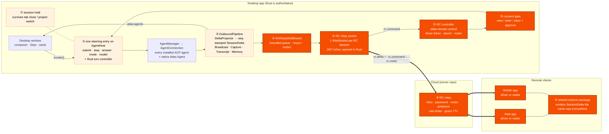
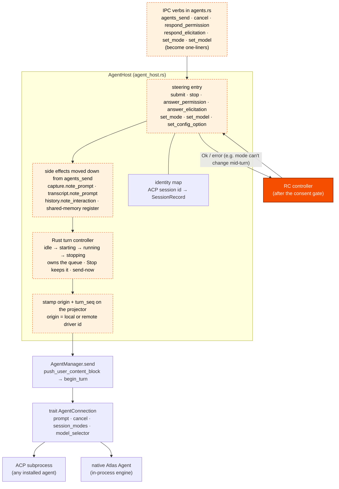
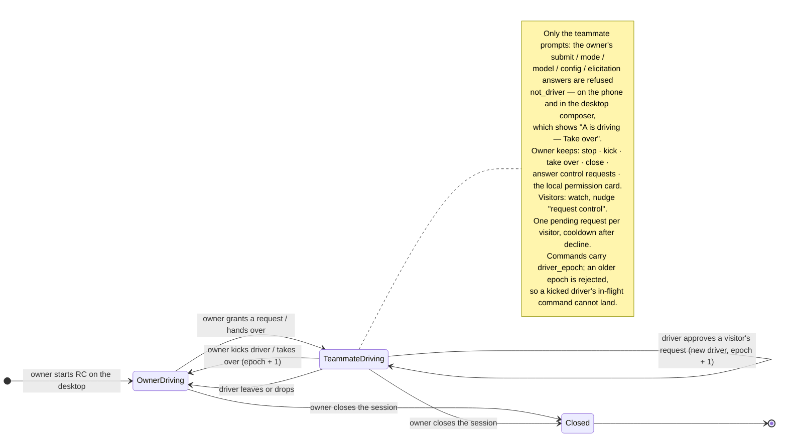
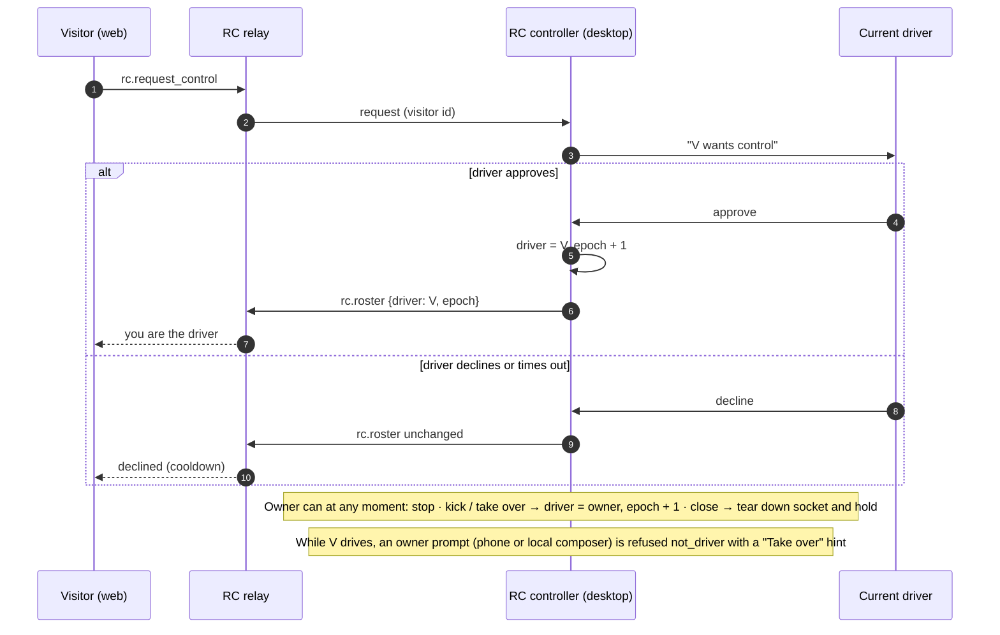
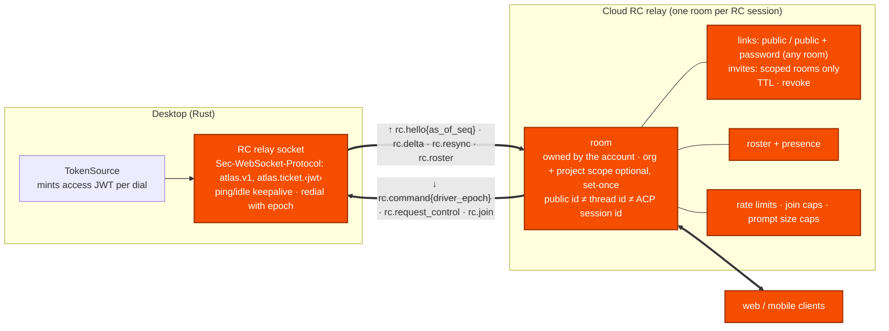
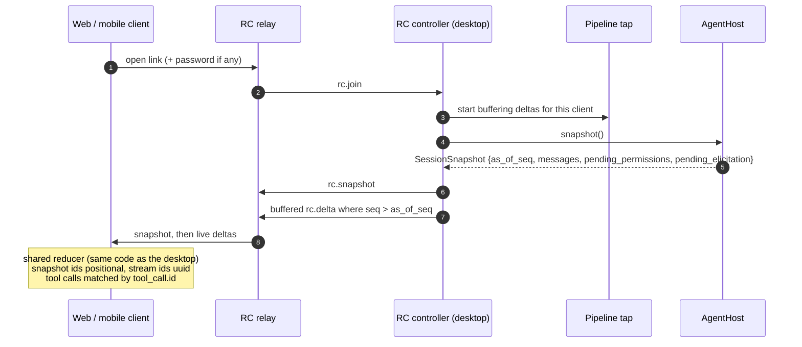
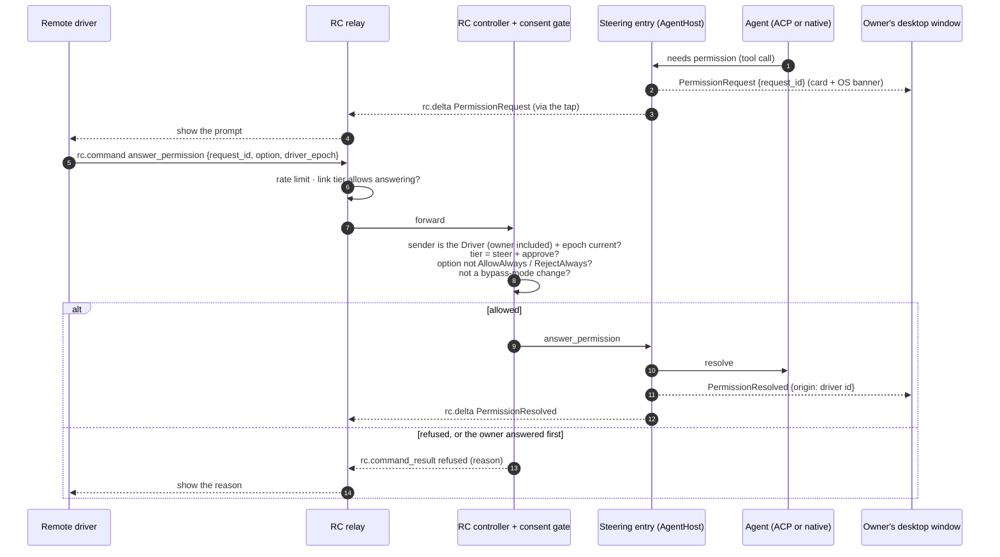
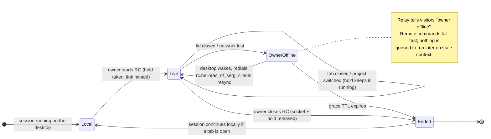

# Universal RC: design review

Review of `docs/research/universal-rc-seam.md`, 2026-10-23, against
`local/app-build` at `9ef484d0`. Read-only; every claim below was checked
against the file and line it cites, and anything not read directly is marked
*inference*.

**Revision of 2026-10-23 (evening).** Corrected to the decision audit's model
([`universal-rc-decision-audit.md`](./universal-rc-decision-audit.md); the API
plan's revision note lists the full change). Three things in this review
contradicted it and are fixed below: (1) §4.1 and §4.4 said a pending permission
prompt is answerable by the driver "plus the owner at any time" and the first
answer wins — that stays true of the owner's **local** card only (audit Q3);
the owner's *steering* (prompt, mode, model, config, elicitation answers, and a
remote permission answer from the phone) is **Driver-only, the owner included**
— once the owner hands the seat to A, only A prompts, from the desktop composer
too, until the owner takes it back (audit A2; product requirement R4); (2) D3's
"the owner can always override" meant the master powers (stop, kick, take over,
close, answer a control request) and is now worded so it cannot be read as "the
owner can always prompt"; (3) nothing here keyed the room on an Organisation,
but D4 now says whose the room is — the **account's**, with an optional,
set-once org + project scope for invites (audit R1/R3). Everything else stands.
The server and desktop code are being brought to this model in parallel; this
document describes the design, not their progress.

## Verdict

**The proposed placement is the right one and is the best of the five options,
but the note is incomplete in four places that would each sink a first
release.** Build it as: a single Rust *steering* entry on `AgentHost` (the
turn controller, once it exists, is that entry's owner), a fan-out stage on the
`OutboundPipeline`, a Tauri-free `atlas-remote-control` crate for arbitration,
one relay socket per RC session — plus the four things the note leaves out:

1. **Deltas carry no sequence number, so "snapshot then tail" double-applies.**
   `SessionDeltaEnvelope` is `{agent_id, session_id, delta}`
   (`crates/atlas-agent-wire/src/delta.rs:195-200`); only `Status`,
   `TurnFinished` and `TurnFailed` carry `turn_seq`. A joiner that subscribes,
   then pulls `agents_snapshot`, cannot tell which buffered `TextChunk`s the
   snapshot already contains. RC needs an additive per-session `seq` on the
   envelope and an `as_of_seq` on the snapshot.
2. **The snapshot cannot hand a joiner a pending permission.** `SessionSnapshot`
   (`src/types/agents.ts:130-160`, built at
   `src-tauri/src/commands/agent_host.rs:1392`) has no pending-permission or
   pending-elicitation field; a waiting tool call is just `status: "pending"`
   (`crates/atlas-agent-delta/src/project.rs:343`) with no `request_id`. The
   projector holds the tables (`projector.rs:371-392`) but never exports them.
   Without this, driver handoff while a prompt is open leaves the new driver
   with nothing to answer — the exact case the feature exists for.
3. **Remote clients cannot render `SessionDelta` without the desktop's
   reducer.** `applyDeltaToDraft` (`src/features/chat/stores/chat-store.ts:1990`
   to the end of the file, ~570 lines) encodes stale-turn drops, inflight tool
   sweeps, re-raised native permission cards keyed by `request_id`,
   user-row-counted rewinds, snapshot-id vs delta-id conventions. The web and
   mobile clients must share that reducer as a package, not reimplement it.
   This is the largest cost in the feature and the note does not count it.
4. **Remote permission answers need a consent policy, not just a driver
   token.** A permission prompt executes on the owner's machine; an
   `AllowAlways` option grants standing permission; a mode change to "bypass"
   or "full access" is permission-grade. The driver gate decides *who* may
   speak; a per-session policy must decide *what* a remote driver may answer.

Everything else in the note holds, with the corrections in §3.

## Architecture diagrams

One global diagram, then one diagram per part of it. The circled numbers in
the global diagram (① to ⑦) are the parts; each part has its own diagram
below, with the same number.

Colours and lines:
- **orange**: new for RC
- **dashed**: exists today but must change first
- **plain**: exists today and stays as it is

### D0. Global: how the RC pieces connect



The same view in plain text:

```
  REMOTE CLIENTS                 CLOUD                      DESKTOP (Rust is authoritative)
 ┌──────────────┐         ┌──────────────────┐        ┌──────────────────────────────────────────┐
 │ Web app      │◄═══════►│ ④ RC relay       │◄══════►│ ④ RC relay socket (1 per RC session)     │
 │ Mobile app   │         │ links · password │        │      │ rc.command ↓        ▲ rc.delta    │
 │              │         │ roster · presence│        │      ▼                     │             │
 │ ⑤ shared     │         │ rate limits      │        │ ③ RC controller            │             │
 │   reducer    │         │ grace TTL        │        │   driver token · epoch     │             │
 │   package    │         └──────────────────┘        │      ▼                     │             │
 └──────────────┘                                     │ ⑥ consent gate             │             │
                                                      │   view/steer/+approve      │             │
                       Desktop window ── invoke() ──► │      ▼                     │             │
                       (composer, Stop, cards)        │ ① ONE STEERING ENTRY       │             │
                              ▲                       │   AgentHost + Rust turn    │             │
                              │                       │   controller   ◄── ⑦ hold  │             │
                              │                       │      ▼                     │             │
                              │                       │ AgentManager → AgentConnection           │
                              │                       │   ACP agents │ native Atlas Agent        │
                              │                       │      ▼                     │             │
                              │  atlas:agents         │ ② OutboundPipeline (seq-stamped deltas)  │
                              └───────────────────────┤   Broadcast · Capture · … · RcRelay ─────┘
                                                      └──────────────────────────────────────────┘
```

Read it as two loops through one desktop. Commands go **down**, through ③ the
controller and ⑥ the gate into ① the steering entry; the desktop window enters
① too. Everything the agent does comes **up** through ② the pipeline. The
pipeline feeds the desktop window and the relay alike, so the desktop and
every remote client see the same stream.

### D1. ① One steering entry (inbound)

The local window and RC enter at the same place. A remote prompt then gets the
same capture, transcript, history and memory side effects as a local one, and
goes into the same queue.



### D2. ② The outbound stream and the RC tap

Each delta gets a per-session `seq`. The RC tap is a pipeline stage with a
bounded queue. It never relies on the lossy in-process bus.

```mermaid
flowchart LR
  classDef rc fill:#f54e00,stroke:#a33300,color:#fff,stroke-width:2px
  classDef chg fill:#fff3e0,stroke:#f54e00,stroke-dasharray:4 3,color:#000

  thread["AcpThread<br/>(one per session, both agent kinds)"]
  proj["DeltaProjector<br/>+ UserMessage{origin} projected from the thread entry<br/>+ ModeChanged announced by the host"]:::chg
  env["SessionDeltaEnvelope<br/>{agent_id, session_id, seq, delta}"]:::chg

  subgraph PIPE["OutboundPipeline (ordered, synchronous)"]
    direction LR
    b["Broadcast<br/>atlas:agents → window"] --> an["Analytics"] --> ka["KeepAwake"] --> cap["Capture"] --> tr["Transcript"] --> mi["MemoryIngest"] --> rcm["RcRelayMiddleware"]:::rc
  end

  q["bounded per-session queue"]:::rc
  redact["atlas-redact<br/>secrets scrubbed before leaving"]:::rc
  resync["on overflow: drop + one rc.resync{as_of_seq}"]:::rc
  sock["RC relay socket"]:::rc

  thread -- "AcpThreadEvent" --> proj --> env --> PIPE
  rcm -- "only sessions with RC on" --> q --> redact --> sock
  q -.->|full| resync -.-> sock
```



### D3. ③ The RC controller: roles and driver handoff

Every connected person is **Owner**, **Driver** or **Visitor**. There is one
driver at a time — **exactly one person who can prompt**. The owner is the driver
by default; once the owner hands the seat to a teammate, the owner does **not**
prompt — not from the phone, not from the desktop composer — until the owner
takes the seat back. What the owner keeps at every moment are the **master
powers**: stop the agent, kick the driver, take over, close the room, answer a
control request; and the desktop's local permission card stays the owner's to
answer (§4.4). The seat is held by a *person*, not a socket: while the owner
drives, the desktop, the phone and the browser all send interchangeably (Claude
Code's rule for the owner's own devices); the same holds for a teammate's several
tabs. A running turn belongs to the session, not the driver, so handing over
control never stops the agent.





### D4. ④ Transport: the relay socket and the cloud relay

The desktop opens one socket per RC session, from Rust, using the same ticket
handshake as the artifacts and comms sockets. The renderer never holds a JWT.
The room belongs to the **account** signed in on the desktop when RC started —
no Organisation is needed, and a token whose `orgs` is empty dials it (Claude
Code's model: own laptop, own phone, same account). The org and project selected
in the app travel as an optional, set-once **scope** that exists only to say
whom the owner may invite; the socket URLs, the room's name and the viewer link
carry the room id alone (API plan §3.1, §6, §7.1).



Frames, in each direction:

| direction | frames |
|---|---|
| desktop → relay | `rc.hello{as_of_seq}`, `rc.snapshot`, `rc.delta{seq}`, `rc.resync{as_of_seq}`, `rc.roster`, `rc.command_result` |
| relay → desktop | `rc.join`, `rc.leave`, `rc.request_control`, `rc.command{driver_epoch, …}` |

### D5. ⑤ Joining mid-turn, and the shared reducer

A joiner gets the snapshot, then only the deltas after it, so nothing is
applied twice. Web and mobile use the same reducer package as the desktop
(extracted from `chat-store.ts`) and render the stream exactly as the desktop
does.



### D6. ⑥ A remote command through the consent gate

The relay and the desktop each enforce the rules, and neither trusts the other.
A permission prompt is shown on the desktop and to the remote driver; the
owner's **local** card is answerable whoever drives and the first answer wins. A
*remote* answer — the teammate's, or the owner's own from the phone — must come
from the Driver.



| tier | who | can watch | prompt / stop / model / safe modes | answer permission prompts |
|---|---|---|---|---|
| **view** | anyone with the link (default) | yes | no | no |
| **steer** | password links and up | yes | yes | no; owner only |
| **steer + approve** | invited, signed-in teammates only (a room with an org + project scope) | yes | yes | yes, except "always" options and bypass modes |

Sign-in prompts and the org tool server's outward-action prompts stay
owner-only in every tier. Every "yes" in the prompt column means *while holding
the seat* — for the owner too; the owner's master powers (stop, kick, take over,
close) and the local permission card are the only things the seat does not gate.

### D7. ⑦ RC session lifecycle (hold, offline, close)

While RC is on, the session is **held**: closing the tab or switching project
doesn't drop it. If the desktop sleeps, the relay keeps the room open for a
grace period. Commands are **never** queued while the owner is offline.



## 1. Options compared

| | (a) AgentHost + pipeline **(proposed)** | (b) `AgentConnection` decorator / inside `AgentManager` | (c) Frontend mirror (store or window events over a socket) | (d) ACP-level proxy | (e) Each agent's own RC |
|---|---|---|---|---|---|
| Universal across ACP and native | Yes — both kinds already converge at `AgentHost::send` (`agent_host.rs:1550`) and at `Emitter::emit` (`delta.rs:241`) | Inbound: sees only `prompt`/`cancel` (`connection.rs:319-324`). Permission answers bypass the connection entirely (thread oneshot, `thread.rs:1705`, host `agent_host.rs:1945-1968`); mode and model go through capability objects (`session_modes()` → `AgentSessionModes::set_mode`, `connection.rs:446-452`). Decorating one trait misses four of six verbs | Yes, but inherits the `claude-code` branches (`chat-store.ts:2439-2452`) | Yes — the pinned crate has `Agent`, `Proxy`, `Conductor` roles (`agent-client-protocol-2.0.0/src/role/acp.rs:277,1037,1080`) | No. Only Claude Code has one; ACP schema 1.5.0 advertises no such capability, so enabling it is a branch on agent id (ADR-0002) |
| Local-UI coherence | Needs the `UserMessage` delta (gap, §3) and host-announced `ModeChanged`; after that the desktop hears everything a remote driver does | Same gaps, and worse: a remote prompt entering below the host skips `turn_seq`, `begin_atlas_turn`, capture, transcript, history | Perfect by construction — the store *is* the source | Same gaps as (a): the desktop UI reads the projector, not ACP, so a prompt entering the ACP endpoint still has to reach `host.send` | None. The remote driver talks to Anthropic's service; Atlas sees a turn start with no prompt and competing permission answers |
| Code rewritten | Fold `agents_send`'s side-effects into the host (`agents.rs:1764-1814`); one new middleware; new crate; frontend dedupe of optimistic rows | Same as (a) plus a decorator per capability trait | Small in Rust, but the desktop window becomes a required relay node; the renderer must stay mounted on the tab (`chat-store.ts:1991-1992` drops deltas with no tab) | Largest: an agent-side ACP server (`session/load`, `prompt`, `cancel`, `set_mode`, config options, `request_permission` forwarding), ACP-over-WS in the relay, and a client UI anyway | Nothing in Atlas, which is the problem |
| Security / credentials | Socket opened in Rust with a `TokenSource` ticket (`crates/atlas-artifacts/src/socket.rs:9-21`); renderer never holds a JWT (`crates/atlas-comms/src/lib.rs:6-9`); desktop enforces the driver gate on every inbound command | Same as (a) | Breaks the comms layering: remote commands would enter a renderer that "renders agent-authored markdown with no CSP" and "decides nothing" (`atlas-comms/src/lib.rs:6-15`). Arbitration in JS is unenforceable | ACP's `fs/*` and `terminal/*` are things the *agent* asks the *client* to do; with the desktop as agent, a remote client would be asked to serve the owner's files. Must be stripped. Messy | Credentials and consent live with a third party; Atlas's permission prompts can be answered elsewhere |
| Latency | One hop: emit thread → bounded queue → WS | Same | Two hops (Rust → webview → Rust → WS); WKWebView throttles backgrounded timers | One hop, but `session/load` replays history as updates rather than one snapshot | n/a |
| Driver arbitration fit | Clean: the gate sits in front of one entry; the host already re-reads option kinds off the pending request rather than trusting the caller (`agent_host.rs:1952-1960`) | Clean in principle, but there is no single entry below the host to gate | Unenforceable | ACP is one client per session: no roster, one answerer for `request_permission`. The relay must multiplex — which is the RC controller again, in ACP clothing | None; one driver per agent's own service |

**Ranking.**

1. **(a) as amended** — the only option where both agent kinds already share the two seams, the error path is a request/response (a remote driver must *see* "mode can't change mid-turn", `engine/connection.rs:3917-3925`), and the gate is enforceable in the process that owns the agent.
2. **(c)** — fastest demo and the right insight about rendering (reuse the React chat view), but the wrong authority: the window must stay open, the renderer becomes a security boundary, and nothing is enforceable. Steal its renderer idea (§4.6), not its transport.
3. **(d)** — a principled wire for third-party clients someday, but ACP is 1:1, strips Atlas's enrichments (`turn_seq`, `TurnFailed.error_kind`, `RetryStatus`, `SubagentUpserted`, `UsageUpdated`, `RateLimits`, `Compaction`, `ContextUsage`), and still needs a roster layer on top. Revisit only if "any ACP client can drive an Atlas session" becomes a goal.
4. **(b)** — sees half the verbs and loses the identity map; a remote prompt that enters below the host silently drops capture, transcript and history.
5. **(e)** — killed by the universality constraint; also invisible to the Atlas window and in conflict with Atlas's own permission path.

## 2. Verification of the note's load-bearing claims

| claim | status | evidence |
|---|---|---|
| Inbound converges at `AgentHost` | **Correct** | `AgentHost::send` `agent_host.rs:1550-1600` bumps `turn_seq`, stamps the projector, `begin_atlas_turn`, spawns `manager.send` (`manager.rs:1096-1143`) → `connection.prompt` (`connection.rs:319`). `cancel` `:1779`, `set_mode` `:1787`, `set_model` `:1801`, `respond_permission` `:1940`, `respond_elicitation` `:2069` |
| `agents_send` side-effects live above the host | **Correct** | `agents.rs:1764-1814`: `CaptureState::note_prompt`, `history.note_interaction`, `TranscriptState::note_prompt`, `SharedMemoryStore::register_session`, then `host.send` at `:1814-1818` |
| Outbound converges at `Emitter` → `OutboundPipeline`, lossless | **Correct** | `delta.rs:216-252` (bus publish only when `receiver_count() > 0`, then `sink.emit`); `TauriDeltaSink` `agents.rs:74-110`; pipeline runs synchronously, pinned by `atlas-bus/src/middleware.rs:92-140`; bus ring is 1024 (`bus.rs:7`) |
| The user's prompt is never a delta | **Correct** | `projector.rs:869` `AgentThreadEntry::UserMessage(_) => (Projected::User, Vec::new())`; stated again at `src-tauri/src/commands/capture.rs:18-27`; the snapshot *does* carry user messages (`project.rs:496-499`) |
| Frontend-only state: queue, `pendingSend`, `stopping`, optimistic rows, title | **Correct** | queue `chat-store.ts:341-344`, drained by a React effect `chat-panel.tsx:1172-1178`; Stop clears queue and permission cards locally `chat-panel.tsx:1326-1334`; optimistic user row `:1426`/`:1458`; title `:1429-1434`/`:1466`; `running` set before `invoke` returns `:1476`; send-error row `:1522` |
| Closing the tab kills the session | **Correct in substance, wrong citation** | `close-tab.ts:41-52` is the busy-confirm + `agents.cancel`; the drop is indirect: `finishClose` → `chat.actions.removeSession` (`close-tab.ts:72`) → `dropBackendSession` (`chat-store.ts:1578`, defined `:1980-1982`) → `agents.dropSession` (`agents-api.ts:185-186`) → `agents_drop_session` (`agents.rs:1901-1915`) → `AgentHost::drop_session` (`agent_host.rs:1346-1370`) |
| The window drops deltas for a session with no tab | **Correct** | `chat-store.ts:1991-1992` `if (!tid) return;` |
| Native `set_mode` refuses mid-turn, announces nothing; host announces `ModelChanged` but not `ModeChanged` | **Correct** | `engine/connection.rs:3906-3941`; `agent_host.rs:1787-1800` vs `:1818` |
| Permission/elicitation answers resolve by wire `request_id` through the projector tables | **Correct** | `projector.rs:371-392`; `agent_host.rs:1945-1968`; option kind re-read off the pending request, not trusted from the caller |
| Native-only verbs via downcast; capabilities published per plugin | **Correct** | `native_connection` `agent_host.rs:1923-1936`; `PluginCapabilities` `:3209-3216`; `ui_control: true` only in-process `engine/connection.rs:720` |
| The artifacts socket cannot carry RC | **Correct** | per-Project, read-only frames, bound-Project only (`artifacts/src/socket.rs:23-29`, `manager.rs:20-45`) |

## 3. Corrections and additions to the note

1. **Tab close is not the only killer.** `removeSessions` (project discarded from the hot set, `chat-store.ts:1594-1595`) and `resetSessions` (project switch, `:409`) also drop backend sessions. The hold must be honoured by `AgentHost::drop_session` for every caller, not only the tab path — which the note's `SessionRecord` refcount does, but the frontend side of the note ("keep or re-attach a tab") is weaker than stated and stronger than needed. Because Rust is authoritative and `agents_snapshot` is the truth, the window may keep dropping deltas for a held session; it only needs the sidebar to show the session as live and remote-driven, and to hydrate from the snapshot on reopen (`hydrateSessionSnapshot`, referenced at `chat-store.ts:2434`).
2. **No per-delta sequence number** (verdict item 1). Additive envelope field; `as_of_seq` on the snapshot; the RC controller buffers from subscribe, takes the snapshot, and drops buffered deltas `≤ as_of_seq`.
3. **Snapshot lacks pending requests** (verdict item 2). Additive `pending_permissions: [{request_id, tool_call, options}]` and `pending_elicitation` on `SessionSnapshot`, exported from the projector's existing tables. This also fixes a latent desktop bug: a window reload mid-prompt loses the card today.
4. **The cheapest `UserMessage` delta is a projection, not a host announcement.** The thread already holds the entry (`manager.rs:1116` `push_user_content_block`); `project_new` can project it (`projector.rs:869`) instead of skipping it, with `origin` stamped into the projector's per-session state at send time the way `set_turn_seq` is (`projector.rs:361-363`). That keeps the thread as the single source and makes the snapshot and the stream agree on user rows. The frontend dedupes its optimistic row by adopting the first `UserMessage{origin: local}` that arrives for a row with no wire id; held-for-bind rows (`pendingSend`) stay optimistic because no session exists yet.
5. **The RC tap must be bounded, with a resync marker.** `CaptureMiddleware` uses an unbounded channel because disk always drains; a relay that is down for a 20-minute turn would hold every `TextChunk` in memory. Use a bounded per-session queue; on overflow drop and enqueue one `rc.resync{as_of_seq}` so the remote client re-pulls the snapshot. With (2) and (3) in place this is safe; without them it is not.
6. **`loading_status` and request-scoped elicitations are correctly excluded**, and the UI/org tool servers are correctly out of scope — but the org tool server's "outward actions ask first" (ADR-0014) prompts arrive as ordinary permission requests and must be owner-only under the policy in §4.4.
7. **`pendingSend` citation.** `chat-store.ts:1792-1824` is `noteAgentDisconnected`/`noteAgentRemoved` re-queueing a held send; the held-send action itself is `setPendingSend`. Substance unchanged.
8. **Minor.** `src/types/agents.ts:9-12` is the `SessionKey` shape as the note says; `agents_respond_permission` ignores `agent_id` (`agents.rs:1961`) and so does `agents_drop_session` (`:1908`), which supports the note's advice that remote clients never see `agent_id`.

## 4. Hard problems and proposed answers

### 4.1 Driver handoff while a turn is running or a prompt is pending

The turn belongs to the session, not the driver: `manager.send` is already running on its own task (`agent_host.rs:1574`), and the driver token gates *new* inbound steering — **from every surface, the owner's included**. Handoff is therefore a token reassignment with no agent interaction; kick ≠ stop (the master may stop explicitly, whoever drives — `stop` is never seat-gated). While a teammate holds the token the owner does not prompt: the steering entry refuses `Origin::Local` `submit`/`set_*`/`answer_elicitation` as it refuses a remote non-driver, and the composer shows "A is driving — Take over" (audit A2; product requirement R4). The pending permission prompt stays in the projector table and is answerable by whoever holds the token at answer time — and by the owner **on the desktop's local card** at any time, because a permission answer is consent executing on the owner's machine rather than a prompt (audit Q3); the owner's *remote* answer from the phone follows the token like any other command. The host is already idempotent against the race: the first answer consumes the `request_id`, the second gets "permission request is not pending" (`agent_host.rs:1946-1948`) and the RC controller relays that as a decline-with-reason. What is missing is that the *new* driver must see the open prompt — hence snapshot-with-pending (§3.3). *Inference:* the relay should include `driver_epoch` on every `rc.command`, and the desktop should reject a command whose epoch is older than its current roster view, so a kicked driver's in-flight command cannot land after the kick.

### 4.2 Joining mid-turn: snapshot plus tail over a lossy bus

Do not use the bus. Subscribe on the pipeline (bounded queue, §3.5), take `agents_snapshot` with `as_of_seq`, replay the buffer above it. Two id conventions bite here and the shared reducer (§4.6) must carry both: snapshot message ids are positional and stream ids are uuids (`project.rs:485-489`), and the desktop matches by `tool_call.id`, never by `message_id`. A joiner during a streaming assistant message must append subsequent `TextChunk`s to the snapshot's last assistant run — the desktop's existing rule, which is why the reducer must be shared and not described.

### 4.3 Desktop sleeps or goes offline

`KeepAwakeManager` only blocks *idle* sleep, only while the setting is on, and the display may still sleep (`src-tauri/src/keep_awake.rs:11-18`); a closed lid suspends the process and every ACP subprocess with it. Nothing in `lib.rs` handles resume. Proposal: the relay socket runs under a supervisor with the artifacts manager's per-slot epoch rule (`artifacts/src/manager.rs:7-16`) and redials on wake with `rc.hello{as_of_seq}`; the relay keeps the RC session alive for a server-side grace TTL and tells visitors "owner offline"; the link remains valid. **Commands never queue on the relay while the owner is offline** — a permission answer delivered on wake would execute a decision made against stale context; prompts fail fast with "owner offline" (the user may retry). Every hop bounded, per ADR-0008.

### 4.4 May a remote driver answer permission prompts? Per tool or per session?

Per session, chosen at link creation, with an owner veto that never goes away:

- **view** — stream only. Default for every public link.
- **steer** — prompt, stop, queue, model, modes that do not widen permissions; permission and elicitation prompts stay owner-only (desktop card and OS banner as today). Ceiling for password-protected public links.
- **steer + approve** — invited, signed-in teammates only; never a public link. Remote drivers may answer prompts, but the RC gate filters `AllowAlways`/`RejectAlways` option kinds (standing grants belong to the owner) and refuses mode changes to a bypass/full-access mode. The host already re-reads option kinds from the pending request (`agent_host.rs:1952-1960`), so the filter is a kind check in the gate, not a new protocol.

The desktop always shows the card too, and the owner may answer it **locally** whoever holds the seat; first answer wins. That local card is the one steering-adjacent thing the single-driver rule does not gate (audit Q3): a remote `answer_permission` — a teammate's, or the owner's own from the phone — must come from the Driver, and `answer_elicitation` follows the seat on every surface, the local card included (an elicitation answer is content the agent asked for, i.e. a prompt). Sign-in elicitations stay desktop-only (already off the pipeline, `agents.rs:1097-1140`). Org "outward actions ask first" prompts (ADR-0014) are owner-only in every tier. Every remote answer is recorded in the transcript with the driver's identity (`origin` on the resolving delta), because an audit line is the only thing that lets the owner find out what a teammate approved.

### 4.5 Rate limiting and abuse on public links

Split enforcement; neither side trusts the other. Relay: password hash with attempt limits, join caps per link, link TTL and revocation, one pending control request per visitor with a cooldown after decline, prompt size caps, token bucket on `rc.command`. Desktop, independently: reject any command whose driver token or epoch it does not recognise — the owner's own included, when the owner is not the driver; at most one in-flight submit per session (the turn controller's job); a small per-session command budget; and the master's `stop` and "close session" as kill switches — `stop` halts the agent whoever drives, close tears down the socket and the hold at once. Link creation requires a signed-in owner — an account, not an Organisation; a public link never forces an org onto solo use (audit R5), and only a room with an org + project scope can have invited teammates. Two things the note should say aloud: the stream carries file paths and tool output from the owner's machine, so link creation must say so; and `crates/atlas-redact` already exists and should run on the outbound RC stream before it leaves the process.

### 4.6 Can remote clients render `SessionDelta` without the desktop's frontend logic?

No. Extract the pure reducer (`applyDeltaToDraft` and its helpers; it operates on an Immer draft and does not call Tauri) and the message-list components into a shared package consumed by the desktop and the web client; a mobile client shares the reducer. This is the one place to borrow from option (c). It also removes the `claude-code` branches from the reducer (`chat-store.ts:2439-2452`) in favour of `acpAvailableModes`/`ModeChanged`, which is overdue for ADR-0002 regardless of RC.

## 5. Recommended build order — thin vertical slices

Each slice is demoable on its own and leaves the desktop better even if the next never ships.

1. **One steering entry.** `AgentHost::submit/stop/answer_permission/answer_elicitation/set_mode/set_model/set_config_option` carrying the `agents_send` side-effects; the IPC verbs become one-liners. Project `UserMessage{origin}` from the thread entry; host-announce `ModeChanged`; add `seq` to the envelope and `as_of_seq` plus pending requests to the snapshot. Contract tests in `crates/atlas-agent-wire/tests/contract.rs` and `tests/wire-shape-contract.test.ts`. *Demo:* a prompt sent from the devtools console appears as a user row in the window; reload mid-prompt and the permission card comes back.
2. **Session hold.** A hold on `SessionRecord` honoured by `drop_session` for tab close, project discard and project switch; sidebar shows held sessions as live; reopen hydrates from snapshot. *Demo:* set a dev hold, close the tab mid-turn, reopen, the turn is still streaming.
3. **Rust turn controller.** Queue, Stop-discards-queue, send-now, with a `QueueChanged` delta; the frontend queue becomes a mirror. *Demo:* queue three prompts, Stop, the snapshot agrees with the window.
4. **RC view-only.** `atlas-remote-control` crate, `commands/rc.rs` (`rc_start` needs a signed-in session and nothing else — the org is a scope hint, never a precondition), the fan-out middleware with its bounded queue and resync marker, the relay socket on the comms/artifacts handshake (`?room=` only), a QR of the viewer link beside "Copy link", and a web viewer built on the shared reducer package. *Demo:* from an account with no Organisation, create a link, watch a turn from a phone browser signed in as the same account, join mid-turn and see the right transcript.
5. **Owner steering.** Prompt, stop, mode, model from the owner's own phone, interchangeably with the desktop composer; errors round-trip (`mode can't change mid-turn` is shown remotely). *Demo:* start a turn from the phone, see the user row and the stream on the desktop.
6. **Roster and arbitration.** N visitors, one driver; request/grant/decline; master stop, kick, take-over, close; **the owner's composer and phone refused `not_driver` while a teammate drives, with "Take over" offered**; password links; teammate invites (only once the room has an org + project scope; the picker is that org's members who can read the project, or "Everyone in <org>"); `driver_epoch` on commands. *Demo:* two browsers, hand control back and forth during a running turn; while the teammate drives, the owner's Send is replaced by Take over and Stop still works.
7. **Remote approvals under policy.** The three tiers, option-kind filtering, owner veto, transcript audit line. *Demo:* a teammate approves a file write; the owner sees who did it.
8. **Resilience and abuse.** Sleep/offline redial with epoch and resync, relay grace TTL, rate limits, link TTL/revocation, redaction on the outbound stream. *Demo:* close the lid mid-turn, reopen, the phone catches up without duplicates.
