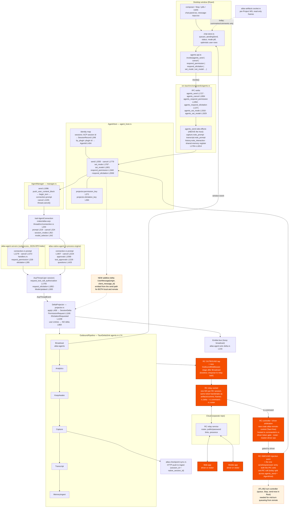

# Universal RC: where the seam is (ATL-964)

Research note, 2026-10-23. Read-only survey of the current agent path on
`local/app-build` (HEAD `9ef484d0`) to answer one question: is there a single
point below the UI through which every agent's traffic passes, where remote
control (ATL-964) can hook in. Every claim cites `file:line`; anything not
read directly is marked *inference*.

Feature as written in ATL-964: one desktop emits a session; web, mobile and
desktop can steer it (prompt, stop, answer permissions and elicitations,
change mode/model); one driver, N visitors; visitors ask for control, the
driver approves; the creator is master driver and can kick, take over and
close; links may be public and password-protected. Must hold for every ACP
agent and the in-process Atlas Agent with no branch on agent identity
(ADR-0002).

## The current path, with the RC additions marked

### Mermaid



### ASCII

```
 DESKTOP WINDOW (React)
 ┌──────────────────────────────────────────────────────────────────────────┐
 │ composer / Stop / mode+model pills / permission+elicitation cards        │
 │   chat-panel.tsx:1341 handleSend  ─ addMessage("user") 1426/1458        │
 │   chat-store.ts queues:341 pendingSend:1792 status reducer:1995          │
 │   agents-api.ts  send:151 cancel:157 respondPermission:204 setMode:188   │
 └───────────────┬──────────────────────────────────────▲───────────────────┘
                 │ invoke()                             │ "atlas:agents" window event
 ════════════════╪══════════════════════════════════════╪═══════════════════
 RUST            ▼                                      │
 ┌ agents.rs (IPC verbs) ────────────────────────────┐  │
 │ agents_send:1727  ┌─ capture.note_prompt   :1764  │  │
 │                   ├─ history.note_interaction     │  │
 │                   ├─ transcript.note_prompt       │  │
 │                   └─ shared-memory register       │  │   ┌───────────────────────────┐
 │ agents_cancel:1894 agents_set_mode:1918           │  │   │ OutboundPipeline          │
 │ agents_respond_permission:1954 _elicitation:1371  │  │   │ (TauriDeltaSink,          │
 └───────────────┬───────────────────────────────────┘  │   │  agents.rs:74-110)        │
   ╔═════════════╪═════════════════════════════════╗    │   │  Broadcast ──────────────┼──┘
   ║ ★ RC INBOUND injection = ONE send/stop/answer ║    │   │  Analytics                │
   ║   entry shared by IPC verb and RC controller  ║    │   │  KeepAwake                │
   ║   (today that entry is split: agents_send     ║    │   │  Capture ──► checkpoint   │
   ║    side-effects + AgentHost::send)            ║    │   │     sync.rs HTTP push     │
   ╚═════════════╪═════════════════════════════════╝    │   │  Transcript               │
                 ▼                                      │   │  MemoryIngest             │
 ┌ AgentHost  agent_host.rs ─────────────────────────┐  │   │ ★ RcRelayMiddleware (NEW) │
 │ identity map  sessions[acp session id]:248        │  │   └──────────┬────────────────┘
 │                by_plugin[plugin id]→AgentId:404   │  │              │
 │ send:1550 cancel:1779 set_mode:1787 set_model:1801│  │   ┌──────────▼────────────────┐
 │ respond_permission:1940 (projector.permission_key)│  │   │ ★ RC relay socket (NEW)   │
 │ respond_elicitation:2069 (…elicitation_key)       │  │   │ 1 WS per RC session       │
 └───────────────┬───────────────────────────────────┘  │   │ ticket in                 │
                 ▼                                      │   │ Sec-WebSocket-Protocol    │
 ┌ AgentManager manager.rs ──────────────────────────┐  │   │ rc.delta ↑  rc.command ↓  │
 │ send:1096 push_user_content_block → begin_turn    │  │   └──────────┬────────────────┘
 │           → connection.prompt    cancel:1155      │  │              │
 └───────────────┬───────────────────────────────────┘  │   ┌──────────▼────────────────┐
                 ▼                                      │   │ ★ RC controller (NEW)     │
 ┌ trait AgentConnection  acp-thread/connection.rs:204┐ │   │ atlas-remote-control      │
 │ prompt:319 cancel:324 session_modes:352 model:342 │  │   │ driver token gate, roster │
 └──────┬──────────────────────────────┬─────────────┘  │   │ master-driver kick/close  │
        ▼                              ▼                │   └──────────┬────────────────┘
 ┌ ACP subprocess ─────────┐  ┌ native engine ─────────┐│              │ gated commands
 │ agent-servers/          │  │ native-agent/engine/   ││              └──────► RC INBOUND
 │ connection.rs prompt    │  │ connection.rs prompt   ││
 │  :1278 cancel:1372      │  │  :1807 cancel:2224     ││
 │ handlers.rs             │  │ approvals→thread:1068  ││
 │  request_permission:228 │  │ tool_approvals:1226    ││
 │  elicitation:285        │  │ questions→thread:1425  ││
 └──────┬──────────────────┘  └──────┬─────────────────┘│
        └──────────────┬─────────────┘                  │
                       ▼                                │
 ┌ AcpThread  thread.rs ───────────────────────────────┐│
 │ request_tool_call_authorization:1705                ││
 │ request_elicitation:1852  ModeUpdated:1365          ││
 └───────────────────────┬─────────────────────────────┘│
                         ▼  AcpThreadEvent              │
 ┌ DeltaProjector  projector.rs ───────────────────────┐│
 │ apply:458 → SessionDelta  PermissionRequest:1166    ││
 │ ElicitationRequested:1208  user entry → NO delta:869││
 │ Emitter → lossy bus (delta.rs:216) + sink ──────────┼┘
 └─────────────────────────────────────────────────────┘
        ░ GAP: NEW additive SessionDelta::UserMessage{origin} ░
        ░ GAP: ATL-852 turn controller for mid-turn queueing   ░

 CLOUD (separate repo)                 FAR SIDE
 ┌────────────────────────────┐        ┌──────────┐  ┌──────────┐
 │ RC relay: roster, presence,│◄──────►│ Web app  │  │ Mobile   │
 │ public/password links      │        │ driver / │  │ driver / │
 └────────────▲───────────────┘        │ visitor  │  │ visitor  │
              │ WS                     └──────────┘  └──────────┘
   ★ RC relay socket (desktop)
```

## Q1. Inbound: composer to agent, both agent kinds

**Prompt.** `message-input` submit → `handleSend`
(`src/features/chat/components/chat-panel.tsx:1341`) → optimistic user row
`addMessage(tabId, "user", …)` (`:1426` held-for-bind, `:1458` normal) →
`updateSessionStatus(tabId, "running")` (`:1476`) → `agents.send(key, …)`
(`:1509`) → `invoke("agents_send")` (`src/features/chat/lib/agents-api.ts:151`)
→ `agents_send` (`src-tauri/src/commands/agents.rs:1727`), which does four
side-effects *before* the host sees the turn: `CaptureState::note_prompt`
(`:1781`), `history.note_interaction` (`:1792`), `TranscriptState::note_prompt`
(`:1803`), shared-memory `register_session` (`:1812`) → `host.send`
(`:1816`) → `AgentHost::send` (`src-tauri/src/commands/agent_host.rs:1550`):
bumps `turn_seq`, stamps the projector (`:1566`), `begin_atlas_turn`, then
spawns `manager.send` (`:1574`) → `AgentManager::send`
(`crates/atlas-agent-manager/src/manager.rs:1096`): pushes the user content
onto the thread (`:1116`), `begin_turn` (`:1118`), then
`connection.prompt(request)` (`:1123`) → `AgentConnection::prompt`
(`crates/atlas-acp-thread/src/connection.rs:319`).

- ACP: `AcpConnection::prompt` (`crates/atlas-agent-servers/src/connection.rs:1278`)
  sends `session/prompt` over stdio.
- Native: `EngineConnection::prompt` (`crates/atlas-native-agent/src/engine/connection.rs:1807`)
  flattens the blocks and starts an engine turn in-process.

Nothing between `agents_send` and `prompt` names an agent. The one
identity-shaped thing on the send path is `plugin_id` handed to capture and
transcript as a label (`agents.rs:1775-1780`).

**Cancel.** `chat-panel.tsx:1338` → `agents_cancel` (`agents.rs:1894`) →
`AgentHost::cancel` (`agent_host.rs:1779`) → `AgentManager::cancel`
(`manager.rs:1155`, `thread.cancel()`) which in turn calls the connection's
`cancel` (`connection.rs:324`): ACP `:1372` (`session/cancel` notification +
local cancel signal), native `:2224` (interrupts the turn and every
descendant subagent). The frontend also clears its queue and permission
cards locally (`chat-panel.tsx:1326-1334`), state Rust never sees.

**Permission answer.** Card or OS banner → `respondAndPopPermission`
(`src/features/chat/lib/respond-permission.ts:19`) → `agents_respond_permission`
(`agents.rs:1954`; `agent_id` is ignored, `:1961`) → `AgentHost::respond_permission`
(`agent_host.rs:1940`): resolves the wire `request_id` through
`projector.permission_key` (`crates/atlas-agent-delta/src/projector.rs:371`)
to a `(session_id, tool_call_id)`, re-reads the option kind off the pending
request (`:1955`), then `thread.authorize_tool_call` / `cancel_tool_call_authorization`.
The thread's waiter wakes whichever connection raised it: ACP
`handle_request_permission` (`crates/atlas-agent-servers/src/handlers.rs:228-260`)
or native `approvals` (`engine/connection.rs:1068`) / `tool_approvals`
(`:1226`, `:1312`, `:1355`). Same path, same delta, both kinds.

**Elicitation answer.** `elicitation-modal.tsx:75` → `agents_respond_elicitation`
(`agents.rs:1371`) → `AgentHost::respond_elicitation` (`agent_host.rs:2069`):
first the connection-scoped table (`request_elicitations.answered_by`,
sign-in dialogs, `:2080`), then the projector's session-scoped
`elicitation_key` (`projector.rs:384`) → `thread.respond_to_elicitation`
(`crates/atlas-acp-thread/src/thread.rs:1878`). Raised by ACP
`handlers.rs:285-312` (session scope → thread; request scope → connection
store) and by the native `questions` path (`engine/connection.rs:1425`,
ADR-0013). Same path, both kinds.

**Mode / model.** `message-input.tsx:548` sets the pill optimistically
(`setAcpMode`), `chat-panel.tsx:548`/`:582` and `resume-mode.ts:142` call
`agents_set_mode` / `agents_set_model` (`agents.rs:1918`, `:1929`) →
`AgentHost::set_mode` (`agent_host.rs:1787`, capability-gated on
`connection.session_modes()`), `AgentHost::set_model` (`:1801`, gated on
`model_selector()`, then **host-announced** `projector.note_model_changed`
`:1818`). Effort, fork and rewind go through `native_connection`, a downcast
(`agent_host.rs:1923-1936`) — capability by type, not by id, but it is the one
place the host knows a concrete connection.

**Lowest agent-agnostic point that still has the identity map:** `AgentHost`.
Its `sessions` map is keyed by the ACP session id string
(`agent_host.rs:1291-1301`), `by_plugin` maps plugin id → the per-process
`AgentId` (`:404`), and every verb takes a `SessionKey { agent_id, session_id }`
(`:67-70`). Below it, `AgentManager` keys by `(Agent, SessionId)` and has no
notion of plugin id, cwd, turn_seq or history row.

But note what is *above* the host: `agents_send`'s four side-effects live in
the Tauri command, not the host (`agents.rs:1764-1814`). A remote prompt that
calls `AgentHost::send` directly would reach the agent and skip capture,
transcript and history. That is the first thing to fold down.

## Q2. Outbound: does everything cross the pipeline?

Every `AcpThreadEvent` from either connection lands in
`DeltaProjector::apply` (`projector.rs:458`) → `Emitter::emit`
(`crates/atlas-agent-wire/src/delta.rs:241`), which fans to the lossy
in-process bus (`delta.rs:218`, `EventBus`, ring 1024, `atlas-bus/src/bus.rs:7`)
**and** the host sink. The sink is the `OutboundPipeline`
(`agents.rs:74-110`): Broadcast (`atlas:agents`, `:118`) → Analytics →
KeepAwake → Capture → Transcript → MemoryIngest. The pipeline runs
synchronously on the emit thread and cannot lag
(`crates/atlas-bus/src/middleware.rs:92-140` pins this).

**Permission requests and elicitations are deltas on that pipeline:**
`SessionDelta::PermissionRequest` / `PermissionResolved`
(`crates/atlas-agent-wire/src/delta.rs:161-169`) from
`permission_requested` (`projector.rs:1150-1185`), and
`SessionDelta::ElicitationRequested` (`delta.rs:106`) from
`elicitation_requested` (`projector.rs:1187-1215`). The wire `request_id`
minted there is the only handle the answer path accepts, so an RC mirror
can forward the delta verbatim and relay the answer to
`AgentHost::respond_*` unchanged.

Host-announced deltas with no thread event behind them also go through the
same emitter: `note_turn_failed` (`projector.rs:397`), `note_model_changed`
(`:413`), `note_config_options` (`:428`).

**What reaches the UI without the pipeline (each a gap for a mirror):**

1. **The user's own prompt.** `project_new` maps a `UserMessage` entry to
   `(Projected::User, Vec::new())` (`projector.rs:869`) — no delta ever. The
   send path says so in three places (`agents.rs:1764-1770`,
   `src-tauri/src/commands/capture.rs:19-27`,
   `crates/atlas-checkpoint/src/capture.rs:115-120`). The window renders it
   optimistically; capture gets it by a direct call. A remote viewer gets
   nothing.
2. **Turn start is a bare status flip** (`Status{Running}`) with no text
   (`agents.rs:1767`).
3. Request-scoped (sign-in) elicitations: `atlas:agent-elicitation` /
   `…-resolved`, a separate forwarder (`agents.rs:1097-1140`). Desktop-only by
   nature; RC should not mirror them.
4. UI tool server actions: `atlas:ui-action` / `atlas:org-window-action`
   (`agents.rs:816`, `src-tauri/src/commands/ui_server/mod.rs:45-63`),
   answered by `ui_action_respond` (`:73`). Native-only (`ui_control: true`
   only on the in-process connection, `engine/connection.rs:720`; ACP sets
   `false`, `agent-servers/src/connection.rs:490`). Needs the window; cannot
   be served remotely.
5. Org action audit rows `atlas:org-action` (`agents.rs:858`).
6. Manager loading status, emitted *on* `atlas:agents` but as a hand-built
   `{kind:"loading_status"}` keyed by plugin id, not a `SessionDelta`
   (`agents.rs:990-997`).
7. `atlas:threads-changed` sidebar invalidation (`agents.rs:1085`), auth-run
   stdout/stderr/done (`:2163-2230`), agent update/catalog events (`:1118`,
   `:1131`).
8. Frontend-only synthesised rows: `agent send error: …` assistant row when
   `invoke` rejects (`chat-panel.tsx:1522`).
9. The catch-up **snapshot** (`agents_snapshot`, `agents.rs:1701`) is a pull;
   it does include user messages (`crates/atlas-agent-delta/src/project.rs:496`).
   A late-joining remote viewer needs this once, then the stream.

Also note the bus is explicitly advertised as the cloud tap
(`agents.rs:68-73`, `delta.rs:229-233`, `bus.rs:14-17`) — but it is lossy
by design. A permission request dropped under lag is a turn stuck for the
remote driver. The RC tap belongs on the pipeline (lossless), enqueueing to
a relay task the way `CaptureMiddleware` does (`capture.rs:28-33`).

## Q3. Local-UI coherence for a remote-originated prompt

If a remote driver's prompt enters at `AgentHost::send` (or even at
`agents_send`), the local chat shows **nothing for the prompt itself**:
the user row is added only by `chat-panel.tsx:1426/1458`, keyed to the
composer's `handleSend`. The thread does get the entry
(`manager.rs:1116`), the snapshot would show it, but the live mirror never
hears it (`projector.rs:869`). The subsequent `Status{Running}` delta does
flip the local tab to running (`chat-store.ts:1995-2013`), and the
assistant's reply streams normally — so the local user would see an answer
to a question they cannot see.

State that lives only in the frontend and goes stale under remote drive:

| state | where | consequence |
|---|---|---|
| user message rows | `chat-panel.tsx:1426/1458`, mirrored as optimistic rows with no wire id (`chat-store.ts:2413`, `projector.rs:719-722`) | remote prompt invisible locally; `HistoryRewound` counts user rows the local view never got |
| message queue | `chat-store.ts:341-344`, drained by a React effect (`chat-panel.tsx:1172`) | a remote "send while running" has nowhere to queue; a local Stop clears the queue locally only (`chat-panel.tsx:1327`) |
| `pendingSend` (held first message while binding) | `chat-store.ts:1792-1824` | remote cannot see or cancel it |
| `stopping` flag | `chat-store.ts` `setStopping` (`:1326`) | local only; remote Stop never shows the local "stopping" affordance |
| `status: "running"` is set optimistically before `invoke` returns (`chat-panel.tsx:1476`) | the authoritative flip is the `Status` delta | fine for remote-originated turns (the delta arrives); but a local "send error" row (`:1522`) is view-only |
| mode pill `acpCurrentMode` / `claudePermissionMode` | set at pick time (`message-input.tsx:514/548`, `chat-panel.tsx:980`) | ACP agents echo `current_mode_update` → `ModeUpdated` (`thread.rs:1365`) → `ModeChanged` delta (`projector.rs:807`), so a remote mode change *does* reach the local pill for ACP. The **native** `set_mode` records the mode on the connection and raises no thread event (`engine/connection.rs:3906-3941`), and the host does not announce it (`agent_host.rs:1787-1800`, contrast `set_model :1818`) — a remote native mode change leaves the local pill wrong |
| model pill `acpCurrentModel` | `set_model` host-announces `ModelChanged` (`agent_host.rs:1818`) | coherent for both kinds |
| pending permission / elicitation cards | fed by deltas (`chat-store.ts:2458`), popped locally on answer (`respond-permission.ts:36`) | a remote answer resolves via `PermissionResolved` on the pipeline; coherent |
| title | first 40 chars of the first local prompt (`chat-panel.tsx:1429-1434`, `:1466`) | remote-first session has no local title until `TitleUpdated` |

The native-agent side also refuses a mode change mid-turn
(`engine/connection.rs:3917-3925`) — a remote driver must see that error,
which today surfaces only as an `invoke` rejection.

## Q4. Session addressing and tab independence

Three ids exist:

- **`ThreadId`** — Atlas-minted UUID, persistent, in `threads.db`
  (`crates/atlas-thread-metadata/src/model.rs:26-32`; ADR-0001 line 21).
  The row's `session_id` is `Option<acp::SessionId>` (`model.rs:85-87`): a
  draft has none. `resume_thread` turns a `ThreadId` into a live
  `SessionKey` (`ResumedThread.key`, `agent_host.rs:3199-3206`).
- **ACP session id** — the agent's id for the conversation; the key of every
  live map: `AgentHost::sessions` (`agent_host.rs:1291`), the projector
  (`projector.rs:108`), the manager (`manager.rs:1151`), and the delta
  envelope's `session_id` (`delta.rs:195-200`). It is also what capture
  stores as `native_session_id` (`crates/atlas-checkpoint/src/model.rs:363`).
- **`SessionKey { agent_id, session_id }`** — the IPC handle
  (`agent_host.rs:67-70`, `src/types/agents.ts:9-12`); `agent_id` is a
  per-process UUID per plugin (`agent_host.rs:401-404`), meaningless across
  restarts. Several verbs already ignore it (`agents.rs:1961`, `:1379`).

Recommendation: an RC session binds to a `ThreadId` for identity across
restarts and resolves to the live ACP session id for routing; the remote
client never sees `agent_id`. Mint a separate RC session id (the public
link) rather than exposing either, since the thread id is the key to a
local store and the ACP id may be reused across agents (`manager.rs:1162-1166`
guards exactly that collision).

**Tab independence** is true for the *stream* — the projector owns the
broadcast (`docs/architecture.md` "Streams are tab-independent"), and
`BroadcastMiddleware` emits whether or not a tab listens. It is not true
for the *session*: closing a chat tab cancels a busy turn and calls
`agents_drop_session` (`src/features/chat/lib/close-tab.ts:41-52`,
`agents.rs:1901`), which removes the `SessionRecord`, closes the projector
session and `manager.close_session` (`agent_host.rs:1346-1370`). And the
window drops deltas for a session with no tab (`close-tab.ts:14-17`). So a
remote-driven session needs either a pinned tab or a Rust-side "held open by
RC" refcount that `drop_session` honours. *Inference:* the cleanest shape is
a `SessionHolder` count on `SessionRecord`, incremented by the RC controller,
with `drop_session` only ending the agent session when it hits zero.

## Q5. Cloud transport

**Artifacts socket** (`crates/atlas-artifacts/src/socket.rs`): one WebSocket
per **Project** (`:23-29`), JWT ticket in `Sec-WebSocket-Protocol`
(`:9-20`), client frames are only `session.subscribe` / `session.unsubscribe`
(`:83-90`), server frames are `workspace.hello`, `session.summary`,
`artifact.upsert`, `comment.*`, `presence` (`:99-133`). The desktop never
sends content on it; pushes go over HTTP from `atlas-checkpoint/src/sync.rs`
(`ingest_base :61`), and `commands/artifacts_cloud.rs:9-13` states the split
("this module only ever reads"). Board sockets exist only for Projects bound
to Cloud; follower sockets are per watched Session (`manager.rs:22-45`).

What capture already uploads per session: `SessionArtifact { session_id,
source, native_session_id, title, agent, model, token_totals, started_at }`
(`crates/atlas-checkpoint/src/artifacts.rs:98-108`), then `MessageArtifact`
/ `ToolCallArtifact` / `CheckpointArtifact` keyed by that `session_id`
(`:111-162`). `session_id` is the checkpoint store's own id
(`upsert_session`, `checkpoint/src/capture.rs:131-140`); `native_session_id`
is the ACP session id. So the server can already join an RC session to a
recorded one by `native_session_id` — but only when capture is on for that
Project (opt-in, `agents.rs:91-93`), and only turn-by-turn after the fact
(bodies are accumulated and flushed at turn end, `capture.rs:34-40`). The
`ThreadId` is not in any artifact.

Verdict: **RC needs its own socket**, one per RC session, dialled the way
`artifacts::socket` and `atlas_comms::conn` already dial (`socket.rs:3-7`
says the two share one handshake precisely so a third can). Reasons: the
artifacts socket is per Project and bound-Project only; its frames are
read-only; the delta volume (every `TextChunk`) does not belong on the board
socket that every teammate's desktop holds open; and RC must work on a
Project that is not captured or not bound. *Inference:* the relay server is
new work in the other repo; the desktop side is a `TokenSource`-style seam
(`crates/atlas-artifacts/src/lib.rs:62`) plus a supervisor like
`ArtifactsManager` (`manager.rs:7-17` has the epoch rules to copy).

## Q6. What breaks agent-agnosticism for RC

Mostly nothing on the core path — that is the port's point. The edges:

- **Native-only verbs via downcast**: `set_effort`, `fork_session`,
  `rewind_last_turn` use `native_connection` (`agent_host.rs:1867-1936`).
  RC should expose them only from `PluginCapabilities` (`:3209-3216`), never
  from the agent id.
- **Native tool approvals re-raise the same tool call**: a "preparing" card
  goes up, then is replaced (`engine/connection.rs:1312`, `:1355`,
  `tool_approvals.rs` "Preparing, then the card"). On the wire that is
  `PermissionRequest` → `PermissionResolved` → `PermissionRequest` for one
  `tool_call_id`; the mirror must key cards by `request_id`, as the local
  store does, not by tool call.
- **Native `set_mode`** is refused mid-turn and announces no delta
  (`engine/connection.rs:3906-3941`); ACP agents announce theirs
  (`thread.rs:1365`). Make the host announce `ModeChanged` after a successful
  `set_mode` (the `note_model_changed` pattern, `agent_host.rs:1818`) so both
  kinds behave the same on the wire.
- **UI tool server** (`atlas:ui-action`) and org window tools need the
  window and are native-only (ADR-0012). Out of scope for remote steering;
  the remote driver will see the tool call row only.
- **Request-scoped elicitations** (sign-in) bypass the pipeline
  (`agents.rs:1097-1140`). Desktop-only; do not mirror.
- **Frontend branches on `claude-code`** for the permission-mode pill
  (`chat-store.ts:2439-2452`, `chat-panel.tsx:532-540`). An existing
  ADR-0002 tension; a remote client should consume `acpAvailableModes` /
  `ModeChanged` generically and never this branch.
- **`loading_status` on `atlas:agents`** is keyed by plugin id, not session
  (`agents.rs:990-997`). Irrelevant to a bound RC session.

## Verdict on the hypothesis

"One single point below the UI that every agent's traffic passes through."
**Two points, not one — and that is correct, not a flaw.**

- **Inbound** converges at `AgentHost` (`agent_host.rs`): the last layer that
  has the identity map, the turn_seq, the history row and the permission /
  elicitation request-id tables, and the first layer that does not know the
  window. Everything below it (`AgentManager`, `AgentConnection`) is
  agent-agnostic already. But the *complete* send is split today: the
  capture / transcript / history / memory side-effects run in the IPC verb
  (`agents.rs:1764-1814`), above the host. RC must not call `host.send` and
  lose them, and must not re-implement them.
- **Outbound** converges at `Emitter` → `OutboundPipeline`
  (`delta.rs:216-241`, `agents.rs:74-110`): every delta of every agent, in
  order, losslessly. The bus is a second, lossy tap of the same stream.

They cannot be one point because the shapes differ: inbound is a request
with a result (`invoke` returns an error the caller must see — "mode can't
change mid-turn"), outbound is a fire-and-forget stream. Forcing both through
one object buys nothing; what RC needs is that each side has exactly one
seam, which is already true outbound and nearly true inbound.

**Recommended placement:**

1. Extract one Rust entry per verb that both the IPC verb and RC call —
   `submit(session, content, origin)`, `stop`, `answer_permission`,
   `answer_elicitation`, `set_mode`, `set_model` — carrying the
   `agents_send` side-effects with it. Whether this lands on `AgentHost` or
   on ATL-852's turn controller is a sequencing choice; ATL-852 says its
   submit policy "must be the one place [steering] plugs in", which is the
   same requirement from the other direction.
2. An `RcRelayMiddleware` on the `OutboundPipeline`, after Broadcast, that
   enqueues envelopes for the RC session's relay task (never blocks the emit
   thread; same discipline as `CaptureMiddleware`).
3. An RC controller in a Tauri-free crate (`atlas-remote-control`), hosted in
   `src-tauri/src/commands/rc.rs` the way `artifacts_cloud.rs` hosts
   `atlas-artifacts`. It owns: the RC session ↔ (`ThreadId`, live session
   id) binding, the driver token and its gate on inbound commands, the
   master-driver operations, the "held open by RC" refcount, and the
   snapshot-then-stream catch-up for joiners. *Inference:* the server owns
   roster, presence and link auth; the desktop enforces the driver gate on
   every inbound command regardless, because only the desktop can be the
   authority on who may drive its process.
4. One relay socket per RC session, on the artifacts/comms handshake.

## What must change before RC works vs what is additive

**Must change (RC is wrong without it):**

- Emit the user's prompt on the wire: an additive
  `SessionDelta::UserMessage { message_id, origin, … }` from the send entry,
  for local and remote prompts alike; the frontend renders it and dedupes
  against its optimistic row by a client message id
  (`ClientUserMessageId` exists, `connection.rs:63-80`; `manager.rs:1110-1112`
  already mints one for agents that accept it). Wire contract tests in
  `crates/atlas-agent-wire/tests/contract.rs` and
  `tests/wire-shape-contract.test.ts` in the same change.
- Fold `agents_send`'s side-effects (`agents.rs:1764-1814`) into the shared
  entry so a remote prompt is captured, transcribed and recorded in history.
- A session must survive its tab: a hold on `SessionRecord` that
  `drop_session` (`agent_host.rs:1346`) respects, and a frontend that keeps
  (or re-attaches) a tab for an RC-driven session instead of dropping its
  deltas (`close-tab.ts:14`).
- Host-announce `ModeChanged` after `set_mode` so native and ACP agree on
  the wire (`agent_host.rs:1787`).
- A turn controller in Rust (ATL-852) for anything beyond "send when idle":
  mid-turn queueing, send-now and Stop-discards-queue semantics are frontend
  state today (`chat-store.ts:341`, `chat-panel.tsx:1172`) and a remote
  driver cannot reach them. A first RC can ship with submit-rejected-while-
  running and still be honest.

**Additive (RC adds without touching the existing path):**

- `RcRelayMiddleware` on the pipeline.
- The `atlas-remote-control` crate, `commands/rc.rs`, its IPC verbs
  (create/close RC session, link settings, roster view) and `atlas:rc-*`
  window events (register in `tests/event-contract.test.ts`).
- The relay socket and its frames (`rc.delta`, `rc.command`, `rc.roster`,
  `rc.control_request` / `_grant` / `_kick`).
- Snapshot-on-join from `agents_snapshot` (`agents.rs:1701`).
- Remote clients consume the existing `SessionDelta` shapes unchanged;
  permission and elicitation answers reuse the existing `request_id`
  round-trip.
